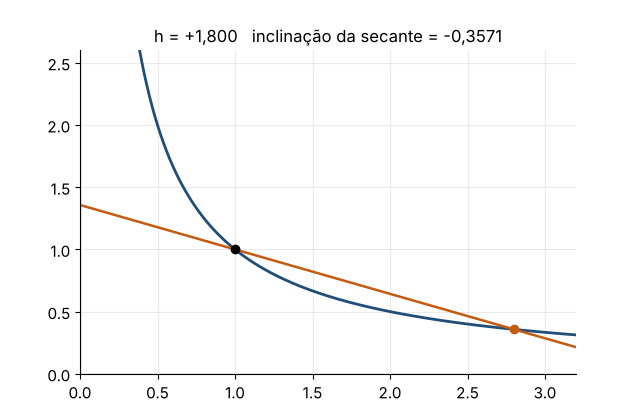

# Cálculo I — edição condensada em português

Adaptação e tradução de **Calculus Volume 1**, de Gilbert Strang (MIT) e Edwin "Jed" Herman
(University of Wisconsin–Stevens Point), publicado pela OpenStax (Rice University).
A meta é ter, em até 150 páginas, o essencial do Cálculo I para **revisar** o conteúdo:
definições, teoremas, exemplos-chave e figuras. Ao fim de cada capítulo há uma seleção de
exercícios. As soluções completas, com animações dos gráficos, ficam neste repositório.

📘 **[Baixar o PDF](Calculo_I.pdf)**

## Conteúdo

| Capítulo | Tema | Livro | Exercícios resolvidos |
|---|---|---|---|
| 1 | Funções e gráficos | ✅ | [11 exercícios](exercicios/cap1/README.md) |
| 2 | Limites | ✅ | [12 exercícios](exercicios/cap2/README.md) |
| 3 | Derivadas | em produção | — |
| 4 | Aplicações das derivadas | em produção | — |
| 5 | Integração | em produção | — |
| 6 | Aplicações da integração | em produção | — |

Cada solução segue o mesmo roteiro: a **estratégia**, a resolução passo a passo, um
comentário sobre erros comuns ou interpretações e uma **animação** do gráfico do problema.



## Estrutura

```
Calculo_I.pdf          livro compilado
livro/                 fontes LaTeX (calculo1.tex, capN.tex) e figuras
  exercicios_capN.tex  gerado automaticamente; não edite à mão
exercicios/capN/       soluções (README.md) e animações (anim/*.gif)
ferramentas/
  ex_capN.py           enunciados, respostas e soluções (fonte única)
  anim_capN.py         animações (matplotlib)
  gerar.py             gera o .tex dos exercícios, os README e as animações
```

## Como compilar

```bash
pip install -r ferramentas/requirements.txt
python3 ferramentas/gerar.py            # exercícios + animações dos capítulos 1 e 2
cd livro && latexmk -pdf calculo1.tex   # requer TeX Live com babel-portuges, pgfplots e tcolorbox
```

Para gerar só os textos, sem refazer as animações: `python3 ferramentas/gerar.py --sem-animacoes`.

## Licença e créditos

Este trabalho é uma obra derivada de *Calculus Volume 1*, © 2016 Rice University,
disponível gratuitamente em <https://openstax.org/details/books/calculus-volume-1>,
licenciado sob [CC BY-NC-SA 4.0](https://creativecommons.org/licenses/by-nc-sa/4.0/).
Esta adaptação (tradução, condensação, figuras redesenhadas, soluções e animações) é
distribuída sob a **mesma licença**, apenas para uso não comercial. Veja [LICENSE](LICENSE).

**Alterações em relação ao original:** tradução; condensação do texto; remoção dos pontos
de verificação, dos projetos e da maior parte dos exercícios; seleção de exercícios com
soluções e animações novas; redesenho de parte das figuras.

Esta versão não é endossada pela OpenStax nem pela Rice University. Os nomes e logotipos
OpenStax e Rice University são marcas registradas e não fazem parte da licença.
*Access for free at openstax.org.*
