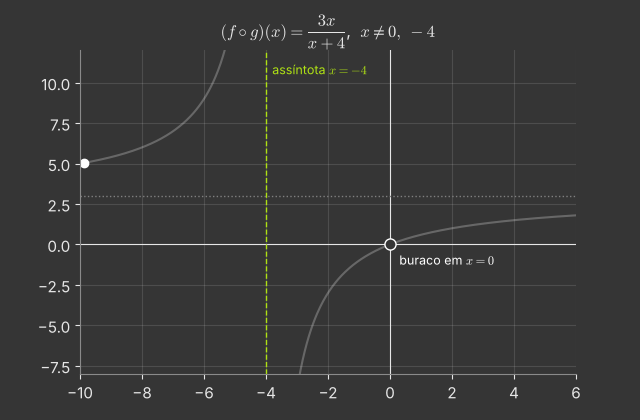
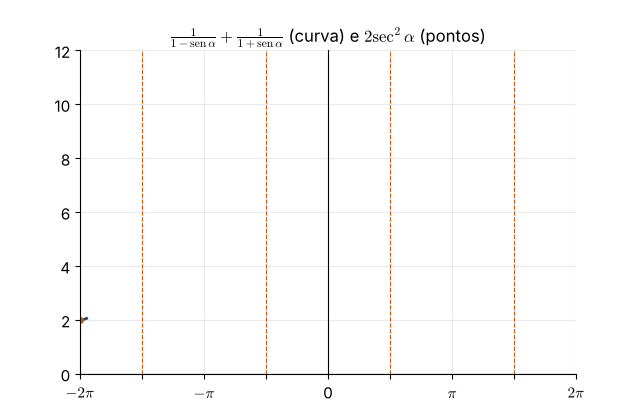
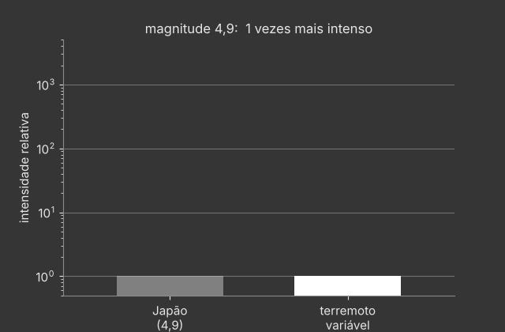
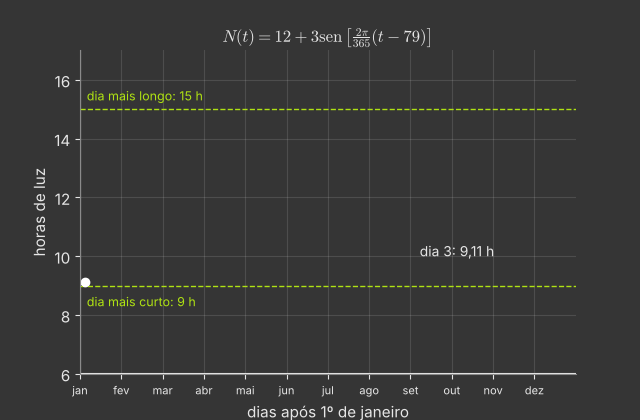
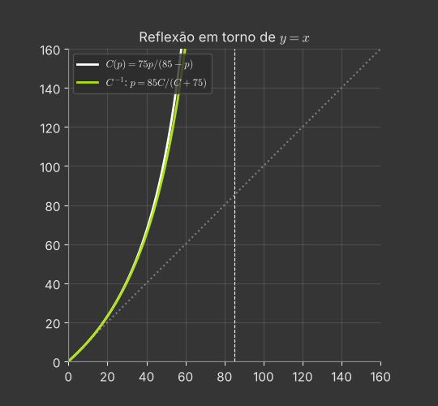
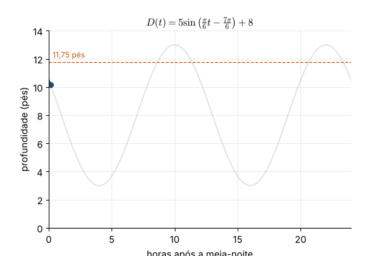
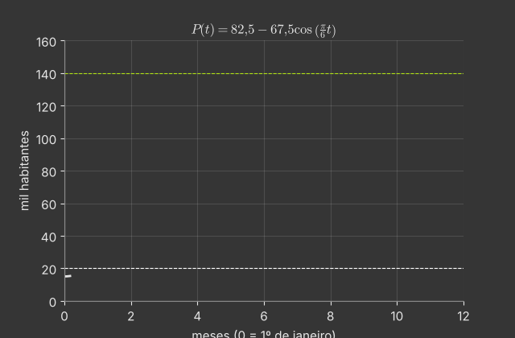

# Capítulo 1 — Funções e gráficos: exercícios

São 65 exercícios: 20 fáceis, 20 médios, 20 difíceis e 5 desafios. Tente resolver antes de abrir a resposta. Os marcados com ★ têm [solução completa com animação](#soluções-completas).

Muitos enunciados são adaptados de *Calculus Volume 1* (OpenStax, CC BY-NC-SA 4.0).

## Fáceis

**1.1** Para $f(x)=3x^2+2x-1$, calcule $f(-2)$, $f(0)$ e $f(a+1)$.

Resposta

$7$; $-1$; $3a^2+8a+4$.

**1.2** Determine o domínio e a imagem de $f(x)=\sqrt{6x+5}$.

Resposta

Domínio $[-\tfrac56,\infty)$; imagem $[0,\infty)$.

**1.3** Determine o domínio e a imagem de $g(x)=\dfrac{3}{x-4}$.

Resposta

Domínio $\lbrace x\mid x\neq4\rbrace $; imagem $\lbrace y\mid y\neq0\rbrace $.

**1.4** Determine o domínio de $f(x)=\dfrac{x}{x^2-16}$.

Resposta

$\lbrace x\mid x\neq\pm4\rbrace $.

**1.5** Determine o domínio e a imagem de $f(x)=|x-7|+8$.

Resposta

Domínio $\mathbb R$; imagem $[8,\infty)$.

**1.6** Encontre os zeros e o intercepto $y$ de $f(x)=x^3-5x^2+6x$.

Resposta

Zeros $0$, $2$ e $3$; intercepto $(0,0)$.

**1.7** Calcule a inclinação da reta que passa por $(-1,4)$ e $(3,-1)$.

Resposta

$m=-\tfrac54$.

**1.8** Escreva a equação reduzida da reta de inclinação $-6$ que passa por $(1,3)$.

Resposta

$y=-6x+9$.

**1.9** Escreva a equação da reta com intercepto $x$ igual a 5 e intercepto $y$ igual a $-3$.

Resposta

$y=\tfrac35x-3$.

**1.10** Classifique como par, ímpar ou nenhuma das duas: (a) $x^4-3x^2$; (b) $x^3+x$; (c) $x^2+x$.

Resposta

(a) par; (b) ímpar; (c) nenhuma.

**1.11** Converta para radianos: $240^\circ$, $-60^\circ$ e $330^\circ$.

Resposta

$\tfrac{4\pi}3$, $-\tfrac\pi3$ e $\tfrac{11\pi}6$.

**1.12** Converta para graus: $\tfrac{7\pi}{6}$, $\tfrac{11\pi}{2}$ e $-\tfrac{5\pi}{4}$.

Resposta

$210^\circ$, $990^\circ$ e $-225^\circ$.

**1.13** Calcule o valor exato de $\sin\tfrac{2\pi}3$, $\cos\!\big(-\tfrac\pi4\big)$ e $\tan\tfrac{5\pi}6$.

Resposta

$\tfrac{\sqrt3}2$, $\tfrac{\sqrt2}2$ e $-\tfrac{\sqrt3}3$.

**1.14** Dê a amplitude, o período e o deslocamento vertical de $y=3\sin(2x)+1$.

Resposta

Amplitude 3; período $\pi$; deslocamento 1 para cima.

**1.15** Encontre a inversa de $f(x)=5x-7$ e verifique que $f^{-1}(f(x))=x$.

Resposta

$f^{-1}(x)=\tfrac{x+7}5$.

**1.16** Calcule $\sin^{-1}\tfrac12$, $\cos^{-1}(-1)$ e $\tan^{-1}\sqrt3$.

Resposta

$\tfrac\pi6$, $\pi$ e $\tfrac\pi3$.

**1.17** Calcule $5^3$, $5^{1/2}$ e $(0{,}3)^{-1}$.

Resposta

$125$, $\sqrt5$ e $\tfrac{10}3$.

**1.18** Calcule $\log_2 32$, $\ln e^3$ e $\log_{10}0{,}001$.

Resposta

$5$, $3$ e $-3$.

**1.19** Resolva (a) $2^x=16$; (b) $e^x=7$.

Resposta

(a) $x=4$; (b) $x=\ln7$.

**1.20** Calcule $\cosh0$, $\sinh0$ e $\tanh0$.

Resposta

$1$, $0$ e $0$.

## Médios

**1.21** **Composição e domínio.** Sejam $f(x)=\dfrac{3}{2x+1}$ e $g(x)=\dfrac{2}{x}$. Encontre $(f\circ g)(x)$ e $(g\circ f)(x)$ e determine o domínio de cada composta. ★ [ver solução](#ex-1-21)

Resposta

$(f\circ g)(x)=\dfrac{3x}{x+4}$, com $x\neq0,-4$;\quad $(g\circ f)(x)=\dfrac{2(2x+1)}{3}$, com $x\neq-\tfrac12$.

**1.22** Sejam $f(x)=\sqrt x$ e $g(x)=x-2$. Encontre $f\circ g$ e $g\circ f$, com seus domínios.

Resposta

$(f\circ g)(x)=\sqrt{x-2}$, $x\ge2$; $(g\circ f)(x)=\sqrt x-2$, $x\ge0$.

**1.23** Para $f(x)=\begin{cases}x^2-3,&x<0\\4x-3,&x\ge0\end{cases}$, calcule $f(-4)$, $f(0)$ e $f(2)$.

Resposta

$13$, $-3$ e $5$.

**1.24** Descreva as transformações que levam $y=x^2$ em $y=-(x+1)^2+3$ e dê o vértice da parábola.

Resposta

Translação de 1 para a esquerda, reflexão no eixo $x$, translação de 3 para cima; vértice $(-1,3)$.

**1.25** Determine o domínio e a imagem de $f(x)=\sqrt{4-x^2}$ e descreva seu gráfico.

Resposta

Domínio $[-2,2]$; imagem $[0,2]$; semicircunferência superior de raio 2.

**1.26** **Custo e ponto de equilíbrio.** Uma confeitaria vende cupcakes em festivais. Montar a barraca custa R\$ 125,00 e cada cupcake custa R\$ 0,75 para ser produzido. (a) Escreva o custo total $C$ em função do número $x$ de cupcakes. (b) Quanto custa produzir 160 cupcakes? (c) Vendendo cada cupcake a R\$ 1,50, quantos ela precisa vender para começar a ter lucro? ★ [ver solução](#ex-1-26)

Resposta

(a) $C(x)=0{,}75x+125$; (b) R\$ 245,00; (c) 167 cupcakes.

**1.27** Resolva $2\sin^2\theta-\sin\theta-1=0$ para $\theta\in[0,2\pi)$.

Resposta

$\theta=\tfrac\pi2$, $\tfrac{7\pi}6$ e $\tfrac{11\pi}6$.

**1.28** **Identidade trigonométrica.** Verifique a identidade $\dfrac{1}{1-\sin\alpha}+\dfrac{1}{1+\sin\alpha}=2\sec^2\alpha$. ★ [ver solução](#ex-1-28)

Resposta

Some as frações: o denominador comum é $1-\sin^2\alpha=\cos^2\alpha$.

**1.29** Verifique a identidade $\dfrac{\tan\theta-\cot\theta}{\sin\theta\cos\theta}=\sec^2\theta-\csc^2\theta$.

Resposta

Escreva $\tan$ e $\cot$ em senos e cossenos e separe a fração.

**1.30** Escreva $3\cos t+4\sin t$ na forma $A\cos(t-\varphi)$, com $A>0$.

Resposta

$A=5$, $\varphi=\tan^{-1}\tfrac43\approx0{,}927$.

**1.31** Mostre que $f(x)=\dfrac{2x+1}{x-3}$ é injetora e encontre $f^{-1}$, com domínio e imagem.

Resposta

$f^{-1}(x)=\tfrac{3x+1}{x-2}$; domínio $x\neq2$, imagem $y\neq3$.

**1.32** Restrinja o domínio de $f(x)=(x-2)^2$ para torná-la injetora e encontre a inversa.

Resposta

Em $[2,\infty)$: $f^{-1}(x)=2+\sqrt x$, $x\ge0$.

**1.33** Calcule $\cos^{-1}\!\big(\cos\tfrac{5\pi}3\big)$, $\sin^{-1}\!\big(\sin\tfrac{3\pi}4\big)$ e $\tan\!\big(\cos^{-1}\tfrac35\big)$.

Resposta

$\tfrac\pi3$, $\tfrac\pi4$ e $\tfrac43$.

**1.34** Resolva $\log_2x+\log_2(x-2)=3$.

Resposta

$x=4$ ($x=-2$ é solução estranha).

**1.35** Resolva $\ln(x+1)-\ln x=1$.

Resposta

$x=\dfrac1{e-1}\approx0{,}582$.

**1.36** Simplifique (a) $e^{3\ln2}$; (b) $\log_3(9^x)$; (c) $\ln\sqrt e$.

Resposta

(a) $8$; (b) $2x$; (c) $\tfrac12$.

**1.37** **Expressões hiperbólicas.** Reescreva em termos de exponenciais e simplifique: (a) $2\cosh(\ln x)$; (b) $\cosh 4x+\sinh 4x$; (c) $\cosh 2x-\sinh 2x$; (d) $\ln(\cosh x+\sinh x)+\ln(\cosh x-\sinh x)$. ★ [ver solução](#ex-1-37)

Resposta

(a) $x+\frac1x$ ($x>0$); (b) $e^{4x}$; (c) $e^{-2x}$; (d) $0$.

**1.38** **Decaimento do iodo-131.** O iodo-131 decai segundo $Q(t)=Q_0e^{-0{,}08664t}$, com $t$ em dias. Quanto tempo leva (arredondando para o dia mais próximo) para 95% de uma amostra decair? ★ [ver solução](#ex-1-38)

Resposta

$t=\dfrac{\ln 20}{0{,}08664}\approx35$ dias.

**1.39** **Escala Richter.** O terremoto de 1906 em São Francisco teve magnitude 8,3 na escala Richter. No mesmo período, um terremoto de magnitude 4,9 no Japão causou poucos danos. Quantas vezes o de São Francisco foi mais intenso? ★ [ver solução](#ex-1-39)

Resposta

$10^{3{,}4}\approx2512$ vezes.

**1.40** Use a mudança de base para calcular $\log_5 12$ e $\log_7 0{,}5$ com quatro casas decimais.

Resposta

$1{,}5440$ e $-0{,}3562$.

## Difíceis

**1.41** **Horas de luz do dia.** O número de horas de luz do dia em uma cidade é modelado por $N(t)=12+3\sin\!\left[\frac{2\pi}{365}(t-79)\right]$, em que $t$ é o número de dias após 1º de janeiro. (a) Encontre a amplitude e o período. (b) Quantas horas de luz há no dia mais longo do ano? E no mais curto? (c) Quantas horas de luz há 90 dias após 1º de janeiro? ★ [ver solução](#ex-1-41)

Resposta

(a) Amplitude 3, período 365 dias; (b) 15 h e 9 h; (c) $\approx12{,}56$ h.

**1.42** **Custo de remoção de uma toxina.** O custo (em milhares de reais) para remover $p$ partes por bilhão (ppb) de uma toxina de um lago é $C(p)=\dfrac{75p}{85-p}$, válido para $0\le p<85$. (a) Calcule o custo para remover 25, 40 e 50 ppb. (b) Encontre a função inversa $p=C^{-1}(C)$. (c) Quanto da toxina se remove com R\$ 50 mil? ★ [ver solução](#ex-1-42)

Resposta

(a) $\approx$ R\$ 31,25 mil, R\$ 66,67 mil e R\$ 107,14 mil; (b) $p=\dfrac{85C}{C+75}$; (c) 34 ppb.

**1.43** **Profundidade da maré.** A profundidade (em pés) da água em um cais é $D(t)=5\sin\!\left(\frac{\pi}{6}t-\frac{7\pi}{6}\right)+8$, em que $t$ é o número de horas após a meia-noite. Determine o primeiro instante após a meia-noite em que a profundidade é 11,75 pés. ★ [ver solução](#ex-1-43)

Resposta

$t=7+\frac6\pi\sin^{-1}(0{,}75)\approx8{,}62$ h, por volta de 8h37.

**1.44** **Crescimento de bactérias.** Uma colônia de bactérias dobra a cada 12 horas e começa com 1000 bactérias. (a) Usando $Q=Q_0e^{kt}$, determine $k$ (quatro casas decimais). (b) Aproximadamente quanto tempo leva para haver 200\,000 bactérias? ★ [ver solução](#ex-1-44)

Resposta

(a) $k=\frac{\ln2}{12}\approx0{,}0578$ por hora; (b) $\approx92$ horas.

**1.45** **População sazonal.** A população de uma cidade litorânea, em milhares, é modelada por $P(t)=82{,}5-67{,}5\cos\!\left(\frac\pi6t\right)$, com $t$ em meses ($t=0$ é 1º de janeiro). Em que intervalos do ano a população é menor que 20 mil? E maior que 140 mil? ★ [ver solução](#ex-1-45)

Resposta

$P<20$ para $t\in[0;\,0{,}74)\cup(11{,}26;\,12]$ (início de dez. a fim de jan.); $P>140$ para $t\in(4{,}95;\,7{,}05)$ (fim de maio ao início de ago.).

**1.46** Mostre que toda $f:\mathbb R\to\mathbb R$ é a soma de uma função par e uma ímpar. Aplique a $f(x)=e^x$.

Resposta

$f=\tfrac12[f(x)+f(-x)]+\tfrac12[f(x)-f(-x)]$; $e^x=\cosh x+\sinh x$.

**1.47** Encontre todas as soluções de $\sin(2\theta)=\cos\theta$.

Resposta

$\theta=\tfrac\pi2+n\pi$, $\tfrac\pi6+2n\pi$ ou $\tfrac{5\pi}6+2n\pi$, $n\in\mathbb Z$.

**1.48** Encontre a inversa de $f(x)=x^2-4x+5$ restrita a $x\ge2$, com domínio e imagem.

Resposta

$f^{-1}(x)=2+\sqrt{x-1}$; domínio $[1,\infty)$, imagem $[2,\infty)$.

**1.49** Resolva $y=\sinh x$ para $x$ e mostre que $\sinh^{-1}y=\ln\!\big(y+\sqrt{y^2+1}\big)$.

Resposta

Com $u=e^x$: $u^2-2yu-1=0$, logo $u=y+\sqrt{y^2+1}$ (a raiz positiva).

**1.50** Determine o domínio de $f(x)=\dfrac{\ln(x^2-4)}{\sqrt{5-x}}$.

Resposta

$(-\infty,-2)\cup(2,5)$.

**1.51** Um carro comprado por R\$ 26\,000 perde R\$ 1\,500 por ano. (a) Escreva o valor $V(t)$. (b) Calcule $V(2)$. (c) Em quanto tempo o valor zera?

Resposta

(a) $V(t)=26000-1500t$; (b) R\$ 23\,000; (c) $\approx17{,}3$ anos.

**1.52** A função $C(F)=\tfrac59(F-32)$ converte Fahrenheit em Celsius. Encontre a inversa e a temperatura em que as duas escalas coincidem.

Resposta

$F=\tfrac95C+32$; coincidem em $-40^\circ$.

**1.53** Uma roda-gigante tem raio 20 m, centro a 22 m do solo, e dá uma volta a cada 4 min, partindo do ponto mais baixo. Escreva a altura $h(t)$ e encontre o primeiro instante em que $h=32$ m.

Resposta

$h(t)=22-20\cos\tfrac{\pi t}2$; $t=\tfrac43$ min (80 s).

**1.54** R\$ 1000 rendem 4% ao ano: $A(t)=1000(1{,}04)^t$. Calcule $A(5)$ e $A(10)$ e o tempo para o capital dobrar.

Resposta

R\$ 1216{,}65; R\$ 1480{,}24; $\approx17{,}7$ anos.

**1.55** O pH é $-\log_{10}[\mathrm H^+]$. (a) Quantas vezes uma solução de pH 3 é mais ácida que uma de pH 5? (b) Qual é $[\mathrm H^+]$ para pH $2{,}5$?

Resposta

(a) 100 vezes; (b) $10^{-2{,}5}\approx3{,}16\times10^{-3}$ mol/L.

**1.56** Uma população de coelhos dobra a cada 6 meses e começa com 120. Escreva $P(t)=120\,a^t$ ($t$ em meses) e estime quando chega a 1000.

Resposta

$a=2^{1/6}\approx1{,}1225$; $t\approx18{,}4$ meses.

**1.57** O ângulo de Mach é $\mu=2\sin^{-1}(1/M)$. Calcule $\mu$ para $M=2$ e $M=1{,}5$, e o número de Mach para $\mu=\pi/6$.

Resposta

$60^\circ$; $\approx83{,}6^\circ$; $M=1/\sin\tfrac\pi{12}\approx3{,}86$.

**1.58** O ângulo de visão de um quadro é $\theta=\tan^{-1}\tfrac{5{,}5}{x}-\tan^{-1}\tfrac{2{,}5}{x}$, com $x$ em pés. Calcule $\theta$ para $x=5$.

Resposta

$\approx0{,}369$ rad $\approx21{,}2^\circ$.

**1.59** Resolva $\cosh x=2$.

Resposta

$x=\pm\ln(2+\sqrt3)\approx\pm1{,}317$.

**1.60** Mostre que $\cosh(2x)=\cosh^2x+\sinh^2x$ e deduza que $\cosh^2x=\tfrac12(1+\cosh2x)$.

Resposta

Use a fórmula de adição e $\cosh^2x-\sinh^2x=1$.

## Desafios

**1.61** Encontre todas as funções afins $f(x)=ax+b$ tais que $f(f(x))=4x+3$ para todo $x$.

Resposta

$f(x)=2x+1$ ou $f(x)=-2x-3$.

**1.62** Mostre que $f(x)=\dfrac{ax+b}{cx+d}$ ($c\neq0$, $ad-bc\neq0$) é a própria inversa se, e somente se, $a=-d$. Interprete geometricamente.

Resposta

$f=f^{-1}$ equivale a $(a+d)(cx^2+(d-a)x-b)\equiv0$; o gráfico é simétrico em relação a $y=x$.

**1.63** Resolva $4^x-3\cdot2^{x+1}+8=0$.

Resposta

$x=1$ ou $x=2$.

**1.64** Prove que $\log_2 3$ é irracional.

Resposta

Se $\log_23=p/q$, então $3^q=2^p$: ímpar = par, absurdo.

**1.65** Quantas soluções reais tem a equação $\sin x=\dfrac{x}{10}$? Justifique com um esboço.

Resposta

7 soluções (todas em $[-10,10]$; uma é $x=0$, e as demais são simétricas).

## Soluções completas

### 1.21 — Composição e domínio

*Origem: OpenStax, 1.1, ex. 47.*

> Sejam $f(x)=\dfrac{3}{2x+1}$ e $g(x)=\dfrac{2}{x}$. Encontre $(f\circ g)(x)$ e $(g\circ f)(x)$ e determine o domínio de cada composta.

**Estratégia.** Na composta $f\circ g$, primeiro aplicamos $g$; o domínio é formado pelos $x$
do domínio de $g$ cuja imagem $g(x)$ está no domínio de $f$. Simplificar a fórmula no fim
**não** apaga as restrições do caminho.

**(a)** $(f\circ g)(x)=f\!\left(\frac2x\right)=\dfrac{3}{2\cdot\frac2x+1}=\dfrac{3}{\frac{4+x}{x}}=\dfrac{3x}{x+4}.$

Restrições: $x\neq0$ (para $g$ existir) e $g(x)\neq-\tfrac12$, isto é, $\tfrac2x\neq-\tfrac12 \iff x\neq-4$
(para $f$ existir). Domínio: $\lbrace x\mid x\neq0,\ x\neq-4\rbrace $.

Observe que a fórmula final $\frac{3x}{x+4}$ "aceita" $x=0$, mas a composta não: em $x=0$ há um **buraco** no gráfico.

**(b)** $(g\circ f)(x)=g\!\left(\frac{3}{2x+1}\right)=\dfrac{2}{\frac{3}{2x+1}}=\dfrac{2(2x+1)}{3}=\dfrac{4x+2}{3}.$

Restrições: $x\neq-\tfrac12$ (para $f$ existir) e $f(x)\neq0$, o que nunca acontece. Domínio: $\lbrace x\mid x\neq-\tfrac12\rbrace $.

**Animação.** O ponto percorre o gráfico de $f\circ g$: note a assíntota vertical em $x=-4$ e o buraco em $x=0$.

---

### 1.26 — Custo e ponto de equilíbrio

*Origem: OpenStax, 1.2, ex. 105.*

> Uma confeitaria vende cupcakes em festivais. Montar a barraca custa R\$ 125,00 e cada cupcake custa R\$ 0,75 para ser produzido. (a) Escreva o custo total $C$ em função do número $x$ de cupcakes. (b) Quanto custa produzir 160 cupcakes? (c) Vendendo cada cupcake a R\$ 1,50, quantos ela precisa vender para começar a ter lucro?

**(a)** Custo fixo mais custo por unidade: $C(x)=0{,}75x+125$.

**(b)** $C(160)=0{,}75\cdot160+125=120+125=245$ reais.

**(c)** A receita é $R(x)=1{,}50x$. Há lucro quando $R(x)>C(x)$:
$$1{,}50x>0{,}75x+125\iff 0{,}75x>125\iff x>166{,}\overline{6}.$$
Como $x$ é inteiro, ela precisa vender **167 cupcakes**.

**Animação.** As retas de custo e de receita se cruzam no ponto de equilíbrio $x\approx166{,}7$; à direita dele, a área entre as retas é o lucro.

---

### 1.28 — Identidade trigonométrica

*Origem: OpenStax, 1.3, ex. 153.*

> Verifique a identidade $\dfrac{1}{1-\sin\alpha}+\dfrac{1}{1+\sin\alpha}=2\sec^2\alpha$.

**Estratégia.** Trabalhe com o lado mais complicado (o esquerdo) até chegar ao outro.

$$\frac{1}{1-\sin\alpha}+\frac{1}{1+\sin\alpha}
=\frac{(1+\sin\alpha)+(1-\sin\alpha)}{(1-\sin\alpha)(1+\sin\alpha)}
=\frac{2}{1-\sin^2\alpha}=\frac{2}{\cos^2\alpha}=2\sec^2\alpha .$$

Usamos o produto da soma pela diferença, $(1-s)(1+s)=1-s^2$, e a identidade pitagórica $\sin^2\alpha+\cos^2\alpha=1$.

A identidade vale onde os dois lados estão definidos: $\sin\alpha\neq\pm1$, isto é, $\cos\alpha\neq0$.

**Animação.** O lado esquerdo (curva) e o lado direito (pontos) coincidem para todo $\alpha$; nas retas tracejadas $\cos\alpha=0$ e nenhum dos lados existe.

---

### 1.37 — Expressões hiperbólicas

*Origem: OpenStax, 1.5, ex. 298.*

> Reescreva em termos de exponenciais e simplifique: (a) $2\cosh(\ln x)$; (b) $\cosh 4x+\sinh 4x$; (c) $\cosh 2x-\sinh 2x$; (d) $\ln(\cosh x+\sinh x)+\ln(\cosh x-\sinh x)$.

Use $\cosh u=\frac{e^u+e^{-u}}2$ e $\sinh u=\frac{e^u-e^{-u}}2$.

**(a)** $2\cosh(\ln x)=e^{\ln x}+e^{-\ln x}=x+\frac1x$, para $x>0$.

**(b)** $\cosh 4x+\sinh 4x=\frac{e^{4x}+e^{-4x}+e^{4x}-e^{-4x}}2=e^{4x}$.

**(c)** $\cosh 2x-\sinh 2x=\frac{e^{2x}+e^{-2x}-e^{2x}+e^{-2x}}2=e^{-2x}$.

**(d)** Pelos itens anteriores, $\cosh x+\sinh x=e^x$ e $\cosh x-\sinh x=e^{-x}$. Logo
$\ln e^x+\ln e^{-x}=x-x=0$. (Alternativa: o produto é $\cosh^2x-\sinh^2x=1$, e $\ln1=0$.)

**Animação.** As curvas de $\cosh kx$ e $\sinh kx$ somadas coincidem sempre com $e^{kx}$, enquanto $k$ varia.

---

### 1.38 — Decaimento do iodo-131

*Origem: OpenStax, 1.5, ex. 304.*

> O iodo-131 decai segundo $Q(t)=Q_0e^{-0{,}08664t}$, com $t$ em dias. Quanto tempo leva (arredondando para o dia mais próximo) para 95% de uma amostra decair?

Se 95% decaiu, restam 5%: $Q(t)=0{,}05\,Q_0$.
$$e^{-0{,}08664t}=0{,}05\iff -0{,}08664\,t=\ln0{,}05\iff t=\frac{-\ln0{,}05}{0{,}08664}=\frac{\ln20}{0{,}08664}\approx\frac{2{,}996}{0{,}08664}\approx34{,}6 .$$
Resposta: **cerca de 35 dias**.

**Comentário.** A meia-vida é $\frac{\ln2}{0{,}08664}\approx8$ dias. Como $0{,}05\approx2^{-4{,}3}$, são necessárias cerca de 4,3 meias-vidas, ou seja, $4{,}3\times8\approx35$ dias.

**Animação.** A curva de decaimento é traçada até cruzar o nível de 5%.

---

### 1.39 — Escala Richter

*Origem: OpenStax, 1.5, ex. 309.*

> O terremoto de 1906 em São Francisco teve magnitude 8,3 na escala Richter. No mesmo período, um terremoto de magnitude 4,9 no Japão causou poucos danos. Quantas vezes o de São Francisco foi mais intenso?

Pela escala Richter, $R_1-R_2=\log_{10}\frac{A_1}{A_2}$. Então
$$\log_{10}\frac{A_1}{A_2}=8{,}3-4{,}9=3{,}4\Rightarrow\frac{A_1}{A_2}=10^{3{,}4}\approx2512 .$$
O terremoto de São Francisco foi **cerca de 2500 vezes** mais intenso.

**Intuição.** Cada ponto a mais na escala multiplica a intensidade por 10. Uma diferença de 3,4 pontos é $10^3\cdot10^{0{,}4}\approx1000\cdot2{,}5$.

**Animação.** A magnitude sobe de 4,9 a 8,3 enquanto a barra de intensidade relativa cresce (em escala logarítmica).

---

### 1.41 — Horas de luz do dia

*Origem: OpenStax, 1.3, ex. 180.*

> O número de horas de luz do dia em uma cidade é modelado por $N(t)=12+3\sin\!\left[\frac{2\pi}{365}(t-79)\right]$, em que $t$ é o número de dias após 1º de janeiro. (a) Encontre a amplitude e o período. (b) Quantas horas de luz há no dia mais longo do ano? E no mais curto? (c) Quantas horas de luz há 90 dias após 1º de janeiro?

**(a)** Na forma $A\sin(B(t-\alpha))+C$: $A=3$ (amplitude), $B=\frac{2\pi}{365}$, logo o período é
$\frac{2\pi}{B}=365$ dias. A defasagem é $\alpha=79$ (por volta de 20 de março, o equinócio) e o deslocamento vertical, $C=12$.

**(b)** O seno varia entre $-1$ e $1$, então $N$ varia entre $12-3=9$ e $12+3=15$.
Dia mais longo: **15 horas**. Dia mais curto: **9 horas**.

O máximo ocorre quando $\frac{2\pi}{365}(t-79)=\frac\pi2$, isto é, $t=79+\frac{365}{4}\approx170$ (por volta de 20 de junho).

**(c)** $N(90)=12+3\sin\!\left(\frac{2\pi\cdot11}{365}\right)=12+3\sin(0{,}1894)\approx12+3(0{,}188)\approx12{,}56$ horas.

**Animação.** O ponto percorre o ano; as linhas tracejadas marcam 9 h e 15 h.

---

### 1.42 — Custo de remoção de uma toxina

*Origem: OpenStax, 1.4, ex. 219.*

> O custo (em milhares de reais) para remover $p$ partes por bilhão (ppb) de uma toxina de um lago é $C(p)=\dfrac{75p}{85-p}$, válido para $0\le p<85$. (a) Calcule o custo para remover 25, 40 e 50 ppb. (b) Encontre a função inversa $p=C^{-1}(C)$. (c) Quanto da toxina se remove com R\$ 50 mil?

**(a)** $C(25)=\frac{75\cdot25}{60}=31{,}25$; $C(40)=\frac{3000}{45}\approx66{,}67$; $C(50)=\frac{3750}{35}\approx107{,}14$ (milhares de reais).
Note como o custo cresce cada vez mais rápido: remover os últimos ppb é caríssimo, e $C\to\infty$ quando $p\to85^-$.

**(b)** Isolamos $p$ em $C=\frac{75p}{85-p}$:
$$C(85-p)=75p\iff 85C=75p+Cp=p(75+C)\iff p=\frac{85C}{C+75}.$$

**(c)** $p=\frac{85\cdot50}{125}=34$ ppb.

**Animação.** O gráfico de $C$ é refletido em torno da reta $y=x$ para formar o gráfico da inversa. A assíntota vertical $p=85$ de $C$ vira a assíntota horizontal da inversa.

---

### 1.43 — Profundidade da maré

*Origem: OpenStax, 1.4, ex. 224.*

> A profundidade (em pés) da água em um cais é $D(t)=5\sin\!\left(\frac{\pi}{6}t-\frac{7\pi}{6}\right)+8$, em que $t$ é o número de horas após a meia-noite. Determine o primeiro instante após a meia-noite em que a profundidade é 11,75 pés.

Queremos $D(t)=11{,}75$:
$$5\sin\!\left(\tfrac{\pi}{6}t-\tfrac{7\pi}{6}\right)+8=11{,}75\iff \sin\!\left(\tfrac{\pi}{6}(t-7)\right)=0{,}75 .$$

Seja $u=\frac\pi6(t-7)$. Para $t\ge0$, $u\ge-\frac{7\pi}{6}$. As soluções de $\sin u=0{,}75$ são
$u=\sin^{-1}(0{,}75)+2k\pi\approx0{,}8481+2k\pi$ e $u=\pi-0{,}8481+2k\pi\approx2{,}2935+2k\pi$.

Procuramos o **menor** $u\ge-\frac{7\pi}6\approx-3{,}665$:
- $0{,}8481-2\pi\approx-5{,}435$ (antes da meia-noite, descartado);
- $2{,}2935-2\pi\approx-3{,}990$ (também antes, pois $<-3{,}665$);
- $0{,}8481$ ✓.

Então $\frac\pi6(t-7)=0{,}8481\Rightarrow t=7+\frac{6(0{,}8481)}{\pi}\approx8{,}62$ h, ou seja, **por volta de 8h37**.

**Cuidado.** A função $\sin^{-1}$ dá apenas *uma* solução (entre $-\frac\pi2$ e $\frac\pi2$). Em problemas com tempo, liste todas as soluções e escolha a que respeita o intervalo pedido.

**Animação.** A curva da maré é desenhada a partir da meia-noite até tocar a linha de 11,75 pés.

---

### 1.44 — Crescimento de bactérias

*Origem: OpenStax, 1.5, ex. 307.*

> Uma colônia de bactérias dobra a cada 12 horas e começa com 1000 bactérias. (a) Usando $Q=Q_0e^{kt}$, determine $k$ (quatro casas decimais). (b) Aproximadamente quanto tempo leva para haver 200\,000 bactérias?

**(a)** Em $t=12$, $Q=2Q_0$: $e^{12k}=2\Rightarrow k=\frac{\ln2}{12}\approx0{,}0578$ por hora.

**(b)** $1000e^{kt}=200\,000\iff e^{kt}=200\iff t=\frac{\ln200}{k}=\frac{12\ln200}{\ln2}\approx\frac{12\cdot5{,}298}{0{,}6931}\approx91{,}7$ h.
Resposta: **cerca de 92 horas**. (Conferência: $2^{91{,}7/12}=2^{7{,}64}\approx200$.)

**Animação.** À esquerda, a escala linear: o crescimento parece "explodir". À direita, a escala logarítmica: a exponencial vira uma reta de inclinação $k$.

---

### 1.45 — População sazonal

*Origem: OpenStax, Revisão, ex. 333.*

> A população de uma cidade litorânea, em milhares, é modelada por $P(t)=82{,}5-67{,}5\cos\!\left(\frac\pi6t\right)$, com $t$ em meses ($t=0$ é 1º de janeiro). Em que intervalos do ano a população é menor que 20 mil? E maior que 140 mil?

**Menor que 20 mil.**
$$82{,}5-67{,}5\cos\left(\tfrac\pi6t\right)<20\iff\cos\left(\tfrac\pi6t\right)>\tfrac{62{,}5}{67{,}5}\approx0{,}9259 .$$
Como $\cos^{-1}(0{,}9259)\approx0{,}3873$ rad, precisamos de $\frac\pi6t<0{,}3873$ ou $\frac\pi6t>2\pi-0{,}3873$, isto é,
$t<0{,}74$ ou $t>11{,}26$ meses: **de por volta de 8 de dezembro a 23 de janeiro**.

**Maior que 140 mil.**
$$\cos\left(\tfrac\pi6t\right)<-\tfrac{57{,}5}{67{,}5}\approx-0{,}8519 .$$
Como $\cos^{-1}(-0{,}8519)\approx2{,}5903$ rad, precisamos de $2{,}5903<\frac\pi6t<2\pi-2{,}5903$, isto é,
$4{,}95<t<7{,}05$: **de por volta de 29 de maio a 2 de agosto**.

**Animação.** As faixas sombreadas mostram os períodos abaixo de 20 mil (azul) e acima de 140 mil (laranja).

---
