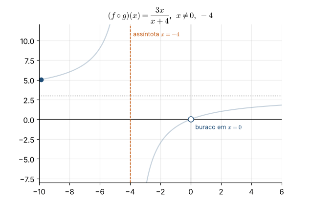
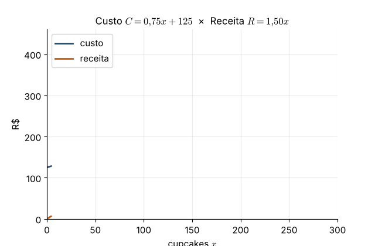
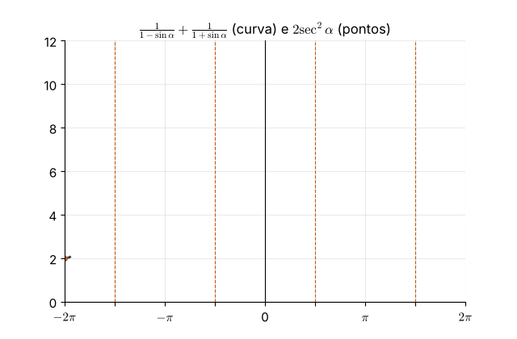
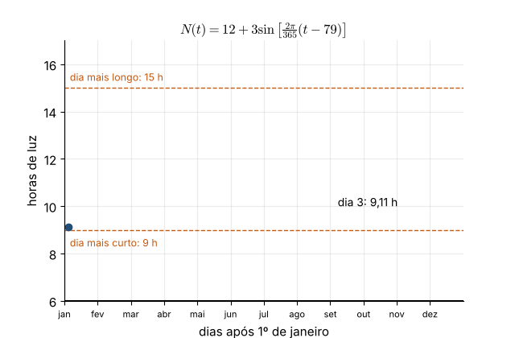
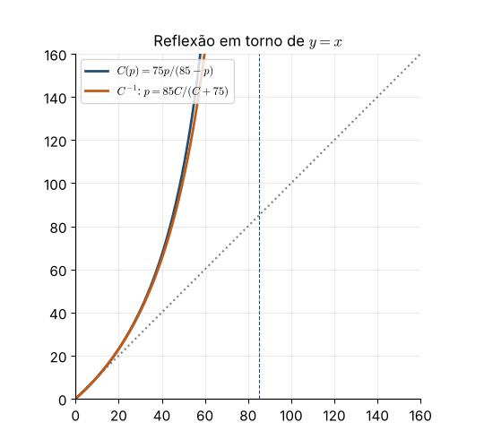
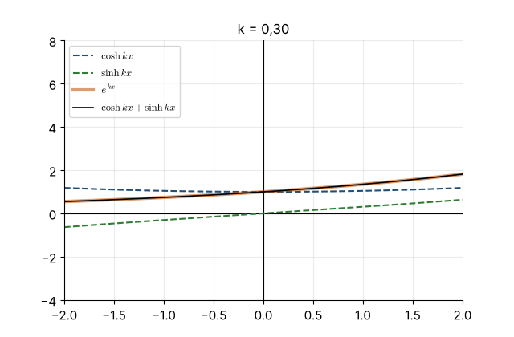
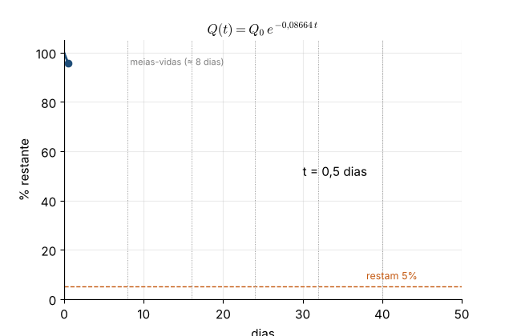
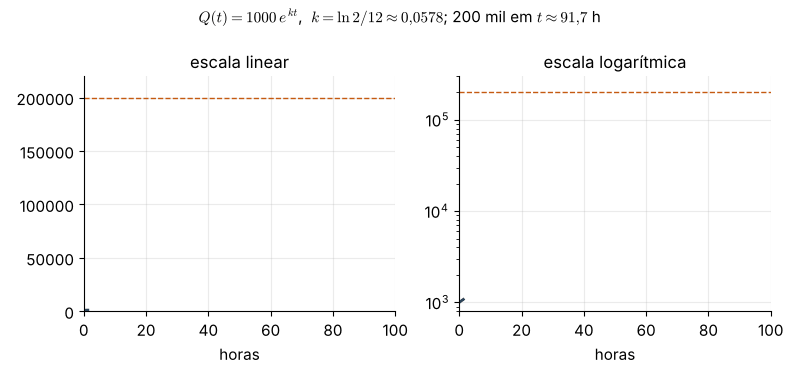
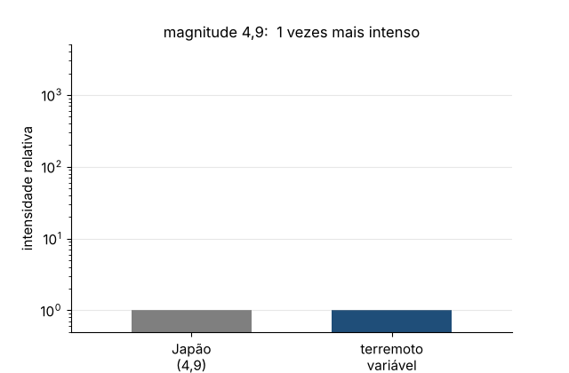
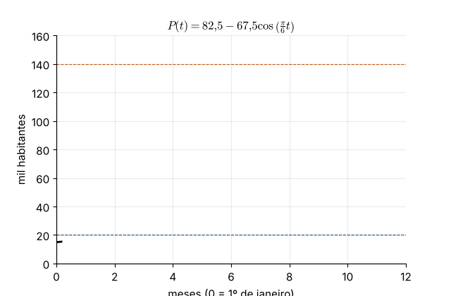

# Capítulo 1 — Funções e gráficos: soluções dos exercícios selecionados

Exercícios adaptados de *Calculus Volume 1* (OpenStax, CC BY-NC-SA 4.0). A numeração de origem indica a seção e o número do exercício no original.

| Nº | Exercício | Origem |
|---|---|---|
| 1.1 | [Composição e domínio](#exercicio-11) | 1.1, ex. 47 |
| 1.2 | [Custo e ponto de equilíbrio](#exercicio-12) | 1.2, ex. 105 |
| 1.3 | [Identidade trigonométrica](#exercicio-13) | 1.3, ex. 153 |
| 1.4 | [Horas de luz do dia](#exercicio-14) | 1.3, ex. 180 |
| 1.5 | [Custo de remoção de uma toxina](#exercicio-15) | 1.4, ex. 219 |
| 1.6 | [Profundidade da maré](#exercicio-16) | 1.4, ex. 224 |
| 1.7 | [Expressões hiperbólicas](#exercicio-17) | 1.5, ex. 298 |
| 1.8 | [Decaimento do iodo-131](#exercicio-18) | 1.5, ex. 304 |
| 1.9 | [Crescimento de bactérias](#exercicio-19) | 1.5, ex. 307 |
| 1.10 | [Escala Richter](#exercicio-110) | 1.5, ex. 309 |
| 1.11 | [População sazonal](#exercicio-111) | Revisão, ex. 333 |

## 1.1 — Composição e domínio

> Sejam $f(x)=\dfrac{3}{2x+1}$ e $g(x)=\dfrac{2}{x}$. Encontre $(f\circ g)(x)$ e $(g\circ f)(x)$ e determine o domínio de cada composta.

**Estratégia.** Na composta $f\circ g$, primeiro aplicamos $g$; o domínio é formado pelos $x$
do domínio de $g$ cuja imagem $g(x)$ está no domínio de $f$. Simplificar a fórmula no fim
**não** apaga as restrições do caminho.

**(a)** $(f\circ g)(x)=f\!\left(\frac2x\right)=\dfrac{3}{2\cdot\frac2x+1}=\dfrac{3}{\frac{4+x}{x}}=\dfrac{3x}{x+4}.$

Restrições: $x\neq0$ (para $g$ existir) e $g(x)\neq-\tfrac12$, isto é, $\tfrac2x\neq-\tfrac12 \iff x\neq-4$
(para $f$ existir). Domínio: $\lbrace x\mid x\neq0,\ x\neq-4\rbrace $.

Observe que a fórmula final $\frac{3x}{x+4}$ "aceita" $x=0$, mas a composta não: em $x=0$ há um **buraco** no gráfico.

**(b)** $(g\circ f)(x)=g\!\left(\frac{3}{2x+1}\right)=\dfrac{2}{\frac{3}{2x+1}}=\dfrac{2(2x+1)}{3}=\dfrac{4x+2}{3}.$

Restrições: $x\neq-\tfrac12$ (para $f$ existir) e $f(x)\neq0$, o que nunca acontece. Domínio: $\lbrace x\mid x\neq-\tfrac12\rbrace $.

**Animação.** O ponto percorre o gráfico de $f\circ g$: note a assíntota vertical em $x=-4$ e o buraco em $x=0$.

---

## 1.2 — Custo e ponto de equilíbrio

> Uma confeitaria vende cupcakes em festivais. Montar a barraca custa R\$ 125,00 e cada cupcake custa R\$ 0,75 para ser produzido.
>
> **(a)** Escreva o custo total $C$ em função do número $x$ de cupcakes.
>
> **(b)** Quanto custa produzir 160 cupcakes?
>
> **(c)** Vendendo cada cupcake a R\$ 1,50, quantos ela precisa vender para começar a ter lucro?

**(a)** Custo fixo mais custo por unidade: $C(x)=0{,}75x+125$.

**(b)** $C(160)=0{,}75\cdot160+125=120+125=245$ reais.

**(c)** A receita é $R(x)=1{,}50x$. Há lucro quando $R(x)>C(x)$:
$$1{,}50x>0{,}75x+125\iff 0{,}75x>125\iff x>166{,}\overline{6}.$$
Como $x$ é inteiro, ela precisa vender **167 cupcakes**.

**Animação.** As retas de custo e de receita se cruzam no ponto de equilíbrio $x\approx166{,}7$; à direita dele, a área entre as retas é o lucro.

---

## 1.3 — Identidade trigonométrica

> Verifique a identidade $\dfrac{1}{1-\sin\alpha}+\dfrac{1}{1+\sin\alpha}=2\sec^2\alpha$.

**Estratégia.** Trabalhe com o lado mais complicado (o esquerdo) até chegar ao outro.

$$\frac{1}{1-\sin\alpha}+\frac{1}{1+\sin\alpha}
=\frac{(1+\sin\alpha)+(1-\sin\alpha)}{(1-\sin\alpha)(1+\sin\alpha)}
=\frac{2}{1-\sin^2\alpha}=\frac{2}{\cos^2\alpha}=2\sec^2\alpha .$$

Usamos o produto da soma pela diferença, $(1-s)(1+s)=1-s^2$, e a identidade pitagórica $\sin^2\alpha+\cos^2\alpha=1$.

A identidade vale onde os dois lados estão definidos: $\sin\alpha\neq\pm1$, isto é, $\cos\alpha\neq0$.

**Animação.** O lado esquerdo (curva) e o lado direito (pontos) coincidem para todo $\alpha$; nas retas tracejadas $\cos\alpha=0$ e nenhum dos lados existe.

---

## 1.4 — Horas de luz do dia

> O número de horas de luz do dia em uma cidade é modelado por $N(t)=12+3\sin\!\left[\frac{2\pi}{365}(t-79)\right]$, em que $t$ é o número de dias após 1º de janeiro.
>
> **(a)** Encontre a amplitude e o período.
>
> **(b)** Quantas horas de luz há no dia mais longo do ano? E no mais curto?
>
> **(c)** Quantas horas de luz há 90 dias após 1º de janeiro?

**(a)** Na forma $A\sin(B(t-\alpha))+C$: $A=3$ (amplitude), $B=\frac{2\pi}{365}$, logo o período é
$\frac{2\pi}{B}=365$ dias. A defasagem é $\alpha=79$ (por volta de 20 de março, o equinócio) e o deslocamento vertical, $C=12$.

**(b)** O seno varia entre $-1$ e $1$, então $N$ varia entre $12-3=9$ e $12+3=15$.
Dia mais longo: **15 horas**. Dia mais curto: **9 horas**.

O máximo ocorre quando $\frac{2\pi}{365}(t-79)=\frac\pi2$, isto é, $t=79+\frac{365}{4}\approx170$ (por volta de 20 de junho).

**(c)** $N(90)=12+3\sin\!\left(\frac{2\pi\cdot11}{365}\right)=12+3\sin(0{,}1894)\approx12+3(0{,}188)\approx12{,}56$ horas.

**Animação.** O ponto percorre o ano; as linhas tracejadas marcam 9 h e 15 h.

---

## 1.5 — Custo de remoção de uma toxina

> O custo (em milhares de reais) para remover $p$ partes por bilhão (ppb) de uma toxina de um lago é $C(p)=\dfrac{75p}{85-p}$, válido para $0\le p<85$.
>
> **(a)** Calcule o custo para remover 25, 40 e 50 ppb.
>
> **(b)** Encontre a função inversa $p=C^{-1}(C)$.
>
> **(c)** Quanto da toxina se remove com R\$ 50 mil?

**(a)** $C(25)=\frac{75\cdot25}{60}=31{,}25$; $C(40)=\frac{3000}{45}\approx66{,}67$; $C(50)=\frac{3750}{35}\approx107{,}14$ (milhares de reais).
Note como o custo cresce cada vez mais rápido: remover os últimos ppb é caríssimo, e $C\to\infty$ quando $p\to85^-$.

**(b)** Isolamos $p$ em $C=\frac{75p}{85-p}$:
$$C(85-p)=75p\iff 85C=75p+Cp=p(75+C)\iff p=\frac{85C}{C+75}.$$

**(c)** $p=\frac{85\cdot50}{125}=34$ ppb.

**Animação.** O gráfico de $C$ é refletido em torno da reta $y=x$ para formar o gráfico da inversa. A assíntota vertical $p=85$ de $C$ vira a assíntota horizontal da inversa.

---

## 1.6 — Profundidade da maré

> A profundidade (em pés) da água em um cais é $D(t)=5\sin\!\left(\frac{\pi}{6}t-\frac{7\pi}{6}\right)+8$, em que $t$ é o número de horas após a meia-noite. Determine o primeiro instante após a meia-noite em que a profundidade é 11,75 pés.

Queremos $D(t)=11{,}75$:
$$5\sin\!\left(\tfrac{\pi}{6}t-\tfrac{7\pi}{6}\right)+8=11{,}75\iff \sin\!\left(\tfrac{\pi}{6}(t-7)\right)=0{,}75 .$$

Seja $u=\frac\pi6(t-7)$. Para $t\ge0$, $u\ge-\frac{7\pi}{6}$. As soluções de $\sin u=0{,}75$ são
$u=\sin^{-1}(0{,}75)+2k\pi\approx0{,}8481+2k\pi$ e $u=\pi-0{,}8481+2k\pi\approx2{,}2935+2k\pi$.

Procuramos o **menor** $u\ge-\frac{7\pi}6\approx-3{,}665$:
- $0{,}8481-2\pi\approx-5{,}435$ (antes da meia-noite, descartado);
- $2{,}2935-2\pi\approx-3{,}990$ (também antes, pois $<-3{,}665$);
- $0{,}8481$ ✓.

Então $\frac\pi6(t-7)=0{,}8481\Rightarrow t=7+\frac{6(0{,}8481)}{\pi}\approx8{,}62$ h, ou seja, **por volta de 8h37**.

**Cuidado.** A função $\sin^{-1}$ dá apenas *uma* solução (entre $-\frac\pi2$ e $\frac\pi2$). Em problemas com tempo, liste todas as soluções e escolha a que respeita o intervalo pedido.

**Animação.** A curva da maré é desenhada a partir da meia-noite até tocar a linha de 11,75 pés.

---

## 1.7 — Expressões hiperbólicas

> Reescreva em termos de exponenciais e simplifique:
>
> **(a)** $2\cosh(\ln x)$;
>
> **(b)** $\cosh 4x+\sinh 4x$;
>
> **(c)** $\cosh 2x-\sinh 2x$;
>
> **(d)** $\ln(\cosh x+\sinh x)+\ln(\cosh x-\sinh x)$.

Use $\cosh u=\frac{e^u+e^{-u}}2$ e $\sinh u=\frac{e^u-e^{-u}}2$.

**(a)** $2\cosh(\ln x)=e^{\ln x}+e^{-\ln x}=x+\frac1x$, para $x>0$.

**(b)** $\cosh 4x+\sinh 4x=\frac{e^{4x}+e^{-4x}+e^{4x}-e^{-4x}}2=e^{4x}$.

**(c)** $\cosh 2x-\sinh 2x=\frac{e^{2x}+e^{-2x}-e^{2x}+e^{-2x}}2=e^{-2x}$.

**(d)** Pelos itens anteriores, $\cosh x+\sinh x=e^x$ e $\cosh x-\sinh x=e^{-x}$. Logo
$\ln e^x+\ln e^{-x}=x-x=0$. (Alternativa: o produto é $\cosh^2x-\sinh^2x=1$, e $\ln1=0$.)

**Animação.** As curvas de $\cosh kx$ e $\sinh kx$ somadas coincidem sempre com $e^{kx}$, enquanto $k$ varia.

---

## 1.8 — Decaimento do iodo-131

> O iodo-131 decai segundo $Q(t)=Q_0e^{-0{,}08664t}$, com $t$ em dias. Quanto tempo leva (arredondando para o dia mais próximo) para 95% de uma amostra decair?

Se 95% decaiu, restam 5%: $Q(t)=0{,}05\,Q_0$.
$$e^{-0{,}08664t}=0{,}05\iff -0{,}08664\,t=\ln0{,}05\iff t=\frac{-\ln0{,}05}{0{,}08664}=\frac{\ln20}{0{,}08664}\approx\frac{2{,}996}{0{,}08664}\approx34{,}6 .$$
Resposta: **cerca de 35 dias**.

**Comentário.** A meia-vida é $\frac{\ln2}{0{,}08664}\approx8$ dias. Como $0{,}05\approx2^{-4{,}3}$, são necessárias cerca de 4,3 meias-vidas, ou seja, $4{,}3\times8\approx35$ dias.

**Animação.** A curva de decaimento é traçada até cruzar o nível de 5%.

---

## 1.9 — Crescimento de bactérias

> Uma colônia de bactérias dobra a cada 12 horas e começa com 1000 bactérias.
>
> **(a)** Usando $Q=Q_0e^{kt}$, determine $k$ (quatro casas decimais).
>
> **(b)** Aproximadamente quanto tempo leva para haver 200\,000 bactérias?

**(a)** Em $t=12$, $Q=2Q_0$: $e^{12k}=2\Rightarrow k=\frac{\ln2}{12}\approx0{,}0578$ por hora.

**(b)** $1000e^{kt}=200\,000\iff e^{kt}=200\iff t=\frac{\ln200}{k}=\frac{12\ln200}{\ln2}\approx\frac{12\cdot5{,}298}{0{,}6931}\approx91{,}7$ h.
Resposta: **cerca de 92 horas**. (Conferência: $2^{91{,}7/12}=2^{7{,}64}\approx200$.)

**Animação.** À esquerda, a escala linear: o crescimento parece "explodir". À direita, a escala logarítmica: a exponencial vira uma reta de inclinação $k$.

---

## 1.10 — Escala Richter

> O terremoto de 1906 em São Francisco teve magnitude 8,3 na escala Richter. No mesmo período, um terremoto de magnitude 4,9 no Japão causou poucos danos. Quantas vezes o de São Francisco foi mais intenso?

Pela escala Richter, $R_1-R_2=\log_{10}\frac{A_1}{A_2}$. Então
$$\log_{10}\frac{A_1}{A_2}=8{,}3-4{,}9=3{,}4\Rightarrow\frac{A_1}{A_2}=10^{3{,}4}\approx2512 .$$
O terremoto de São Francisco foi **cerca de 2500 vezes** mais intenso.

**Intuição.** Cada ponto a mais na escala multiplica a intensidade por 10. Uma diferença de 3,4 pontos é $10^3\cdot10^{0{,}4}\approx1000\cdot2{,}5$.

**Animação.** A magnitude sobe de 4,9 a 8,3 enquanto a barra de intensidade relativa cresce (em escala logarítmica).

---

## 1.11 — População sazonal

> A população de uma cidade litorânea, em milhares, é modelada por $P(t)=82{,}5-67{,}5\cos\!\left(\frac\pi6t\right)$, com $t$ em meses ($t=0$ é 1º de janeiro). Em que intervalos do ano a população é menor que 20 mil? E maior que 140 mil?

**Menor que 20 mil.**
$$82{,}5-67{,}5\cos\left(\tfrac\pi6t\right)<20\iff\cos\left(\tfrac\pi6t\right)>\tfrac{62{,}5}{67{,}5}\approx0{,}9259 .$$
Como $\cos^{-1}(0{,}9259)\approx0{,}3873$ rad, precisamos de $\frac\pi6t<0{,}3873$ ou $\frac\pi6t>2\pi-0{,}3873$, isto é,
$t<0{,}74$ ou $t>11{,}26$ meses: **de por volta de 8 de dezembro a 23 de janeiro**.

**Maior que 140 mil.**
$$\cos\left(\tfrac\pi6t\right)<-\tfrac{57{,}5}{67{,}5}\approx-0{,}8519 .$$
Como $\cos^{-1}(-0{,}8519)\approx2{,}5903$ rad, precisamos de $2{,}5903<\frac\pi6t<2\pi-2{,}5903$, isto é,
$4{,}95<t<7{,}05$: **de por volta de 29 de maio a 2 de agosto**.

**Animação.** As faixas sombreadas mostram os períodos abaixo de 20 mil (azul) e acima de 140 mil (laranja).

---
