# Capítulo 2 — Limites: exercícios

São 65 exercícios. Os pontos antes de cada número indicam a dificuldade: **•** fácil, **••** médio, **•••** difícil e **••••** desafio. Tente resolver antes de abrir a resposta. Os marcados com ★ têm [solução completa com animação](#soluções-completas).

Muitos enunciados são adaptados de *Calculus Volume 1* (OpenStax, CC BY-NC-SA 4.0).

## Lista

`•` **2.1** Calcule $\displaystyle\lim_{x\to7}x^2$.

Resposta

$49$.

`•` **2.2** Calcule $\displaystyle\lim_{x\to-2}(4x^2-1)$.

Resposta

$15$.

`•` **2.3** Calcule $\displaystyle\lim_{x\to0}\frac{1}{1+\sin x}$.

Resposta

$1$.

`•` **2.4** Calcule $\displaystyle\lim_{x\to2}e^{2x-x^2}$.

Resposta

$1$.

`•` **2.5** Calcule $\displaystyle\lim_{x\to1}\frac{2-7x}{x+6}$.

Resposta

$-\tfrac57$.

`•` **2.6** Calcule $\displaystyle\lim_{x\to3}\ln e^{3x}$.

Resposta

$9$.

`•` **2.7** Use as propriedades dos limites para calcular $\displaystyle\lim_{x\to0}(4x^2-2x+3)$.

Resposta

$3$.

`•` **2.8** Calcule $\displaystyle\lim_{x\to1}\frac{x^3+3x^2+5}{4-7x}$.

Resposta

$-3$.

`•` **2.9** Calcule $\displaystyle\lim_{x\to-2}\sqrt{x^2-6x+3}$.

Resposta

$\sqrt{19}$.

`•` **2.10** Calcule $\displaystyle\lim_{x\to-1}(9x+1)^2$.

Resposta

$64$.

`•` **2.11** Mostre que a substituição dá $0/0$ e calcule $\displaystyle\lim_{x\to4}\frac{x^2-16}{x-4}$.

Resposta

$8$.

`•` **2.12** Calcule $\displaystyle\lim_{x\to6}\frac{3x-18}{2x-12}$.

Resposta

$\tfrac32$.

`•` **2.13** Calcule $\displaystyle\lim_{h\to0}\frac{(1+h)^2-1}{h}$.

Resposta

$2$.

`•` **2.14** Para $f(x)=\begin{cases}x^2,&x\le3\\x+4,&x>3\end{cases}$, calcule os limites laterais em $x=3$. O limite existe?

Resposta

$9$ e $7$; não existe.

`•` **2.15** Para $g(x)=\begin{cases}x^3-1,&x\le0\\1,&x>0\end{cases}$, calcule $\lim_{x\to0^-}g(x)$ e $\lim_{x\to0^+}g(x)$.

Resposta

$-1$ e $1$.

`•` **2.16** Calcule $\displaystyle\lim_{x\to0}\frac{\sin5x}{x}$.

Resposta

$5$.

`•` **2.17** Encontre a assíntota vertical de $f(x)=\dfrac{1}{(x-3)^4}$ e o limite correspondente.

Resposta

$x=3$; $\lim_{x\to3}f(x)=+\infty$.

`•` **2.18** Calcule $\displaystyle\lim_{x\to2^+}\frac{1}{x-2}$ e $\displaystyle\lim_{x\to2^-}\frac{1}{x-2}$.

Resposta

$+\infty$ e $-\infty$.

`•` **2.19** $f(x)=\dfrac{x^2-4}{x-2}$ é contínua em $x=2$? Classifique a descontinuidade.

Resposta

Não; removível (o limite é 4).

`•` **2.20** Calcule $\displaystyle\lim_{\theta\to\pi}\frac{\sin\theta}{\tan\theta}$.

Resposta

$-1$ (pois a razão é $\cos\theta$).

`••` **2.21** **Conjugado com raiz.** Mostre que a substituição direta leva a uma forma indeterminada e calcule $\displaystyle\lim_{t\to9}\frac{t-9}{\sqrt t-3}$. ★ [ver solução](#ex-2-21)

Resposta

$0/0$; o limite é 6.

`••` **2.22** **Fatorando cubos.** Calcule $\displaystyle\lim_{x\to1}\frac{x^3-1}{x^2-1}$. ★ [ver solução](#ex-2-22)

Resposta

$\dfrac32$.

`••` **2.23** Calcule $\displaystyle\lim_{x\to-3}\frac{\sqrt{x+4}-1}{x+3}$.

Resposta

$\tfrac12$.

`••` **2.24** Calcule $\displaystyle\lim_{x\to1/2}\frac{2x^2+3x-2}{2x-1}$.

Resposta

$\tfrac52$.

`••` **2.25** Calcule $\displaystyle\lim_{x\to2}\frac{1-\frac2x}{x^2-4}$.

Resposta

$\tfrac18$.

`••` **2.26** **Limites laterais infinitos.** Calcule $\displaystyle\lim_{x\to1^-}\frac{2x^2+7x-4}{x^2+x-2}$ e $\displaystyle\lim_{x\to1^+}\frac{2x^2+7x-4}{x^2+x-2}$. ★ [ver solução](#ex-2-26)

Resposta

$-\infty$ pela esquerda e $+\infty$ pela direita.

`••` **2.27** **O limite de $\sin(ax)/x$.** (a) Use tabelas com $x=\pm0{,}1;\ \pm0{,}01;\ \pm0{,}001$ para estimar $\lim_{x\to0}\frac{\sin2x}{x}$ e $\lim_{x\to0}\frac{\sin3x}{x}$. (b) Conjecture o valor de $\lim_{x\to0}\frac{\sin ax}{x}$ para $a>0$ e prove-o com o Teorema 2.7. ★ [ver solução](#ex-2-27)

Resposta

(a) 2 e 3; (b) $\lim_{x\to0}\frac{\sin ax}{x}=a$.

`••` **2.28** Calcule $\displaystyle\lim_{x\to0}\frac{\sin3x}{\sin5x}$.

Resposta

$\tfrac35$.

`••` **2.29** Calcule $\displaystyle\lim_{x\to0}\frac{\tan x}{x}$.

Resposta

$1$.

`••` **2.30** Calcule $\displaystyle\lim_{x\to0}\frac{1-\cos x}{x^2}$.

Resposta

$\tfrac12$.

`••` **2.31** **Teorema do Confronto.** Calcule $\displaystyle\lim_{\theta\to0}\theta^2\cos\!\left(\frac1\theta\right)$. ★ [ver solução](#ex-2-31)

Resposta

0, pelo Teorema do Confronto.

`••` **2.32** **Escolhendo $k$ para a continuidade (I).** Encontre $k$ para que $f(x)=\begin{cases}3x+2, & x<k\\ 2x-3, & k\le x\le8\end{cases}$ seja contínua em todo o seu domínio. ★ [ver solução](#ex-2-32)

Resposta

$k=-5$.

`••` **2.33** **Escolhendo $k$ para a continuidade (II).** Encontre $k$ para que $f(x)=\begin{cases}e^{kx}, & 0\le x<4\\ x+3, & 4\le x\le8\end{cases}$ seja contínua em $[0,8]$. ★ [ver solução](#ex-2-33)

Resposta

$k=\dfrac{\ln7}{4}\approx0{,}4865$.

`••` **2.34** Classifique as descontinuidades de $f(x)=\dfrac{x^2-x-6}{x^2-9}$.

Resposta

Removível em $x=3$ (limite $\tfrac56$); infinita em $x=-3$.

`••` **2.35** Onde $f(x)=\dfrac{x+1}{x^2-5x+6}$ é contínua?

Resposta

Em todo $x\neq2,3$.

`••` **2.36** $f(x)=\begin{cases}x^2-e^x,&x<0\\x-1,&x\ge0\end{cases}$ é contínua em $x=0$?

Resposta

Sim: os dois limites laterais e $f(0)$ valem $-1$.

`••` **2.37** **TVI: duas partículas.** Uma partícula se move numa reta com posição $s(t)$ contínua, e $s(2)=5$, $s(5)=2$. Outra partícula tem posição $h(t)=s(t)-t$. Explique por que existe um instante $t\in[2,5]$ em que $h(t)=0$. O que isso significa para a primeira partícula? ★ [ver solução](#ex-2-37)

Resposta

$h(2)=3>0$ e $h(5)=-3<0$; pelo TVI, $h(c)=0$ para algum $c\in[2,5]$, ou seja, $s(c)=c$.

`••` **2.38** **TVI: localizando uma raiz.** Use o TVI para decidir se $2^x=x^3$ tem solução em $[1{,}25;\,1{,}375]$ ou em $[1{,}375;\,1{,}5]$. Justifique para cada intervalo. ★ [ver solução](#ex-2-38)

Resposta

Com $g(x)=2^x-x^3$: $g(1{,}25)>0$ e $g(1{,}375)<0$, logo há raiz no 1º intervalo; no 2º, $g$ não muda de sinal e o TVI nada garante.

`••` **2.39** Calcule $\displaystyle\lim_{x\to-2^-}\frac{2x^2+7x-4}{x^2+x-2}$ e $\displaystyle\lim_{x\to-2^+}\frac{2x^2+7x-4}{x^2+x-2}$.

Resposta

$-\infty$ e $+\infty$.

`••` **2.40** **Da secante à tangente.** Calcule $\displaystyle\lim_{h\to0}\frac{\frac{1}{a+h}-\frac1a}{h}$, em que $a\neq0$ é constante. Interprete o resultado em termos de retas secantes ao gráfico de $f(x)=1/x$. ★ [ver solução](#ex-2-40)

Resposta

$-\dfrac{1}{a^2}$: é a inclinação da reta tangente a $y=1/x$ em $x=a$.

`•••` **2.41** **Prova $\varepsilon$-$\delta$.** Use a definição precisa de limite para provar que $\displaystyle\lim_{x\to2}(x^2+2x)=8$. ★ [ver solução](#ex-2-41)

Resposta

Escolha $\delta=\min\lbrace 1,\varepsilon/7\rbrace $.

`•••` **2.42** **Provando que um limite não existe.** Use a definição precisa para provar que $\displaystyle\lim_{x\to1}\frac{|x-1|}{x-1}$ não existe. ★ [ver solução](#ex-2-42)

Resposta

Tome $\varepsilon=\tfrac12$: perto de 1 a função vale $-1$ e $1$, que não cabem juntos em nenhuma faixa de largura 1.

`•••` **2.43** Prove pela definição $\varepsilon$-$\delta$ que $\displaystyle\lim_{x\to2}(5x+8)=18$.

Resposta

$\delta=\varepsilon/5$.

`•••` **2.44** Prove pela definição $\varepsilon$-$\delta$ que $\displaystyle\lim_{x\to3}\frac{x^2-9}{x-3}=6$.

Resposta

$\delta=\varepsilon$ (para $x\neq3$ a expressão é $x+3$).

`•••` **2.45** Para $f(x)=\begin{cases}8x-3,&x<0\\4x-2,&x\ge0\end{cases}$, prove que $\lim_{x\to0^+}f(x)=-2$.

Resposta

$\delta=\varepsilon/4$.

`•••` **2.46** Prove que $\displaystyle\lim_{x\to0}\frac1{x^2}=+\infty$ pela definição.

Resposta

Dado $M>0$, tome $\delta=1/\sqrt M$.

`•••` **2.47** Use o Teorema do Confronto para calcular $\displaystyle\lim_{x\to0}x\sin\frac1x$.

Resposta

$0$, pois $-|x|\le x\sin\tfrac1x\le|x|$.

`•••` **2.48** Encontre $a$ e $b$ para que $f(x)=\begin{cases}ax+2b,&x<1\\5,&x=1\\bx^2-a,&x>1\end{cases}$ seja contínua em $x=1$.

Resposta

$a=-\tfrac53$, $b=\tfrac{10}3$.

`•••` **2.49** Calcule $\displaystyle\lim_{x\to0}\frac{\sqrt{1+x}-\sqrt{1-x}}{x}$.

Resposta

$1$.

`•••` **2.50** Calcule $\displaystyle\lim_{x\to1}\frac{\sqrt[3]x-1}{x-1}$. (Dica: $a^3-1=(a-1)(a^2+a+1)$.)

Resposta

$\tfrac13$.

`•••` **2.51** Calcule $\displaystyle\lim_{h\to0}\frac{(2+h)^3-8}{h}$ e interprete como inclinação de uma tangente.

Resposta

$12$: inclinação da tangente a $y=x^3$ em $x=2$.

`•••` **2.52** Calcule $\displaystyle\lim_{x\to\pi/2}\frac{\cos x}{x-\pi/2}$. (Dica: faça $u=x-\tfrac\pi2$.)

Resposta

$-1$.

`•••` **2.53** Mostre que $x^3+x-1=0$ tem uma raiz em $(0,1)$ e localize-a num intervalo de comprimento $0{,}125$ por bissecção.

Resposta

Raiz em $(0{,}625;\,0{,}75)$; de fato $x\approx0{,}6823$.

`•••` **2.54** Mostre que a equação $\cos x=x$ tem pelo menos uma solução.

Resposta

$g(x)=\cos x-x$: $g(0)=1>0$, $g(\pi/2)<0$; TVI.

`•••` **2.55** O volume de um objeto de massa $m$ é $V=m/\rho$. Calcule $\lim_{\rho\to0^+}V$ e interprete.

Resposta

$+\infty$: densidade tendendo a zero exige volume ilimitado.

`•••` **2.56** Prove pela definição que, se $\lim_{x\to a}f(x)=L$, então $\lim_{x\to a}c\,f(x)=cL$.

Resposta

Para $c\neq0$, use $\varepsilon/|c|$ na hipótese; $c=0$ é imediato.

`•••` **2.57** Seja $f(x)=x$ se $x$ é racional e $f(x)=0$ se $x$ é irracional. Determine $\lim_{x\to0}f(x)$ e prove.

Resposta

$0$; em ambos os casos $|f(x)|\le|x|$, então $\delta=\varepsilon$.

`•••` **2.58** Mostre que $\displaystyle\lim_{x\to0}\sin\frac\pi x$ não existe, usando duas sequências que tendem a 0.

Resposta

$x_n=\tfrac1n$ dá 0; $x_n=\tfrac2{4n+1}$ dá 1.

`•••` **2.59** Encontre as assíntotas verticais e as descontinuidades removíveis de $f(x)=\dfrac{x^2-1}{x^3-x^2-2x}$, com os limites laterais.

Resposta

Removível em $x=-1$ (limite $-\tfrac23$); assíntotas $x=0$ ($-\infty$ à esq., $+\infty$ à dir.) e $x=2$ ($-\infty$ à esq., $+\infty$ à dir.).

`•••` **2.60** Onde a função maior inteiro $f(x)=\lfloor x\rfloor$ é descontínua? Classifique e diga de que lado ela é contínua.

Resposta

Em cada inteiro: salto de 1; contínua à direita.

`••••` **2.61** Calcule $\displaystyle\lim_{x\to0}\frac{1-\cos x}{x\sin x}$.

Resposta

$\tfrac12$.

`••••` **2.62** Prove pela definição que $\lim_{x\to a}\sqrt x=\sqrt a$ para $a>0$.

Resposta

$|\sqrt x-\sqrt a|=\tfrac{|x-a|}{\sqrt x+\sqrt a}\le\tfrac{|x-a|}{\sqrt a}$; tome $\delta=\min\lbrace a,\varepsilon\sqrt a\rbrace $.

`••••` **2.63** Mostre que todo polinômio de grau ímpar tem pelo menos uma raiz real.

Resposta

O termo dominante força sinais opostos para $x$ grande e $x$ muito negativo; TVI.

`••••` **2.64** Calcule $\displaystyle\lim_{x\to0^+}x\left\lfloor\frac1x\right\rfloor$.

Resposta

$1$, pois $1-x<x\lfloor1/x\rfloor\le1$.

`••••` **2.65** Seja $f:[0,1]\to[0,1]$ contínua. Prove que existe $c\in[0,1]$ com $f(c)=c$ (ponto fixo).

Resposta

Aplique o TVI a $g(x)=f(x)-x$: $g(0)\ge0\ge g(1)$.

## Soluções completas

### 2.21 — Conjugado com raiz

*Origem: OpenStax, 2.3, ex. 97.*

> Mostre que a substituição direta leva a uma forma indeterminada e calcule $\displaystyle\lim_{t\to9}\frac{t-9}{\sqrt t-3}$.

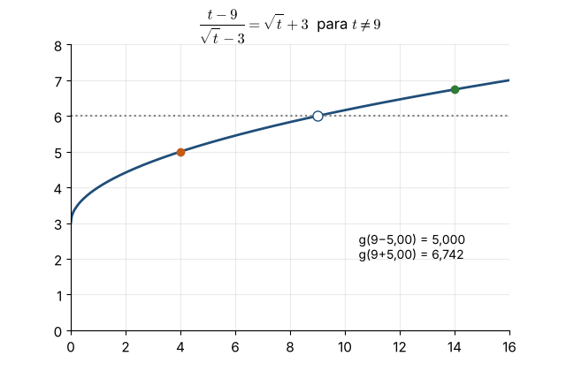

Substituindo: $\frac{9-9}{3-3}=\frac00$, indeterminado.

**Caminho 1 (fatoração).** $t-9=(\sqrt t)^2-3^2=(\sqrt t-3)(\sqrt t+3)$. Para $t\neq9$:
$$\frac{t-9}{\sqrt t-3}=\sqrt t+3\ \Longrightarrow\ \lim_{t\to9}(\sqrt t+3)=6 .$$

**Caminho 2 (conjugado).** Multiplicar por $\frac{\sqrt t+3}{\sqrt t+3}$ dá $\frac{(t-9)(\sqrt t+3)}{t-9}=\sqrt t+3$, que é o mesmo resultado.

**Animação.** O gráfico é o de $\sqrt t+3$ com um buraco em $(9,6)$; pontos pela esquerda e pela direita se aproximam da altura 6.

---

### 2.22 — Fatorando cubos

*Origem: OpenStax, 2.3, ex. 100.*

> Calcule $\displaystyle\lim_{x\to1}\frac{x^3-1}{x^2-1}$.

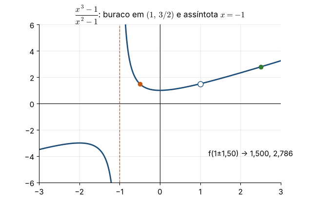

Forma $0/0$. Fatoramos com $a^3-b^3=(a-b)(a^2+ab+b^2)$ e $a^2-b^2=(a-b)(a+b)$:
$$\frac{x^3-1}{x^2-1}=\frac{(x-1)(x^2+x+1)}{(x-1)(x+1)}=\frac{x^2+x+1}{x+1}\quad(x\neq1).$$
Então $\lim_{x\to1}\frac{x^2+x+1}{x+1}=\frac{3}{2}$.

**Comentário.** Em $x=1$ há uma descontinuidade **removível** (o limite existe). Em $x=-1$, o fator $x+1$ permanece no denominador e o numerador vale 1: há uma assíntota vertical.

**Animação.** O ponto se aproxima de $x=1$ pelos dois lados, rumo ao buraco em $(1,\,3/2)$.

---

### 2.26 — Limites laterais infinitos

*Origem: OpenStax, 2.3, ex. 105–106.*

> Calcule $\displaystyle\lim_{x\to1^-}\frac{2x^2+7x-4}{x^2+x-2}$ e $\displaystyle\lim_{x\to1^+}\frac{2x^2+7x-4}{x^2+x-2}$.

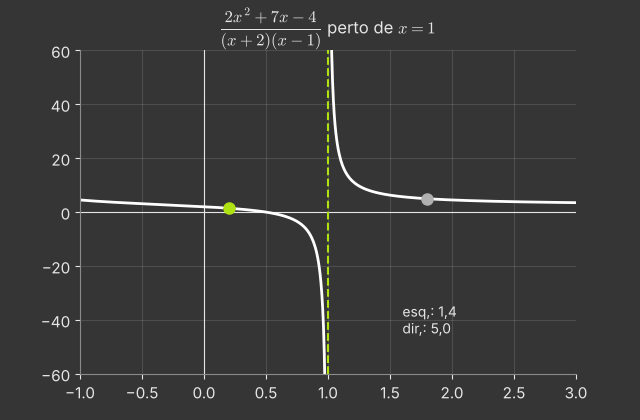

Substituindo $x=1$: numerador $2+7-4=5$, denominador $1+1-2=0$. Forma $K/0$ com $K\neq0$: o limite é infinito, e o **sinal** decide.

Fatoramos o denominador: $x^2+x-2=(x+2)(x-1)$. Perto de $x=1$, $x+2\approx3>0$, então o sinal é o de $x-1$:
- $x\to1^-$: $x-1<0$, logo o denominador $\to0^-$ e $\frac{5}{0^-}\to-\infty$;
- $x\to1^+$: $x-1>0$, logo o denominador $\to0^+$ e $\frac{5}{0^+}\to+\infty$.

Portanto $x=1$ é uma **assíntota vertical**.

**Animação.** Dois pontos se aproximam de $x=1$: o da esquerda despenca e o da direita dispara.

---

### 2.27 — O limite de $\sin(ax)/x$

*Origem: OpenStax, 2.2, ex. 35–37.*

> (a) Use tabelas com $x=\pm0{,}1;\ \pm0{,}01;\ \pm0{,}001$ para estimar $\lim_{x\to0}\frac{\sin2x}{x}$ e $\lim_{x\to0}\frac{\sin3x}{x}$. (b) Conjecture o valor de $\lim_{x\to0}\frac{\sin ax}{x}$ para $a>0$ e prove-o com o Teorema 2.7.

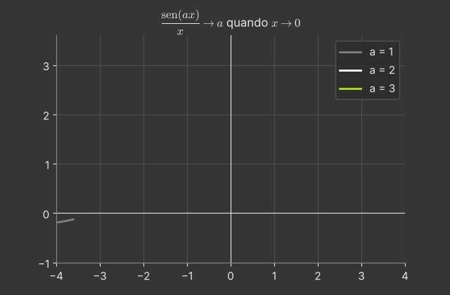

**(a)** Para $\frac{\sin2x}{x}$: $x=0{,}1\Rightarrow1{,}98669$; $x=0{,}01\Rightarrow1{,}99987$; $x=0{,}001\Rightarrow1{,}9999987$. A função é par, então os valores para $-x$ são iguais. O limite parece ser **2**.
Para $\frac{\sin3x}{x}$: $2{,}95520$; $2{,}99955$; $2{,}9999955$, que parecem tender a **3**.

**(b)** Conjectura: o limite é $a$. Prova: com $\theta=ax$, temos $\theta\to0$ quando $x\to0$, e
$$\frac{\sin ax}{x}=a\cdot\frac{\sin ax}{ax}=a\cdot\frac{\sin\theta}{\theta}\longrightarrow a\cdot1=a .$$

**Animação.** O gráfico de $\frac{\sin ax}{x}$ para $a=1,2,3$: o "buraco" em $x=0$ fica exatamente na altura $a$.

---

### 2.31 — Teorema do Confronto

*Origem: OpenStax, 2.3, ex. 127.*

> Calcule $\displaystyle\lim_{\theta\to0}\theta^2\cos\!\left(\frac1\theta\right)$.

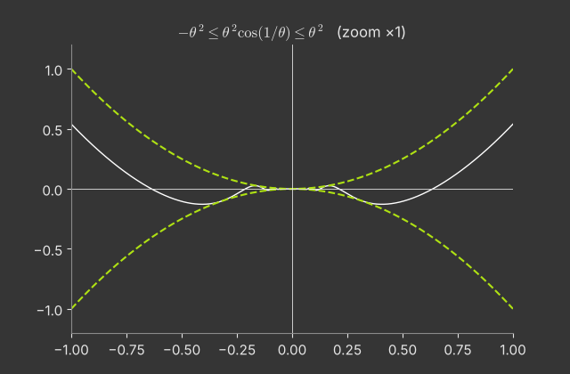

Não dá para usar a propriedade do produto, porque $\lim_{\theta\to0}\cos(1/\theta)$ **não existe** (oscila).
Mas $\cos$ é limitado: $-1\le\cos(1/\theta)\le1$. Multiplicando por $\theta^2\ge0$:
$$-\theta^2\le\theta^2\cos\left(\tfrac1\theta\right)\le\theta^2 .$$
Como $\lim_{\theta\to0}(-\theta^2)=0=\lim_{\theta\to0}\theta^2$, o Teorema do Confronto dá
$$\lim_{\theta\to0}\theta^2\cos\left(\tfrac1\theta\right)=0 .$$

**Padrão útil.** (algo que tende a 0) × (algo limitado) → 0.

**Animação.** Um zoom sucessivo em torno da origem: a função oscila cada vez mais rápido, mas sempre presa entre $-\theta^2$ e $\theta^2$.

---

### 2.32 — Escolhendo $k$ para a continuidade (I)

*Origem: OpenStax, 2.4, ex. 145.*

> Encontre $k$ para que $f(x)=\begin{cases}3x+2, & x<k\\ 2x-3, & k\le x\le8\end{cases}$ seja contínua em todo o seu domínio.

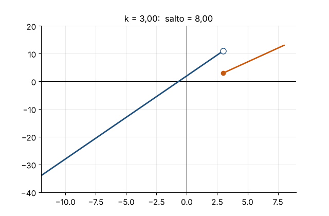

Cada parte é um polinômio, logo contínua. O único ponto a verificar é a emenda $x=k$:
- $\lim_{x\to k^-}f(x)=3k+2$;
- $\lim_{x\to k^+}f(x)=f(k)=2k-3$.

Precisamos de $3k+2=2k-3$, isto é, $k=-5$. Com isso, $f(-5)=-13$ e as duas retas se encontram em $(-5,-13)$.

**Animação.** Enquanto $k$ varia, o salto entre as duas partes muda de tamanho; ele desaparece exatamente em $k=-5$.

---

### 2.33 — Escolhendo $k$ para a continuidade (II)

*Origem: OpenStax, 2.4, ex. 148.*

> Encontre $k$ para que $f(x)=\begin{cases}e^{kx}, & 0\le x<4\\ x+3, & 4\le x\le8\end{cases}$ seja contínua em $[0,8]$.

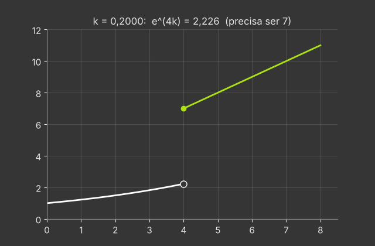

As partes são contínuas; resta a emenda em $x=4$:
- $\lim_{x\to4^-}e^{kx}=e^{4k}$;
- $f(4)=\lim_{x\to4^+}(x+3)=7$.

Logo $e^{4k}=7\iff4k=\ln7\iff k=\frac{\ln7}{4}\approx0{,}4865$.

**Animação.** A exponencial muda de inclinação com $k$ até se encaixar no ponto $(4,7)$.

---

### 2.37 — TVI: duas partículas

*Origem: OpenStax, 2.4, ex. 151.*

> Uma partícula se move numa reta com posição $s(t)$ contínua, e $s(2)=5$, $s(5)=2$. Outra partícula tem posição $h(t)=s(t)-t$. Explique por que existe um instante $t\in[2,5]$ em que $h(t)=0$. O que isso significa para a primeira partícula?

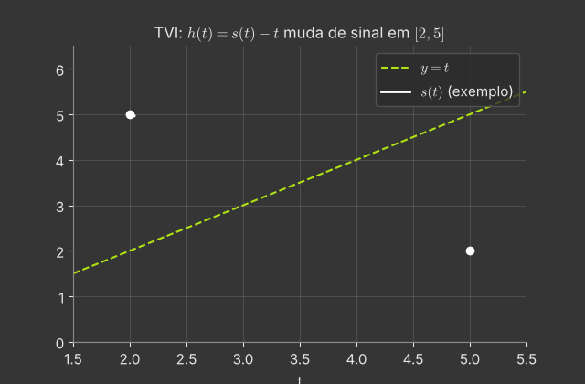

$h(t)=s(t)-t$ é contínua, pois é a diferença de funções contínuas. Calculando nas extremidades:
$$h(2)=5-2=3>0,\qquad h(5)=2-5=-3<0 .$$
Como $0$ está entre $h(2)$ e $h(5)$, o **Teorema do Valor Intermediário** garante que existe $c\in[2,5]$ com $h(c)=0$.

**Significado.** $h(c)=0\iff s(c)=c$: em algum instante a posição da primeira partícula coincide numericamente com o tempo. Graficamente, o gráfico de $s$ cruza a reta $y=t$.

**Animação.** Uma possível $s(t)$ (qualquer curva contínua de $(2,5)$ a $(5,2)$) é desenhada; ela é obrigada a cruzar a reta $y=t$.

---

### 2.38 — TVI: localizando uma raiz

*Origem: OpenStax, 2.4, ex. 153.*

> Use o TVI para decidir se $2^x=x^3$ tem solução em $[1{,}25;\,1{,}375]$ ou em $[1{,}375;\,1{,}5]$. Justifique para cada intervalo.

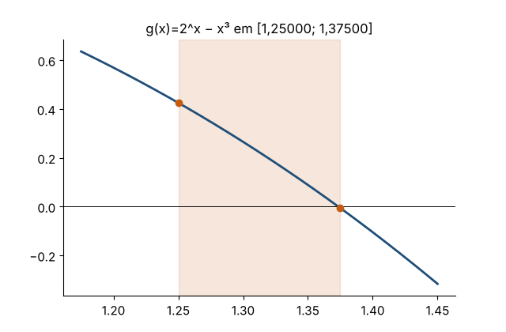

Seja $g(x)=2^x-x^3$, contínua. Uma solução de $2^x=x^3$ é um zero de $g$.
- $g(1{,}25)=2^{1{,}25}-1{,}25^3\approx2{,}3784-1{,}9531=0{,}425>0$;
- $g(1{,}375)\approx2{,}5937-2{,}5996=-0{,}006<0$;
- $g(1{,}5)\approx2{,}8284-3{,}375=-0{,}547<0$.

**Em $[1{,}25;\,1{,}375]$:** $g$ muda de sinal, logo pelo TVI **há** uma solução (de fato, $x\approx1{,}3735$).

**Em $[1{,}375;\,1{,}5]$:** $g$ é negativa nas duas extremidades. O TVI **não garante** nada. (Pode haver zero ou não; o teorema só fala de valores intermediários. Aqui, de fato, não há.)

**Animação.** Zoom sucessivo sobre a raiz, reduzindo o intervalo pela metade a cada passo (método da bissecção).

---

### 2.40 — Da secante à tangente

*Origem: OpenStax, 2.3, ex. 98.*

> Calcule $\displaystyle\lim_{h\to0}\frac{\frac{1}{a+h}-\frac1a}{h}$, em que $a\neq0$ é constante. Interprete o resultado em termos de retas secantes ao gráfico de $f(x)=1/x$.

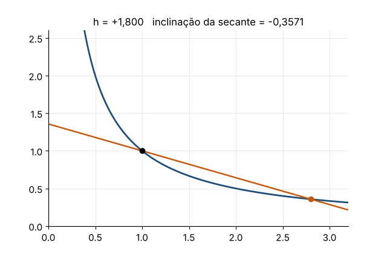

Forma $0/0$ com fração composta: simplificamos o numerador.
$$\frac{\frac{1}{a+h}-\frac1a}{h}=\frac{\frac{a-(a+h)}{a(a+h)}}{h}=\frac{-h}{a(a+h)\,h}=\frac{-1}{a(a+h)}\quad(h\neq0).$$
Logo
$$\lim_{h\to0}\frac{-1}{a(a+h)}=-\frac{1}{a^2}.$$

**Interpretação.** A expressão é a inclinação da secante ao gráfico de $f(x)=1/x$ pelos pontos $(a,f(a))$ e $(a+h,f(a+h))$. Quando $h\to0$, as secantes tendem à **tangente**, cuja inclinação é $-1/a^2$. Esse é exatamente o cálculo da derivada de $1/x$, que veremos no capítulo 3.

**Animação.** Com $a=1$, as secantes giram até a tangente de inclinação $-1$ conforme $h\to0$, pela direita e pela esquerda.

---

### 2.41 — Prova $\varepsilon$-$\delta$

*Origem: OpenStax, 2.5, ex. 192.*

> Use a definição precisa de limite para provar que $\displaystyle\lim_{x\to2}(x^2+2x)=8$.

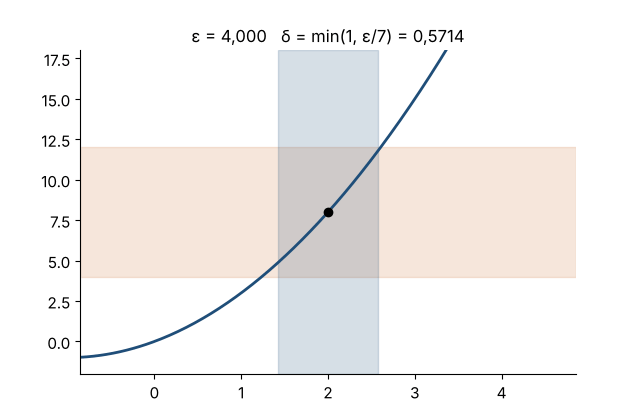

**Rascunho.** Queremos $|(x^2+2x)-8|<\varepsilon$. Fatorando: $|x^2+2x-8|=|x-2|\,|x+4|$.
Controlamos $|x+4|$ restringindo $x$: se $|x-2|<1$, então $1<x<3$, logo $5<x+4<7$ e $|x+4|<7$.
Basta então $|x-2|<\varepsilon/7$.

**Prova.** Seja $\varepsilon>0$. Escolha $\delta=\min\lbrace 1,\varepsilon/7\rbrace $. Suponha $0<|x-2|<\delta$.
Então $|x-2|<1$, donde $|x+4|<7$, e também $|x-2|<\varepsilon/7$. Logo
$$|(x^2+2x)-8|=|x-2|\,|x+4|<\frac\varepsilon7\cdot7=\varepsilon .$$
Portanto $\lim_{x\to2}(x^2+2x)=8$. $\blacksquare$

**Animação.** Para $\varepsilon$ cada vez menor, a faixa vertical de largura $\delta=\min\lbrace 1,\varepsilon/7\rbrace $ mantém o gráfico dentro da faixa horizontal $(8-\varepsilon,8+\varepsilon)$.

---

### 2.42 — Provando que um limite não existe

*Origem: OpenStax, 2.5, ex. 200.*

> Use a definição precisa para provar que $\displaystyle\lim_{x\to1}\frac{|x-1|}{x-1}$ não existe.

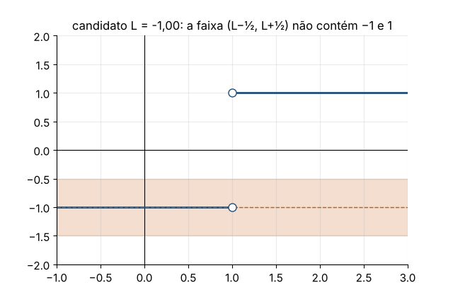

A função vale $f(x)=1$ para $x>1$ e $f(x)=-1$ para $x<1$.

Suponha, por absurdo, que $\lim_{x\to1}f(x)=L$. Tome $\varepsilon=\frac12$. Deveria existir $\delta>0$ tal que $0<|x-1|<\delta\Rightarrow|f(x)-L|<\frac12$.
Escolha $x_1=1+\frac\delta2$ e $x_2=1-\frac\delta2$, ambos com $0<|x-1|<\delta$. Então
$$|1-L|<\tfrac12\quad\text{e}\quad|-1-L|<\tfrac12 .$$
Pela desigualdade triangular,
$$2=|1-(-1)|\le|1-L|+|L-(-1)|<\tfrac12+\tfrac12=1,$$
o que é absurdo. Logo o limite não existe. $\blacksquare$

**Animação.** Testamos vários candidatos $L$: a faixa $(L-\frac12,L+\frac12)$ nunca contém ao mesmo tempo os valores $-1$ e $1$.

---
