# Capítulo 3 — Derivadas: exercícios

São 65 exercícios. Os pontos antes de cada número indicam a dificuldade: **•** fácil, **••** médio, **•••** difícil e **••••** desafio. Tente resolver antes de abrir a resposta. Os marcados com ★ têm [solução completa com animação](#soluções-completas).

Muitos enunciados são adaptados de *Calculus Volume 1* (OpenStax, CC BY-NC-SA 4.0).

## Lista

`•` **3.1** Use a definição de derivada para calcular $f'(x)$ para $f(x)=x^2-3x$.

Resposta

$2x-3$.

`•` **3.2** Use a definição para calcular $f'(x)$ para $f(x)=\dfrac1{x+1}$.

Resposta

$-\dfrac1{(x+1)^2}$.

`•` **3.3** Use a definição para calcular $f'(x)$ para $f(x)=\sqrt{2x+1}$. (Dica: conjugado.)

Resposta

$\dfrac1{\sqrt{2x+1}}$.

`•` **3.4** Encontre a reta tangente a $y=x^3$ em $x=2$.

Resposta

$y=12x-16$.

`•` **3.5** Derive $y=4x^5-\dfrac3{x^2}+2\sqrt x-7$.

Resposta

$20x^4+\dfrac6{x^3}+\dfrac1{\sqrt x}$.

`•` **3.6** Derive $y=(x^2+1)(x^3-2x)$ de duas formas: pela regra do produto e expandindo antes.

Resposta

$5x^4-3x^2-2$.

`•` **3.7** Derive $y=\dfrac{2x-1}{x+3}$.

Resposta

$\dfrac7{(x+3)^2}$.

`•` **3.8** Derive $y=\dfrac{x^2}{x^2+1}$.

Resposta

$\dfrac{2x}{(x^2+1)^2}$.

`•` **3.9** Derive $y=x^2\sin x$.

Resposta

$2x\sin x+x^2\cos x$.

`•` **3.10** Derive $y=\dfrac{\tan x}{x}$.

Resposta

$\dfrac{x\sec^2x-\tan x}{x^2}$.

`•` **3.11** Derive $y=(3x^2-5)^4$.

Resposta

$24x(3x^2-5)^3$.

`•` **3.12** Derive $y=\sin(4x+1)$ e $y=\cos^2x$.

Resposta

$4\cos(4x+1)$; $-2\sin x\cos x=-\sin2x$.

`•` **3.13** Derive $y=\sqrt{1+x^2}$.

Resposta

$\dfrac{x}{\sqrt{1+x^2}}$.

`•` **3.14** Derive $y=e^{-3x}\cos x$.

Resposta

$-e^{-3x}(3\cos x+\sin x)$.

`•` **3.15** Derive $y=\ln(x^2+4)$ e $y=\ln(\sin x)$.

Resposta

$\dfrac{2x}{x^2+4}$; $\cot x$.

`•` **3.16** Derive $y=x^3\,2^x$.

Resposta

$2^x\big(3x^2+x^3\ln2\big)$.

`•` **3.17** Derive $y=\sin^{-1}(2x)$ e $y=\tan^{-1}(3x)$.

Resposta

$\dfrac2{\sqrt{1-4x^2}}$; $\dfrac3{1+9x^2}$.

`•` **3.18** Calcule $y''$ para $y=x^4-2x^3+x$ e para $y=\sin(2x)$.

Resposta

$12x^2-12x$; $-4\sin2x$.

`•` **3.19** Para $s(t)=t^3-6t^2+9t$ (m), calcule a velocidade e a aceleração em $t=2$ s.

Resposta

$v(2)=-3$ m/s; $a(2)=0$.

`•` **3.20** Use derivação implícita para encontrar $y'$ em $x^2+xy+y^2=7$.

Resposta

$y'=-\dfrac{2x+y}{x+2y}$.

`••` **3.21** **Retas tangente e normal.** Encontre as retas tangente e normal à parábola $y=x^2-4x+5$ no ponto de abscissa $x=3$ e esboce as três curvas. ★ [ver solução](#ex-3-21)

Resposta

Tangente $y=2x-4$; normal $y=-\tfrac12x+\tfrac72$.

`••` **3.22** **Construindo o gráfico de $f'$.** Para $f(x)=x^3-3x^2$, determine onde $f'(x)>0$, $f'(x)<0$ e $f'(x)=0$, e esboce o gráfico de $f'$ alinhado com o de $f$. ★ [ver solução](#ex-3-22)

Resposta

$f'(x)=3x(x-2)$: positiva em $(-\infty,0)\cup(2,\infty)$, negativa em $(0,2)$, nula em $x=0$ e $x=2$.

`••` **3.23** **Função por partes derivável.** Encontre $a$ e $b$ para que $f(x)=\begin{cases}x^2,&x\le1\\ax+b,&x>1\end{cases}$ seja derivável em todo $\mathbb R$. ★ [ver solução](#ex-3-23)

Resposta

$a=2$, $b=-1$.

`••` **3.24** Derive $y=(x^2+1)^3(2x-1)^2$ e fatore o resultado.

Resposta

$2(x^2+1)^2(2x-1)(8x^2-3x+2)$.

`••` **3.25** Derive $y=\sin^2(3x)$ e simplifique.

Resposta

$6\sin3x\cos3x=3\sin6x$.

`••` **3.26** Derive $y=\cos\sqrt x$.

Resposta

$-\dfrac{\sin\sqrt x}{2\sqrt x}$.

`••` **3.27** Derive $y=x\,e^{-x^2}$ e encontre onde $y'=0$.

Resposta

$e^{-x^2}(1-2x^2)$; $x=\pm\tfrac1{\sqrt2}$.

`••` **3.28** Derive $y=\ln(\cos x)$ e $y=\ln|\sec x+\tan x|$.

Resposta

$-\tan x$; $\sec x$.

`••` **3.29** Derive $y=\tan^{-1}\sqrt x$.

Resposta

$\dfrac1{2\sqrt x\,(1+x)}$.

`••` **3.30** **O quociente de diferenças do seno.** Para $h=1$, $0{,}5$ e $0{,}1$, esboce $q_h(x)=\dfrac{\sin(x+h)-\sin x}{h}$ junto com $\cos x$. O que acontece quando $h\to0$? Prove o resultado. ★ [ver solução](#ex-3-30)

Resposta

$q_h\to\cos x$; usa $\lim\frac{\sin h}h=1$ e $\lim\frac{\cos h-1}h=0$.

`••` **3.31** **Regra da cadeia e tangente.** Encontre a reta tangente a $y=\sin(x^2)$ em $x=\sqrt{\pi}$. ★ [ver solução](#ex-3-31)

Resposta

$y=-2\sqrt\pi\,(x-\sqrt\pi)$.

`••` **3.32** Calcule $y''$ para $y=xe^x$ e deduza uma fórmula para $y^{(n)}$.

Resposta

$y''=(x+2)e^x$; $y^{(n)}=(x+n)e^x$.

`••` **3.33** Calcule $\dfrac{d^{50}}{dx^{50}}\cos x$ e $\dfrac{d^{99}}{dx^{99}}\sin x$.

Resposta

$-\cos x$; $-\cos x$.

`••` **3.34** Encontre os pontos em que $y=\dfrac{x}{x^2+1}$ tem tangente horizontal.

Resposta

$(1,\tfrac12)$ e $(-1,-\tfrac12)$.

`••` **3.35** Use $f(a+h)\approx f(a)+f'(a)h$ para estimar $\sqrt{4{,}1}$ e $\sqrt[3]{8{,}3}$.

Resposta

$2{,}025$; $2{,}025$.

`••` **3.36** Sabendo que $g(1)=2$, $g'(1)=3$, $f(2)=5$ e $f'(2)=-1$, calcule $h'(1)$ para $h=f\circ g$ e para $k=g\cdot(f\circ g)$.

Resposta

$h'(1)=-3$; $k'(1)=3\cdot5+2\cdot(-3)=9$.

`••` **3.37** **Derivada de uma inversa sem a fórmula.** Seja $f(x)=x+e^x$. Mostre que $f$ é inversível e calcule $(f^{-1})'(1)$ e a reta tangente ao gráfico de $f^{-1}$ no ponto $(1,0)$. ★ [ver solução](#ex-3-37)

Resposta

$(f^{-1})'(1)=\tfrac12$; tangente $y=\tfrac12(x-1)$.

`••` **3.38** Use as propriedades do logaritmo antes de derivar: $y=\ln\dfrac{x^2+1}{x-1}$.

Resposta

$\dfrac{2x}{x^2+1}-\dfrac1{x-1}$.

`••` **3.39** **Custo marginal.** O custo (em mil reais) de produzir $x$ unidades é $C(x)=0{,}01x^3-0{,}6x^2+15x+200$. Calcule o custo marginal em $x=20$ e compare com o custo real de produzir a 21ª unidade. ★ [ver solução](#ex-3-39)

Resposta

$C'(20)=3$; o custo real é $C(21)-C(20)=3{,}01$.

`••` **3.40** Derive $y=3^{\sin x}$ e $y=\log_2(x^2+1)$.

Resposta

$3^{\sin x}\ln3\cos x$; $\dfrac{2x}{(x^2+1)\ln2}$.

`•••` **3.41** **Partícula em movimento.** Uma partícula tem posição $s(t)=t^3-9t^2+24t$ (metros, $t\ge0$ em segundos). (a) Quando ela está em repouso? (b) Quando se move para a frente e para trás? (c) Qual é a distância total percorrida em $[0,5]$? (d) Quando está acelerando? ★ [ver solução](#ex-3-41)

Resposta

(a) $t=2$ e $t=4$; (b) frente em $[0,2)\cup(4,\infty)$, trás em $(2,4)$; (c) 28 m; (d) em $(2,3)$ e $(4,\infty)$.

`•••` **3.42** **Tangentes horizontais numa elipse.** Encontre os pontos da curva $x^2-xy+y^2=3$ onde a reta tangente é horizontal e onde é vertical. ★ [ver solução](#ex-3-42)

Resposta

Horizontal em $(1,2)$ e $(-1,-2)$; vertical em $(2,1)$ e $(-2,-1)$.

`•••` **3.43** **O mínimo de $x^x$.** Use derivação logarítmica para encontrar $\dfrac{d}{dx}x^x$ ($x>0$) e determine o ponto onde o gráfico de $y=x^x$ tem tangente horizontal. ★ [ver solução](#ex-3-43)

Resposta

$y'=x^x(\ln x+1)$; tangente horizontal em $x=1/e$, com $y=e^{-1/e}\approx0{,}692$.

`•••` **3.44** **Tangentes por um ponto externo.** Encontre todas as retas tangentes à parábola $y=x^2$ que passam pelo ponto $(1,-3)$, que não está na parábola. ★ [ver solução](#ex-3-44)

Resposta

$y=6x-9$ (tangente em $x=3$) e $y=-2x-1$ (tangente em $x=-1$).

`•••` **3.45** Prove, pela definição, que $\dfrac{d}{dx}\cos x=-\sin x$.

Resposta

Use $\cos(x+h)=\cos x\cos h-\sin x\sin h$ e os limites do Teorema 2.7.

`•••` **3.46** Deduza $\dfrac{d}{dx}\tan^{-1}x=\dfrac1{1+x^2}$ a partir do teorema da derivada da inversa.

Resposta

$y=\tan^{-1}x\Rightarrow y'=\dfrac1{\sec^2y}=\dfrac1{1+\tan^2y}$.

`•••` **3.47** Derive $y=x^{\sin x}$ ($x>0$).

Resposta

$x^{\sin x}\Big(\cos x\ln x+\dfrac{\sin x}x\Big)$.

`•••` **3.48** Use derivação logarítmica: $y=\dfrac{(x+1)^2(x-2)^3}{(x+3)^4}$.

Resposta

$y\Big(\dfrac2{x+1}+\dfrac3{x-2}-\dfrac4{x+3}\Big)$.

`•••` **3.49** Para a circunferência $x^2+y^2=r^2$, mostre que $y''=-\dfrac{r^2}{y^3}$.

Resposta

$y'=-\tfrac xy$; derive de novo e use $x^2+y^2=r^2$.

`•••` **3.50** Encontre a reta tangente à curva $x^2y+xy^2=6$ no ponto $(1,2)$.

Resposta

$y'=-\tfrac85$; $y=-\tfrac85x+\tfrac{18}5$.

`•••` **3.51** Onde $f(x)=|x^2-4|$ é derivável? Calcule as derivadas laterais nos pontos problemáticos.

Resposta

Em todo $x\neq\pm2$; em $x=2$: $-4$ e $4$; em $x=-2$: $-4$ e $4$.

`•••` **3.52** Mostre que $(\sinh x)'=\cosh x$, $(\cosh x)'=\sinh x$ e $(\tanh x)'=\operatorname{sech}^2x$.

Resposta

Derive as definições com exponenciais; use $\cosh^2-\sinh^2=1$.

`•••` **3.53** Seja $f(x)=x^2\sin\frac1x$ para $x\neq0$ e $f(0)=0$. Calcule $f'(0)$ pela definição e mostre que $f'$ não é contínua em $0$.

Resposta

$f'(0)=0$; $f'(x)=2x\sin\tfrac1x-\cos\tfrac1x$ não tem limite em 0.

`•••` **3.54** A reta normal a $y=e^x$ em $x=0$ corta o eixo $x$ em que ponto?

Resposta

Normal $y=-x+1$; corta em $(1,0)$.

`•••` **3.55** Para que valor de $a$ a reta $y=ax$ é tangente à curva $y=e^x$? Em que ponto?

Resposta

$a=e$, no ponto $(1,e)$.

`•••` **3.56** Derive $y=\sin^{-1}x+\cos^{-1}x$ e conclua uma identidade.

Resposta

$y'=0$, logo $\sin^{-1}x+\cos^{-1}x=\tfrac\pi2$.

`•••` **3.57** Mostre que $y=e^{2x}+e^{-3x}$ satisfaz $y''+y'-6y=0$.

Resposta

Substitua $y'$ e $y''$; os termos se cancelam.

`•••` **3.58** Encontre a reta tangente a $y=x^x$ em $x=e$.

Resposta

$y=e^e+2e^e(x-e)$.

`•••` **3.59** O ângulo de um pêndulo é $\theta(t)=0{,}2\cos(2\pi t)$ rad. Qual é a velocidade angular máxima e quando ocorre?

Resposta

$0{,}4\pi\approx1{,}26$ rad/s, quando $\theta=0$ ($t=\tfrac14+\tfrac n2$).

`•••` **3.60** Em que pontos a tangente a $y=x^3$ é paralela à reta $y=12x+1$? Escreva as tangentes.

Resposta

$x=\pm2$: $y=12x-16$ e $y=12x+16$.

`••••` **3.61** Prove que $(fgh)'=f'gh+fg'h+fgh'$ e generalize para $n$ fatores.

Resposta

Aplique a regra do produto a $(fg)\cdot h$; por indução, soma de $n$ termos com uma derivada em cada.

`••••` **3.62** Para que valores de $n$ a função $y=x^n$ satisfaz $x^2y''-3xy'+4y=0$?

Resposta

$n=2$ (raiz dupla de $n^2-4n+4=0$).

`••••` **3.63** Prove por indução que $\dfrac{d^n}{dx^n}(xe^x)=(x+n)e^x$.

Resposta

Base $n=1$; passo: derive $(x+n)e^x$ e obtenha $(x+n+1)e^x$.

`••••` **3.64** Mostre que as curvas $x^2-y^2=a$ e $xy=b$ ($a,b\neq0$) se cortam em ângulo reto.

Resposta

Inclinações $\tfrac xy$ e $-\tfrac yx$: o produto é $-1$.

`••••` **3.65** Encontre todas as retas que são tangentes simultaneamente a $y=x^2$ e a $y=-x^2+4x-4$.

Resposta

$y=0$ e $y=4x-4$.

## Soluções completas

### 3.21 — Retas tangente e normal

*Origem: OpenStax, inspirado na seção 3.1.*

> Encontre as retas tangente e normal à parábola $y=x^2-4x+5$ no ponto de abscissa $x=3$ e esboce as três curvas.

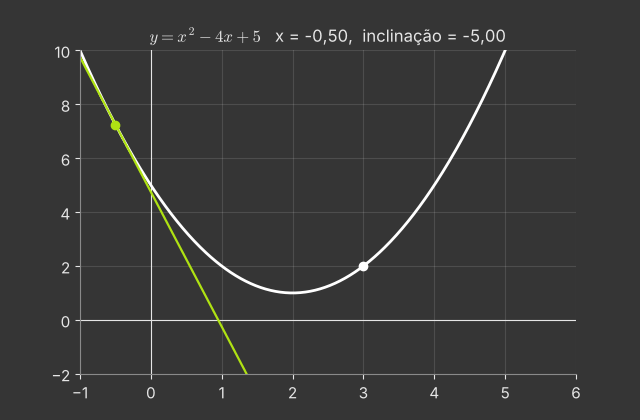

**Ponto.** $y(3)=9-12+5=2$, logo o ponto é $(3,2)$.

**Inclinação da tangente.** $y'=2x-4$, então $m=y'(3)=2$. Tangente: $y-2=2(x-3)$, isto é, $y=2x-4$.

**Normal.** É perpendicular à tangente no mesmo ponto, então tem inclinação $-\frac1m=-\frac12$:
$y-2=-\frac12(x-3)$, isto é, $y=-\frac12x+\frac72$.

**Conferência.** A parábola é $y=(x-2)^2+1$, com vértice $(2,1)$. À direita do vértice ela sobe, e a tangente com inclinação positiva faz sentido.

**Animação.** A tangente percorre a parábola; sua inclinação $2x-4$ é negativa à esquerda do vértice, zero no vértice e positiva à direita.

---

### 3.22 — Construindo o gráfico de $f'$

*Origem: OpenStax, inspirado na seção 3.2.*

> Para $f(x)=x^3-3x^2$, determine onde $f'(x)>0$, $f'(x)<0$ e $f'(x)=0$, e esboce o gráfico de $f'$ alinhado com o de $f$.

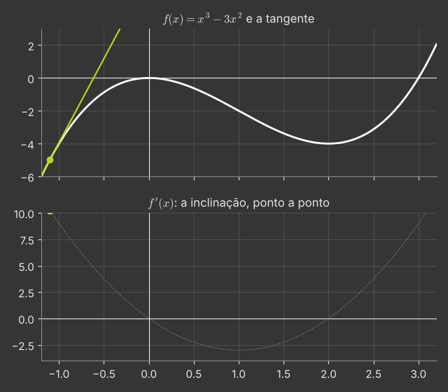

$f'(x)=3x^2-6x=3x(x-2)$, uma parábola com zeros em $0$ e $2$ e vértice em $x=1$ (onde $f'(1)=-3$).

- $f'>0$ em $(-\infty,0)\cup(2,\infty)$: ali $f$ é **crescente**;
- $f'<0$ em $(0,2)$: ali $f$ é **decrescente**;
- $f'=0$ em $x=0$ e $x=2$: **tangentes horizontais**, em $(0,0)$ (máximo local) e $(2,-4)$ (mínimo local).

O ponto em que $f$ decresce mais rápido é $x=1$, o vértice de $f'$.

**Animação.** A reta tangente percorre o gráfico de $f$ (em cima); embaixo, o valor da sua inclinação vai desenhando, ponto a ponto, o gráfico de $f'$.

---

### 3.23 — Função por partes derivável

*Origem: OpenStax, inspirado no Exemplo 3.14.*

> Encontre $a$ e $b$ para que $f(x)=\begin{cases}x^2,&x\le1\\ax+b,&x>1\end{cases}$ seja derivável em todo $\mathbb R$.

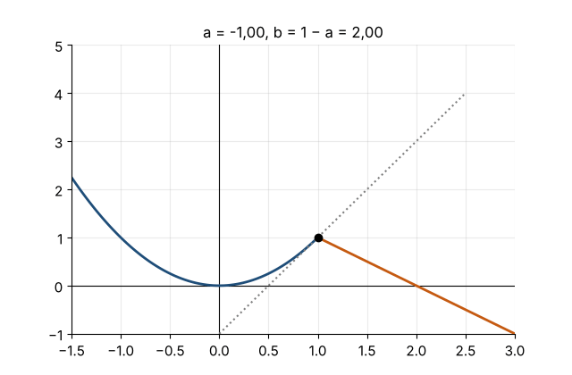

**Continuidade em $x=1$.** $\lim_{x\to1^-}x^2=1$ e $\lim_{x\to1^+}(ax+b)=a+b$. Precisamos de $a+b=1$.

**Derivabilidade em $x=1$.** As derivadas laterais são
$$\lim_{h\to0^-}\frac{(1+h)^2-1}{h}=2,\qquad \lim_{h\to0^+}\frac{a(1+h)+b-1}{h}=\lim_{h\to0^+}\frac{ah+(a+b-1)}{h}=a\ \ (\text{usando }a+b=1).$$
Logo $a=2$ e $b=-1$.

**Interpretação.** A reta $y=2x-1$ é exatamente a **tangente** à parábola em $(1,1)$: a emenda fica "lisa", sem bico.

**Por que a continuidade vem primeiro?** Derivável implica contínua. Se $a+b\neq1$, a derivada lateral direita seria infinita.

**Animação.** Variamos $a$ (mantendo a continuidade, $b=1-a$): só quando $a=2$ as duas partes se encaixam sem bico.

---

### 3.30 — O quociente de diferenças do seno

*Origem: OpenStax, inspirado na seção 3.5.*

> Para $h=1$, $0{,}5$ e $0{,}1$, esboce $q_h(x)=\dfrac{\sin(x+h)-\sin x}{h}$ junto com $\cos x$. O que acontece quando $h\to0$? Prove o resultado.

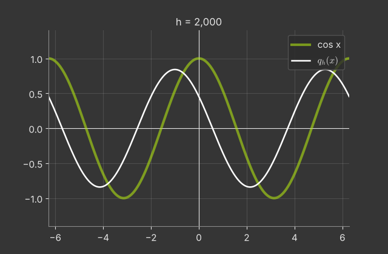

**Observação.** Para cada $h$, $q_h(x)$ é a inclinação de uma secante. Para $h=1$ a curva já parece uma cossenoide, mas deslocada; para $h=0{,}1$ quase coincide com $\cos x$.

Na verdade, pela identidade $\sin A-\sin B=2\cos\frac{A+B}2\sin\frac{A-B}2$,
$$q_h(x)=\frac{\sin(h/2)}{h/2}\,\cos\!\left(x+\frac h2\right),$$
ou seja, $q_h$ é **exatamente** uma cossenoide, com amplitude $\frac{\sin(h/2)}{h/2}<1$ e deslocada de $h/2$ para a esquerda. As duas distorções somem quando $h\to0$.

**Prova (como no texto).**
$$q_h(x)=\sin x\cdot\frac{\cos h-1}{h}+\cos x\cdot\frac{\sin h}{h}\ \xrightarrow{h\to0}\ \sin x\cdot0+\cos x\cdot1=\cos x .$$

**Animação.** $h$ diminui de 2 até 0,01, e $q_h$ (azul) se encaixa sobre $\cos x$ (laranja).

---

### 3.31 — Regra da cadeia e tangente

*Origem: OpenStax, inspirado no Exemplo 3.50.*

> Encontre a reta tangente a $y=\sin(x^2)$ em $x=\sqrt{\pi}$.

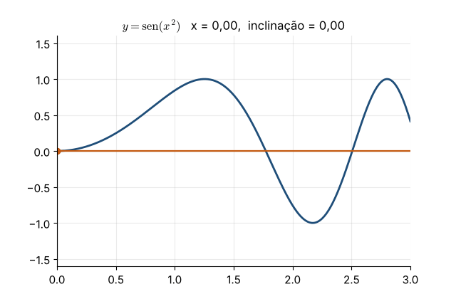

**Ponto.** $y(\sqrt\pi)=\sin\pi=0$.

**Derivada (cadeia).** Fora: $\sin u$, com derivada $\cos u$. Dentro: $u=x^2$, com derivada $2x$.
$$y'=\cos(x^2)\cdot2x\quad\Rightarrow\quad y'(\sqrt\pi)=\cos\pi\cdot2\sqrt\pi=-2\sqrt\pi\approx-3{,}545 .$$

**Tangente.** $y=-2\sqrt\pi\,(x-\sqrt\pi)$.

**Observação.** Perto de $x=\sqrt\pi$, $\sin(x^2)$ oscila cada vez mais rápido à medida que $x$ cresce: o fator $2x$ da regra da cadeia mede justamente essa "aceleração" das oscilações.

**Animação.** A tangente percorre a curva $\sin(x^2)$; a inclinação $2x\cos(x^2)$ fica cada vez maior em módulo.

---

### 3.37 — Derivada de uma inversa sem a fórmula

*Origem: OpenStax, inspirado no Exemplo 3.61.*

> Seja $f(x)=x+e^x$. Mostre que $f$ é inversível e calcule $(f^{-1})'(1)$ e a reta tangente ao gráfico de $f^{-1}$ no ponto $(1,0)$.

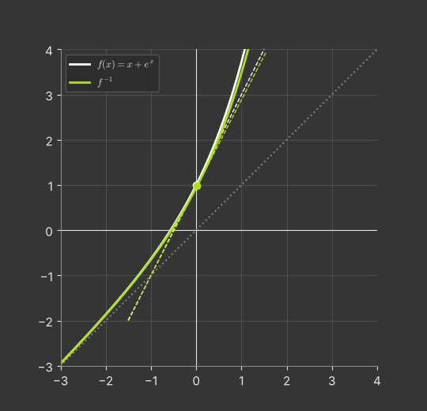

**Inversível.** $f'(x)=1+e^x>0$ para todo $x$, então $f$ é estritamente crescente, logo injetora.

**Ponto correspondente.** Precisamos de $f^{-1}(1)$: $x+e^x=1$ tem solução $x=0$ (pois $0+e^0=1$). Logo $f^{-1}(1)=0$.

**Teorema da inversa.**
$$(f^{-1})'(1)=\frac{1}{f'(f^{-1}(1))}=\frac1{f'(0)}=\frac1{1+1}=\frac12 .$$

**Tangente.** No ponto $(1,0)$ do gráfico de $f^{-1}$: $y=\frac12(x-1)$.

**Observação.** Não existe fórmula elementar para $f^{-1}$, mas a derivada sai mesmo assim.

**Animação.** O gráfico de $f$ e sua tangente em $(0,1)$ (inclinação 2) são refletidos em torno de $y=x$, virando o gráfico de $f^{-1}$ e a tangente em $(1,0)$ (inclinação $\frac12$).

---

### 3.39 — Custo marginal

*Origem: OpenStax, inspirado no Exemplo 3.38.*

> O custo (em mil reais) de produzir $x$ unidades é $C(x)=0{,}01x^3-0{,}6x^2+15x+200$. Calcule o custo marginal em $x=20$ e compare com o custo real de produzir a 21ª unidade.

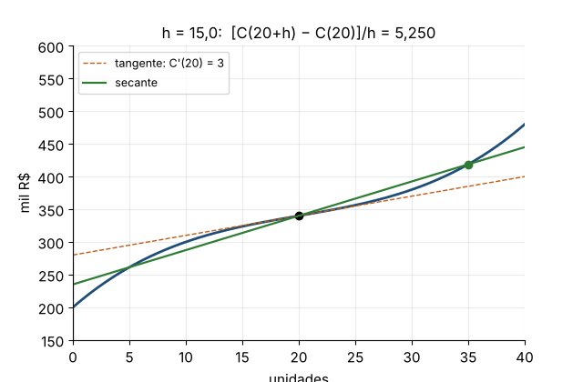

$C'(x)=0{,}03x^2-1{,}2x+15$, então $C'(20)=12-24+15=3$ mil reais por unidade.

Custo real da 21ª unidade: $C(20)=80-240+300+200=340$ e $C(21)=92{,}61-264{,}6+315+200=343{,}01$. Logo $C(21)-C(20)=3{,}01$.

**Por que são próximos?** $C(21)-C(20)$ é a inclinação da secante entre $x=20$ e $x=21$; $C'(20)$ é a inclinação da tangente em $x=20$. Para $h=1$ (pequeno em relação à escala do problema), $C(20+1)\approx C(20)+C'(20)\cdot1$.

**Observação.** $C'$ é mínimo em $x=20$ (vértice de $0{,}03x^2-1{,}2x+15$): é o nível de produção em que cada unidade extra é mais barata.

**Animação.** A secante entre $x=20$ e $x=20+h$ gira até a tangente quando $h$ vai de 10 a 0.

---

### 3.41 — Partícula em movimento

*Origem: OpenStax, inspirado no Exemplo 3.36.*

> Uma partícula tem posição $s(t)=t^3-9t^2+24t$ (metros, $t\ge0$ em segundos). (a) Quando ela está em repouso? (b) Quando se move para a frente e para trás? (c) Qual é a distância total percorrida em $[0,5]$? (d) Quando está acelerando?

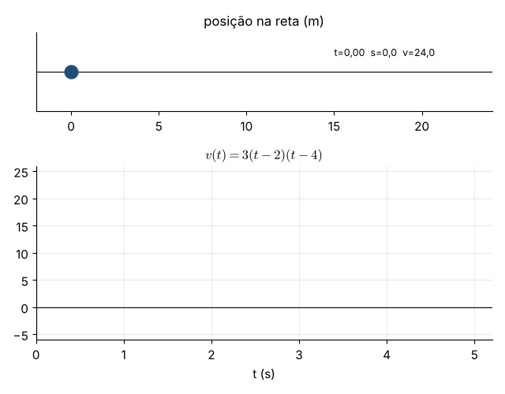

$v(t)=s'(t)=3t^2-18t+24=3(t-2)(t-4)$ e $a(t)=v'(t)=6t-18$.

**(a)** Repouso: $v=0\iff t=2$ ou $t=4$.

**(b)** $v>0$ em $[0,2)$ e $(4,\infty)$ (para a frente); $v<0$ em $(2,4)$ (para trás).

**(c)** A distância **não** é $s(5)-s(0)$, porque a partícula volta no caminho. Somamos cada trecho:
$s(0)=0$, $s(2)=20$, $s(4)=16$, $s(5)=20$. Distância $=|20-0|+|16-20|+|20-16|=20+4+4=28$ m.
(O deslocamento é $s(5)-s(0)=20$ m.)

**(d)** A rapidez $|v|$ aumenta quando $v$ e $a$ têm o mesmo sinal:
- $(0,2)$: $v>0$, $a<0$, desacelera;
- $(2,3)$: $v<0$, $a<0$, acelera;
- $(3,4)$: $v<0$, $a>0$, desacelera;
- $(4,\infty)$: $v>0$, $a>0$, acelera.

**Animação.** A partícula anda sobre a reta enquanto o gráfico de $v(t)$ é traçado; a cor indica se ela vai para a frente (azul) ou para trás (laranja).

---

### 3.42 — Tangentes horizontais numa elipse

*Origem: OpenStax, inspirado na seção 3.8.*

> Encontre os pontos da curva $x^2-xy+y^2=3$ onde a reta tangente é horizontal e onde é vertical.

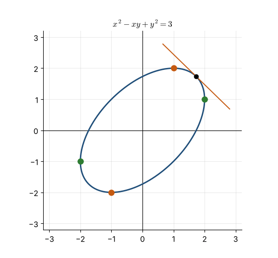

**Derivação implícita.** $2x-(y+xy')+2yy'=0\Rightarrow y'(2y-x)=y-2x\Rightarrow y'=\dfrac{y-2x}{2y-x}$.

**Horizontal ($y'=0$):** numerador nulo, $y=2x$. Na curva: $x^2-2x^2+4x^2=3\Rightarrow x^2=1$. Pontos $(1,2)$ e $(-1,-2)$ (o denominador $2y-x=3x\neq0$ ✓).

**Vertical:** denominador nulo, $x=2y$. Na curva: $4y^2-2y^2+y^2=3\Rightarrow y^2=1$. Pontos $(2,1)$ e $(-2,-1)$ (numerador $y-2x=-3y\neq0$ ✓).

**Sobre a curva.** É uma elipse inclinada a $45^\circ$ (o termo $-xy$ gira os eixos). Os quatro pontos são os "extremos" da elipse nas direções vertical e horizontal.

**Animação.** A tangente percorre a elipse; os pontos de tangente horizontal (laranja) e vertical (verde) ficam marcados.

---

### 3.43 — O mínimo de $x^x$

*Origem: OpenStax, inspirado no Exemplo 3.83.*

> Use derivação logarítmica para encontrar $\dfrac{d}{dx}x^x$ ($x>0$) e determine o ponto onde o gráfico de $y=x^x$ tem tangente horizontal.

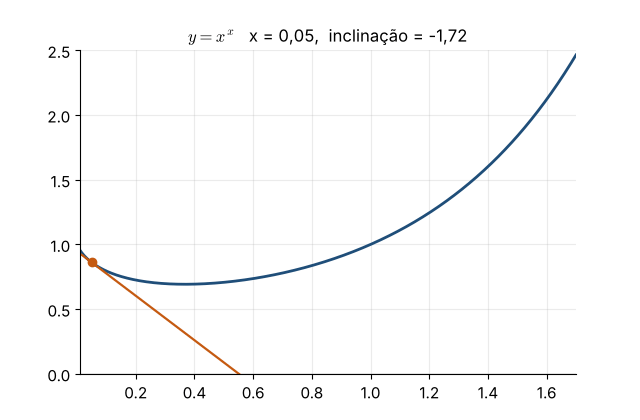

**Derivação logarítmica.** $\ln y=x\ln x\Rightarrow\frac{y'}{y}=\ln x+1\Rightarrow y'=x^x(\ln x+1)$.

**Tangente horizontal.** Como $x^x>0$, $y'=0\iff\ln x=-1\iff x=\frac1e\approx0{,}368$. O valor é $y=\left(\frac1e\right)^{1/e}=e^{-1/e}\approx0{,}692$.

**Sinal de $y'$.** Para $x<\frac1e$, $\ln x+1<0$, e a função decresce; para $x>\frac1e$, ela cresce. Logo $x=1/e$ é um **mínimo** (no capítulo 4 isso fica sistemático).

**Erros comuns.** $\frac{d}{dx}x^x\neq x\cdot x^{x-1}$ (regra da potência, que exige expoente constante) e $\neq x^x\ln x$ (regra da exponencial, que exige base constante). A resposta correta é a **soma** das duas: $x^x\ln x+x\cdot x^{x-1}$.

**Animação.** A tangente percorre $y=x^x$ e fica horizontal em $x=1/e$.

---

### 3.44 — Tangentes por um ponto externo

*Origem: OpenStax, problema clássico.*

> Encontre todas as retas tangentes à parábola $y=x^2$ que passam pelo ponto $(1,-3)$, que não está na parábola.

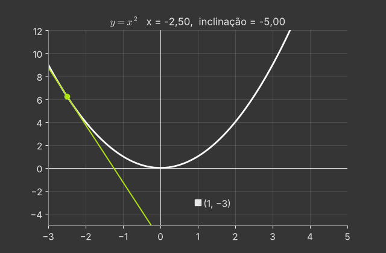

**Ideia.** Não sabemos o ponto de tangência; chamamos de $(a,a^2)$ e impomos a condição.

A tangente em $(a,a^2)$ tem inclinação $2a$: $y=a^2+2a(x-a)=2ax-a^2$.

Ela passa por $(1,-3)$ se $-3=2a-a^2$, isto é, $a^2-2a-3=0\Rightarrow(a-3)(a+1)=0$.

- $a=3$: $y=6x-9$;
- $a=-1$: $y=-2x-1$.

**Verificação.** $6(1)-9=-3$ ✓ e $-2(1)-1=-3$ ✓.

**Observação.** De um ponto **abaixo** da parábola partem duas tangentes; de um ponto **sobre** ela, uma; de um ponto **acima**, nenhuma (a equação em $a$ não tem raiz real).

**Animação.** A tangente percorre a parábola; ela "acende" nas duas posições em que passa pelo ponto $(1,-3)$.

---
