# Capítulo 4 — Aplicações das derivadas: exercícios

São 65 exercícios. Os pontos antes de cada número indicam a dificuldade: **•** fácil, **••** médio, **•••** difícil e **••••** desafio. Tente resolver antes de abrir a resposta. Os marcados com ★ têm [solução completa com animação](#soluções-completas).

Muitos enunciados são adaptados de *Calculus Volume 1* (OpenStax, CC BY-NC-SA 4.0).

## Lista

`•` **4.1** Encontre a linearização de $f(x)=\sqrt[3]x$ em $a=8$ e use-a para estimar $\sqrt[3]{8{,}2}$.

Resposta

$L(x)=2+\tfrac{x-8}{12}$; $\approx2{,}0167$.

`•` **4.2** Para $y=x^2-3x$, compare $dy$ e $\Delta y$ quando $x=2$ e $dx=0{,}1$.

Resposta

$dy=0{,}1$; $\Delta y=0{,}11$.

`•` **4.3** Encontre os pontos críticos de $f(x)=x^3-12x+1$.

Resposta

$x=\pm2$.

`•` **4.4** Encontre os pontos críticos de $f(x)=x^{2/3}(x-5)$ (inclua os pontos em que $f'$ não existe).

Resposta

$x=2$ e $x=0$.

`•` **4.5** Encontre os extremos absolutos de $f(x)=x^2-4x+3$ em $[0,3]$.

Resposta

Máximo $3$ em $x=0$; mínimo $-1$ em $x=2$.

`•` **4.6** Encontre os extremos absolutos de $f(x)=\sin x+\cos x$ em $[0,\pi]$.

Resposta

Máximo $\sqrt2$ em $x=\tfrac\pi4$; mínimo $-1$ em $x=\pi$.

`•` **4.7** Verifique as hipóteses do Teorema de Rolle para $f(x)=x^2-4x$ em $[0,4]$ e encontre $c$.

Resposta

$c=2$.

`•` **4.8** Encontre o $c$ do TVM para $f(x)=x^2$ em $[1,3]$ e interprete.

Resposta

$c=2$: tangente paralela à secante.

`•` **4.9** Determine os intervalos de crescimento e de decrescimento de $f(x)=x^3-3x^2$.

Resposta

Cresce em $(-\infty,0)\cup(2,\infty)$; decresce em $(0,2)$.

`•` **4.10** Estude a concavidade de $f(x)=x^4-4x^3$ e encontre os pontos de inflexão.

Resposta

Para cima em $(-\infty,0)\cup(2,\infty)$, para baixo em $(0,2)$; inflexões $(0,0)$ e $(2,-16)$.

`•` **4.11** Use o teste da segunda derivada para classificar os pontos críticos de $f(x)=2x^3-3x^2-12x$.

Resposta

Máx. local $f(-1)=7$; mín. local $f(2)=-20$.

`•` **4.12** Calcule $\displaystyle\lim_{x\to\infty}\frac{3x^2-x}{5x^2+2}$.

Resposta

$\tfrac35$.

`•` **4.13** Calcule $\displaystyle\lim_{x\to-\infty}\frac{2x+1}{\sqrt{x^2+3}}$.

Resposta

$-2$.

`•` **4.14** Encontre as assíntotas verticais e horizontais de $f(x)=\dfrac{2x^2}{x^2-9}$.

Resposta

Verticais $x=\pm3$; horizontal $y=2$.

`•` **4.15** Encontre a assíntota oblíqua de $f(x)=\dfrac{x^2+1}{x+1}$.

Resposta

$y=x-1$.

`•` **4.16** Use L'Hôpital para calcular $\displaystyle\lim_{x\to1}\frac{\ln x}{x-1}$ e $\displaystyle\lim_{x\to0}\frac{e^x-1}{x}$.

Resposta

$1$ e $1$.

`•` **4.17** Calcule $\displaystyle\lim_{x\to\infty}x^2e^{-x}$.

Resposta

$0$.

`•` **4.18** Faça duas iterações do método de Newton para $f(x)=x^2-5$ com $x_0=2$.

Resposta

$x_1=2{,}25$; $x_2\approx2{,}236111$.

`•` **4.19** Calcule $\int(3x^2-4x+5)\,dx$ e $\int(\sin x+e^x)\,dx$.

Resposta

$x^3-2x^2+5x+C$; $-\cos x+e^x+C$.

`•` **4.20** Resolva o problema de valor inicial $f'(x)=6x^2-2$, $f(1)=3$.

Resposta

$f(x)=2x^3-2x+3$.

`••` **4.21** **A escada escorregando.** Uma escada de 5 m está apoiada numa parede vertical. A base se afasta da parede a $0{,}5$ m/s. (a) Com que rapidez o topo desce quando a base está a 3 m da parede? (b) Em que posição as duas extremidades se movem com a mesma rapidez? ★ [ver solução](#ex-4-21)

Resposta

(a) $0{,}375$ m/s; (b) quando $x=y=\tfrac{5}{\sqrt2}\approx3{,}54$ m.

`••` **4.22** **A sombra no poste.** Uma pessoa de $1{,}8$ m se afasta de um poste de luz de 6 m de altura a $1{,}5$ m/s. (a) Com que rapidez sua sombra aumenta? (b) Com que rapidez a ponta da sombra se move? ★ [ver solução](#ex-4-22)

Resposta

(a) $\tfrac{9}{14}\approx0{,}64$ m/s; (b) $\tfrac{15}{7}\approx2{,}14$ m/s.

`••` **4.23** **Avião e radar.** Um avião voa horizontalmente a 4 km de altitude, a 600 km/h, numa trajetória que passa diretamente acima de uma estação de radar. Com que rapidez a distância avião–radar aumenta quando essa distância é 5 km (e o avião já passou da estação)? ★ [ver solução](#ex-4-23)

Resposta

360 km/h.

`••` **4.24** Uma mancha de óleo circular se espalha com o raio crescendo a 2 m/s. Com que rapidez a área cresce quando $r=10$ m?

Resposta

$40\pi\approx125{,}7$ m²/s.

`••` **4.25** A aresta de um cubo cresce a $0{,}5$ cm/s. Com que rapidez o volume cresce quando a aresta mede 4 cm?

Resposta

$24$ cm³/s.

`••` **4.26** O raio de uma esfera mede $10$ cm com erro de $\pm0{,}2$ cm. Estime o erro absoluto e o percentual no volume.

Resposta

$dV=80\pi\approx251$ cm³; $6%$.

`••` **4.27** Use uma aproximação linear para estimar $\sin31^\circ$.

Resposta

$\tfrac12+\tfrac{\sqrt3}2\cdot\tfrac\pi{180}\approx0{,}5151$.

`••` **4.28** **Método do intervalo fechado.** Encontre os valores máximo e mínimo absolutos de $f(x)=x\,e^{-x}$ em $[0,4]$. ★ [ver solução](#ex-4-28)

Resposta

Máximo $\tfrac1e\approx0{,}368$ em $x=1$; mínimo $0$ em $x=0$.

`••` **4.29** **Teorema do Valor Médio.** Verifique as hipóteses do TVM para $f(x)=x^3-x$ em $[0,2]$ e encontre todos os $c$ garantidos pelo teorema. ★ [ver solução](#ex-4-29)

Resposta

$c=\tfrac{2}{\sqrt3}\approx1{,}155$.

`••` **4.30** Mostre que $x^3+x-1=0$ tem exatamente uma raiz real.

Resposta

Existe pelo TVI; é única porque $f'=3x^2+1>0$ (pelo Rolle, duas raízes exigiriam $f'=0$).

`••` **4.31** Mostre que $\tan^{-1}x+\tan^{-1}\tfrac1x=\tfrac\pi2$ para $x>0$.

Resposta

A derivada da soma é $0$, então ela é constante; em $x=1$ vale $\tfrac\pi2$.

`••` **4.32** Encontre os extremos locais de $f(x)=x^2e^{-x}$.

Resposta

Mín. local $f(0)=0$; máx. local $f(2)=\tfrac4{e^2}\approx0{,}541$.

`••` **4.33** Encontre os extremos locais de $f(x)=x-2\sin x$ em $(0,2\pi)$.

Resposta

Mín. $f(\tfrac\pi3)=\tfrac\pi3-\sqrt3$; máx. $f(\tfrac{5\pi}3)=\tfrac{5\pi}3+\sqrt3$.

`••` **4.34** Calcule $\displaystyle\lim_{x\to\infty}\big(\sqrt{x^2+x}-x\big)$.

Resposta

$\tfrac12$.

`••` **4.35** Calcule $\displaystyle\lim_{x\to0}\frac{x-\sin x}{x^3}$.

Resposta

$\tfrac16$.

`••` **4.36** Calcule $\displaystyle\lim_{x\to\infty}x^{1/x}$.

Resposta

$1$.

`••` **4.37** Calcule $\displaystyle\lim_{x\to\pi/2^-}(\sec x-\tan x)$.

Resposta

$0$.

`••` **4.38** **O limite $(1+a/x)^x$.** Mostre, com L'Hôpital, que $\displaystyle\lim_{x\to\infty}\Big(1+\frac ax\Big)^x=e^a$ para qualquer constante $a$. Use o resultado para calcular o montante de R\$ 1000 a 6% ao ano com capitalização contínua por 10 anos. ★ [ver solução](#ex-4-38)

Resposta

$e^a$; $1000e^{0{,}6}\approx$ R\$ 1822{,}12.

`••` **4.39** Calcule $\displaystyle\int\frac{x^3-2x}{x^2}\,dx$.

Resposta

$\tfrac{x^2}2-2\ln|x|+C$.

`••` **4.40** Calcule $\displaystyle\int\Big(\frac2{1+x^2}-\frac3{\sqrt{1-x^2}}\Big)dx$.

Resposta

$2\tan^{-1}x-3\sin^{-1}x+C$.

`•••` **4.41** **Esboço completo de um gráfico.** Faça o estudo completo e esboce $f(x)=\dfrac{x}{x^2+1}$: domínio, simetria, assíntotas, crescimento, extremos, concavidade e inflexões. ★ [ver solução](#ex-4-41)

Resposta

Ímpar; assíntota $y=0$; máx. $(1,\tfrac12)$, mín. $(-1,-\tfrac12)$; inflexões em $x=0$ e $x=\pm\sqrt3$.

`•••` **4.42** **Cercado junto ao rio.** Um fazendeiro tem 600 m de cerca para construir um cercado retangular junto a um rio reto (sem cerca do lado do rio), dividido em dois currais por uma cerca perpendicular ao rio. Que dimensões maximizam a área total? ★ [ver solução](#ex-4-42)

Resposta

100 m (perpendicular ao rio) por 300 m (paralelo); área 30\,000 m².

`•••` **4.43** **Ponto mais próximo.** Encontre os pontos da parábola $y=x^2$ mais próximos do ponto $(0,3)$ e a distância mínima. ★ [ver solução](#ex-4-43)

Resposta

$\big(\pm\sqrt{5/2},\,\tfrac52\big)$; distância $\tfrac{\sqrt{11}}{2}\approx1{,}658$.

`•••` **4.44** **O cabo mais barato.** Uma usina fica numa margem de um rio de 1 km de largura. Uma fábrica fica na outra margem, 3 km rio abaixo. O cabo custa R\$ 5 mil/km sob a água e R\$ 4 mil/km em terra. Qual é o trajeto mais barato (atravessar em diagonal até um ponto e seguir pela margem)? ★ [ver solução](#ex-4-44)

Resposta

Atravessar até o ponto a $\tfrac43$ km rio abaixo; custo mínimo R\$ 15 mil.

`•••` **4.45** **Método de Newton para $\cos x=x$.** Use o método de Newton com $x_0=1$ para aproximar a solução de $\cos x=x$ com 9 casas decimais. Quantas iterações são necessárias? ★ [ver solução](#ex-4-45)

Resposta

$x\approx0{,}739085133$; 3 iterações (a 4ª só confirma).

`•••` **4.46** **Lançamento vertical.** Uma bola é lançada para cima a partir de 2 m de altura com velocidade de 15 m/s ($g=9{,}8$ m/s²). Partindo de $a(t)=-9{,}8$, encontre $v(t)$ e $s(t)$, a altura máxima e o instante em que a bola atinge o chão. ★ [ver solução](#ex-4-46)

Resposta

$s(t)=-4{,}9t^2+15t+2$; altura máx. $\approx13{,}48$ m em $t\approx1{,}53$ s; chão em $t\approx3{,}19$ s.

`•••` **4.47** Uma calha de 10 m tem seção em triângulo isósceles invertido, com 1 m de largura no topo e $0{,}5$ m de altura. Entra água a $0{,}4$ m³/min. Com que rapidez o nível sobe quando $h=0{,}2$ m?

Resposta

$0{,}1$ m/min.

`•••` **4.48** Dois carros partem do mesmo ponto: um para o norte a 60 km/h e outro para o leste a 80 km/h. Com que rapidez a distância entre eles aumenta?

Resposta

$100$ km/h (constante).

`•••` **4.49** Um balão sobe verticalmente a 2 m/s e é observado de um ponto no solo a 50 m da base. Com que rapidez o ângulo de elevação aumenta quando o balão está a 50 m de altura?

Resposta

$0{,}02$ rad/s.

`•••` **4.50** Encontre o retângulo de maior área inscrito num semicírculo de raio $R$ (com um lado sobre o diâmetro).

Resposta

Lados $\sqrt2R$ e $\tfrac R{\sqrt2}$; área $R^2$.

`•••` **4.51** Uma caixa sem tampa de base quadrada deve ter volume $32\,000$ cm³. Que dimensões minimizam o material?

Resposta

Base $40\times40$ cm, altura $20$ cm; área $4800$ cm².

`•••` **4.52** Encontre o retângulo de maior área com base no eixo $x$ e vértices superiores na parábola $y=12-x^2$.

Resposta

Base 4, altura 8; área 32.

`•••` **4.53** A demanda de um produto é $q=1000-20p$ ($p$ em reais). Que preço maximiza a receita $R=pq$?

Resposta

$p=25$; receita R\$ 12\,500.

`•••` **4.54** Faça o estudo completo de $f(x)=x^{2/3}(x-5)$ (há uma cúspide) e esboce o gráfico.

Resposta

Máx. local $(0,0)$ (cúspide); mín. local $(2,-3\sqrt[3]4)\approx(2;-4{,}76)$; inflexão $(-1,-6)$.

`•••` **4.55** Faça o estudo completo de $f(x)=e^{-x^2}$ e esboce o gráfico.

Resposta

Par; máx. $(0,1)$; inflexões em $x=\pm\tfrac1{\sqrt2}$; assíntota $y=0$.

`•••` **4.56** Calcule $\displaystyle\lim_{x\to0}\frac{e^x-1-x}{x^2}$ e $\displaystyle\lim_{x\to\infty}x\Big(\frac\pi2-\tan^{-1}x\Big)$.

Resposta

$\tfrac12$ e $1$.

`•••` **4.57** Use o TVM para provar que $|\sin a-\sin b|\le|a-b|$ para todos $a,b$.

Resposta

$\sin a-\sin b=\cos c\,(a-b)$ e $|\cos c|\le1$.

`•••` **4.58** Prove que $e^x\ge1+x$ para todo $x$.

Resposta

$g(x)=e^x-1-x$ tem mínimo absoluto $g(0)=0$.

`•••` **4.59** Resolva $f''(x)=6x+2$, $f'(0)=1$, $f(0)=-1$.

Resposta

$f(x)=x^3+x^2+x-1$.

`•••` **4.60** Prove que a equação $\cos x=x$ tem exatamente uma solução.

Resposta

Existência pelo TVI; unicidade porque $g(x)=\cos x-x$ tem $g'=-\sin x-1\le0$, zerando só em pontos isolados.

`••••` **4.61** Prove que a única função derivável com $f'=f$ e $f(0)=1$ é $f(x)=e^x$. (Dica: derive $g(x)=f(x)e^{-x}$.)

Resposta

$g'=0$, logo $g$ é constante $=g(0)=1$.

`••••` **4.62** A luz vai de $A$ (no ar, velocidade $v_1$) a $B$ (na água, velocidade $v_2$) pelo caminho de tempo mínimo. Deduza a lei de Snell $\dfrac{\sin\theta_1}{v_1}=\dfrac{\sin\theta_2}{v_2}$.

Resposta

Escreva o tempo em função do ponto de cruzamento e anule a derivada.

`••••` **4.63** Para $a>0$, mostre que o método de Newton para $x^2=a$ dá $x_{n+1}=\tfrac12\big(x_n+\tfrac a{x_n}\big)$ e que $x_n\ge\sqrt a$ para todo $n\ge1$, qualquer que seja $x_0>0$.

Resposta

Desigualdade entre as médias aritmética e geométrica.

`••••` **4.64** Calcule $\displaystyle\lim_{x\to0}\Big(\frac1{x^2}-\frac1{\sin^2x}\Big)$.

Resposta

$-\tfrac13$.

`••••` **4.65** Qual é o comprimento da maior barra que pode ser carregada horizontalmente pela esquina entre dois corredores de larguras 8 m e 27 m?

Resposta

$13\sqrt{13}\approx46{,}9$ m (minimizando $\tfrac8{\sin\theta}+\tfrac{27}{\cos\theta}$).

## Soluções completas

### 4.21 — A escada escorregando

*Origem: OpenStax, inspirado no Exemplo 4.2.*

> Uma escada de 5 m está apoiada numa parede vertical. A base se afasta da parede a $0{,}5$ m/s. (a) Com que rapidez o topo desce quando a base está a 3 m da parede? (b) Em que posição as duas extremidades se movem com a mesma rapidez?

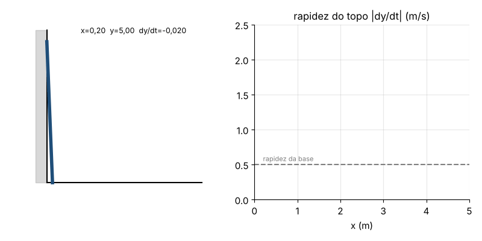

**Modelo.** $x$ = distância da base à parede, $y$ = altura do topo: $x^2+y^2=25$.

**Derivando em $t$:** $2x\,x'+2y\,y'=0\Rightarrow y'=-\dfrac{x}{y}\,x'$.

**(a)** $x=3\Rightarrow y=4$. Com $x'=0{,}5$: $y'=-\frac34(0{,}5)=-0{,}375$ m/s. O topo **desce** a $0{,}375$ m/s.

**(b)** $|y'|=|x'|\iff\frac xy=1\iff x=y=\frac5{\sqrt2}\approx3{,}54$ m.

**Observação.** Quando $y\to0$, $|y'|=\frac xy\,x'\to\infty$: o modelo prevê que o topo cai "infinitamente rápido" no fim. Na prática, a escada perde contato com a parede antes disso.

**Animação.** A escada escorrega; as setas mostram as velocidades da base (constante) e do topo (cada vez maior).

---

### 4.22 — A sombra no poste

*Origem: OpenStax, problema clássico de taxas relacionadas.*

> Uma pessoa de $1{,}8$ m se afasta de um poste de luz de 6 m de altura a $1{,}5$ m/s. (a) Com que rapidez sua sombra aumenta? (b) Com que rapidez a ponta da sombra se move?

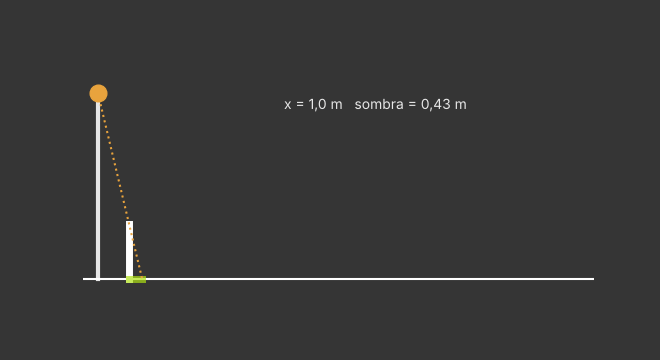

**Modelo.** $x$ = distância da pessoa ao poste, $s$ = comprimento da sombra. Por semelhança de triângulos (poste e pessoa, ambos com a ponta da sombra como vértice):
$$\frac{s}{1{,}8}=\frac{x+s}{6}\iff6s=1{,}8x+1{,}8s\iff s=\frac{3}{7}x .$$

**(a)** $s'=\frac37x'=\frac37(1{,}5)=\frac9{14}\approx0{,}64$ m/s (constante!).

**(b)** A ponta está em $x+s$: $(x+s)'=1{,}5+0{,}64=\frac{15}7\approx2{,}14$ m/s.

**Observação.** As taxas não dependem de onde a pessoa está, porque a relação entre $s$ e $x$ é **linear**.

**Animação.** A pessoa caminha, e a sombra (em laranja) cresce proporcionalmente à distância ao poste.

---

### 4.23 — Avião e radar

*Origem: OpenStax, inspirado no Exemplo 4.2 (avião).*

> Um avião voa horizontalmente a 4 km de altitude, a 600 km/h, numa trajetória que passa diretamente acima de uma estação de radar. Com que rapidez a distância avião–radar aumenta quando essa distância é 5 km (e o avião já passou da estação)?

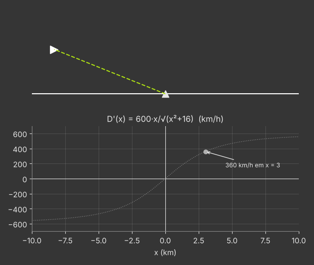

**Modelo.** $x$ = distância horizontal do avião à estação, $D$ = distância avião–radar: $D^2=x^2+16$.

**Derivando:** $2D\,D'=2x\,x'\Rightarrow D'=\dfrac{x}{D}\,x'$.

Quando $D=5$: $x=3$. Com $x'=600$: $D'=\frac35(600)=360$ km/h.

**Interpretação.** $\frac xD=\cos\theta$, onde $\theta$ é o ângulo entre a horizontal e a linha de visada: só a componente da velocidade **ao longo** da linha de visada afasta o avião do radar. Bem acima da estação, $x=0$ e $D'=0$; muito longe, $\frac xD\to1$ e $D'\to600$.

**Animação.** O avião passa sobre o radar; o gráfico mostra $D'(t)$ subindo de $-600$ a $600$ km/h.

---

### 4.28 — Método do intervalo fechado

*Origem: OpenStax, inspirado no Exemplo 4.13.*

> Encontre os valores máximo e mínimo absolutos de $f(x)=x\,e^{-x}$ em $[0,4]$.

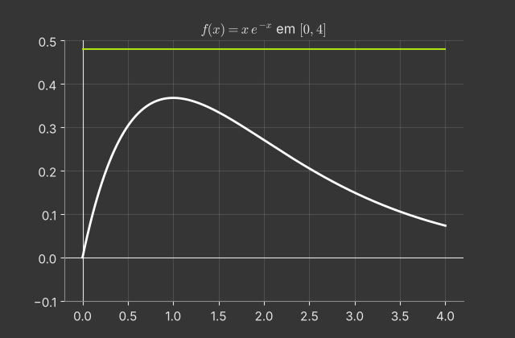

**Pontos críticos.** $f'(x)=e^{-x}-xe^{-x}=e^{-x}(1-x)$. Como $e^{-x}>0$, $f'=0\iff x=1$.

**Tabela de valores:**

| $x$ | $f(x)$ |
|---|---|
| $0$ (extremidade) | $0$ |
| $1$ (crítico) | $e^{-1}\approx0{,}368$ |
| $4$ (extremidade) | $4e^{-4}\approx0{,}073$ |

**Máximo absoluto:** $\frac1e$ em $x=1$. **Mínimo absoluto:** $0$ em $x=0$.

**Por que funciona?** $f$ é contínua em $[0,4]$ (Teorema do Valor Extremo: os extremos existem) e eles só podem estar em pontos críticos ou nas extremidades.

**Animação.** Uma reta horizontal desce desde o topo até tocar o gráfico (máximo) e sobe desde baixo até tocá-lo (mínimo).

---

### 4.29 — Teorema do Valor Médio

*Origem: OpenStax, inspirado no Exemplo 4.15.*

> Verifique as hipóteses do TVM para $f(x)=x^3-x$ em $[0,2]$ e encontre todos os $c$ garantidos pelo teorema.

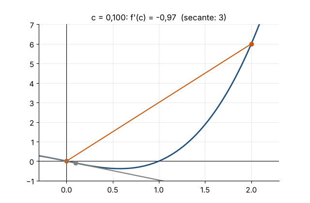

**Hipóteses.** $f$ é polinômio: contínua em $[0,2]$ e derivável em $(0,2)$. ✓

**Inclinação média:** $\dfrac{f(2)-f(0)}{2-0}=\dfrac{6-0}{2}=3$.

**Condição:** $f'(c)=3c^2-1=3\iff c^2=\frac43\iff c=\pm\frac2{\sqrt3}$. Só $c=\frac2{\sqrt3}\approx1{,}155$ está em $(0,2)$.

**Interpretação.** Nesse ponto a tangente é paralela à secante que liga $(0,0)$ a $(2,6)$.

**Animação.** A tangente percorre o gráfico; ela fica verde exatamente quando sua inclinação iguala a da secante.

---

### 4.38 — O limite $(1+a/x)^x$

*Origem: OpenStax, inspirado no Exemplo 4.43.*

> Mostre, com L'Hôpital, que $\displaystyle\lim_{x\to\infty}\Big(1+\frac ax\Big)^x=e^a$ para qualquer constante $a$. Use o resultado para calcular o montante de R\$ 1000 a 6% ao ano com capitalização contínua por 10 anos.

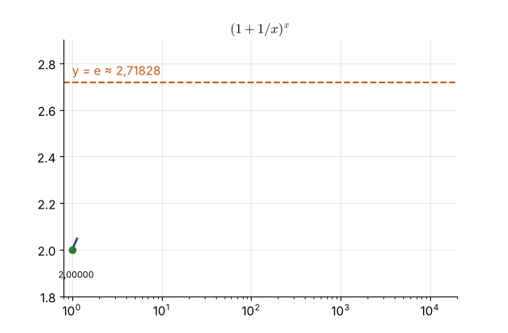

**Forma $1^\infty$.** Seja $y=\left(1+\frac ax\right)^x$. Então
$$\ln y=x\ln\!\left(1+\frac ax\right)=\frac{\ln(1+a/x)}{1/x}\quad\left(\text{forma }\tfrac00\right).$$
Por L'Hôpital (derivando em $x$):
$$\lim_{x\to\infty}\frac{\frac{1}{1+a/x}\cdot\left(-\frac a{x^2}\right)}{-\frac1{x^2}}=\lim_{x\to\infty}\frac{a}{1+a/x}=a .$$
Logo $\ln y\to a$ e $y\to e^a$.

**Juros.** Com capitalização $n$ vezes ao ano, o montante é $P\left(1+\frac rn\right)^{nt}=P\left[\left(1+\frac rn\right)^n\right]^t\to Pe^{rt}$.
Para $P=1000$, $r=0{,}06$, $t=10$: $1000e^{0{,}6}\approx1822{,}12$ reais.

**Animação.** O gráfico de $(1+a/x)^x$ para $a=1$ se aproxima da assíntota $y=e$; marcamos os valores para $x=1,10,100,\dots$

---

### 4.41 — Esboço completo de um gráfico

*Origem: OpenStax, inspirado na seção 4.6.*

> Faça o estudo completo e esboce $f(x)=\dfrac{x}{x^2+1}$: domínio, simetria, assíntotas, crescimento, extremos, concavidade e inflexões.

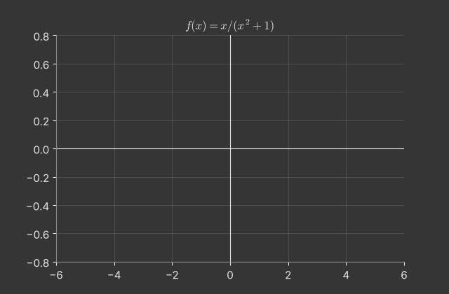

**1. Domínio e simetria.** $\mathbb R$ (o denominador nunca zera). $f(-x)=-f(x)$: **ímpar**, simétrica em relação à origem. Intercepto $(0,0)$.

**2. Assíntotas.** Não há verticais. $\lim_{x\to\pm\infty}\frac{x}{x^2+1}=0$: **assíntota horizontal $y=0$**.

**3. Primeira derivada.** $f'(x)=\dfrac{(x^2+1)-2x^2}{(x^2+1)^2}=\dfrac{1-x^2}{(x^2+1)^2}$.
Crescente em $(-1,1)$, decrescente em $(-\infty,-1)$ e $(1,\infty)$. **Máximo** $f(1)=\frac12$, **mínimo** $f(-1)=-\frac12$.

**4. Segunda derivada.** $f''(x)=\dfrac{2x(x^2-3)}{(x^2+1)^3}$. Sinal:
- $(-\infty,-\sqrt3)$: $-$ (côncava para baixo); $(-\sqrt3,0)$: $+$ (para cima);
- $(0,\sqrt3)$: $-$; $(\sqrt3,\infty)$: $+$.

**Inflexões** em $x=0$ e $x=\pm\sqrt3$, com $f(\pm\sqrt3)=\pm\frac{\sqrt3}{4}$.

**Animação.** O esboço é montado em camadas: assíntota, extremos, inflexões e, por fim, a curva.

---

### 4.42 — Cercado junto ao rio

*Origem: OpenStax, inspirado no Exemplo 4.32.*

> Um fazendeiro tem 600 m de cerca para construir um cercado retangular junto a um rio reto (sem cerca do lado do rio), dividido em dois currais por uma cerca perpendicular ao rio. Que dimensões maximizam a área total?

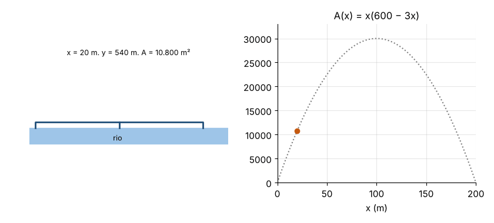

**Variáveis.** $x$ = lado perpendicular ao rio (há **três** desses segmentos: as duas laterais e a divisória), $y$ = lado paralelo ao rio (um segmento).

**Restrição:** $3x+y=600\Rightarrow y=600-3x$, com $0\le x\le200$.

**Área:** $A(x)=x(600-3x)=600x-3x^2$.

**Otimização:** $A'(x)=600-6x=0\iff x=100$. Como $A''=-6<0$ (ou $A(0)=A(200)=0$), é máximo.

Dimensões: $x=100$ m e $y=300$ m. Área máxima $30\,000$ m².

**Padrão.** No ótimo, a cerca total "paralela" ($y=300$) é igual à cerca total "perpendicular" ($3x=300$): metade da cerca para cada direção.

**Animação.** O retângulo muda de forma com a cerca total fixa; ao lado, o gráfico de $A(x)$ é traçado até o máximo.

---

### 4.43 — Ponto mais próximo

*Origem: OpenStax, inspirado na seção 4.7.*

> Encontre os pontos da parábola $y=x^2$ mais próximos do ponto $(0,3)$ e a distância mínima.

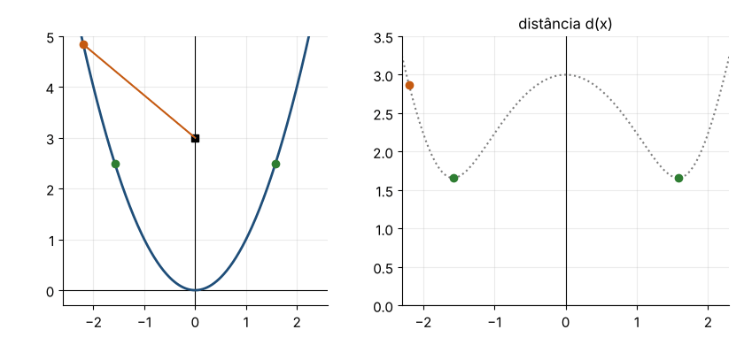

**Truque.** Minimizar $d$ é o mesmo que minimizar $d^2$ (sem a raiz, as contas ficam mais simples).

$$g(x)=d^2=x^2+(x^2-3)^2=x^4-5x^2+9 .$$

$g'(x)=4x^3-10x=2x(2x^2-5)=0\iff x=0$ ou $x=\pm\sqrt{5/2}$.

- $g(0)=9$ (é **máximo local** de $g$: o vértice da parábola está a distância 3);
- $g(\pm\sqrt{5/2})=\frac{25}4-\frac{25}2+9=\frac{11}4$.

Como $g\to\infty$ quando $|x|\to\infty$, o mínimo absoluto é $\frac{11}4$: os pontos são $\left(\pm\sqrt{\tfrac52},\tfrac52\right)$ e a distância mínima é $\frac{\sqrt{11}}2\approx1{,}658$.

**Geometria.** No ponto mais próximo, o segmento até $(0,3)$ é **perpendicular** à tangente: inclinação da tangente $2x=\sqrt{10}$, inclinação do segmento $\frac{5/2-3}{\sqrt{5/2}}=-\frac1{\sqrt{10}}$; o produto é $-1$. ✓

**Animação.** Um ponto percorre a parábola ligado a $(0,3)$; o gráfico de $d(x)$ mostra os dois mínimos.

---

### 4.44 — O cabo mais barato

*Origem: OpenStax, inspirado no Exemplo 4.34.*

> Uma usina fica numa margem de um rio de 1 km de largura. Uma fábrica fica na outra margem, 3 km rio abaixo. O cabo custa R\$ 5 mil/km sob a água e R\$ 4 mil/km em terra. Qual é o trajeto mais barato (atravessar em diagonal até um ponto e seguir pela margem)?

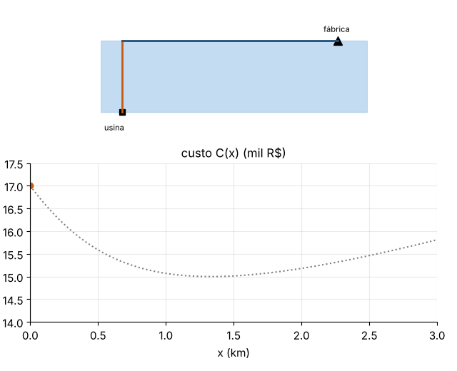

**Variável.** $x$ = distância rio abaixo, na outra margem, até o ponto onde o cabo sai da água ($0\le x\le3$).

**Custo:** trecho na água $\sqrt{1+x^2}$, trecho em terra $3-x$:
$$C(x)=5\sqrt{1+x^2}+4(3-x).$$

$C'(x)=\dfrac{5x}{\sqrt{1+x^2}}-4=0\iff5x=4\sqrt{1+x^2}\iff25x^2=16+16x^2\iff x=\tfrac43 .$

**Comparação:** $C(0)=5+12=17$; $C(\tfrac43)=5\cdot\tfrac53+4\cdot\tfrac53=15$; $C(3)=5\sqrt{10}\approx15{,}81$.

O mínimo é **R\$ 15 mil**, atravessando até $\frac43$ km rio abaixo.

**Observação (lei de Snell).** No ótimo, $\frac{x}{\sqrt{1+x^2}}=\frac45$: o seno do ângulo de travessia é a razão entre os custos, como na refração da luz.

**Animação.** O ponto de saída desliza ao longo da margem; o gráfico de $C(x)$ registra o custo.

---

### 4.45 — Método de Newton para $\cos x=x$

*Origem: OpenStax, inspirado no Exemplo 4.46.*

> Use o método de Newton com $x_0=1$ para aproximar a solução de $\cos x=x$ com 9 casas decimais. Quantas iterações são necessárias?

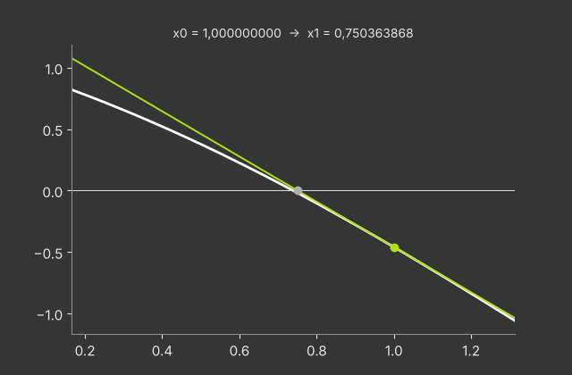

**Função.** $f(x)=\cos x-x$, $f'(x)=-\sin x-1$. Iteração:
$$x_{n+1}=x_n-\frac{\cos x_n-x_n}{-\sin x_n-1}=x_n+\frac{\cos x_n-x_n}{\sin x_n+1}.$$

| $n$ | $x_n$ |
|---|---|
| 0 | 1 |
| 1 | 0,750363868 |
| 2 | 0,739112891 |
| 3 | 0,739085133 |
| 4 | 0,739085133 |

A partir de $x_3$, as 9 casas se estabilizam: $x\approx0{,}739085133$.

**Convergência quadrática.** Os erros são aproximadamente $2{,}6\times10^{-1}$, $1{,}1\times10^{-2}$, $2{,}8\times10^{-5}$, $1{,}8\times10^{-10}$: o número de casas corretas **dobra** a cada passo.

**Animação.** Cada passo traça a tangente em $(x_n,f(x_n))$ e desce até o eixo, revelando $x_{n+1}$; o gráfico é ampliado a cada iteração.

---

### 4.46 — Lançamento vertical

*Origem: OpenStax, inspirado no Exemplo 4.54.*

> Uma bola é lançada para cima a partir de 2 m de altura com velocidade de 15 m/s ($g=9{,}8$ m/s²). Partindo de $a(t)=-9{,}8$, encontre $v(t)$ e $s(t)$, a altura máxima e o instante em que a bola atinge o chão.

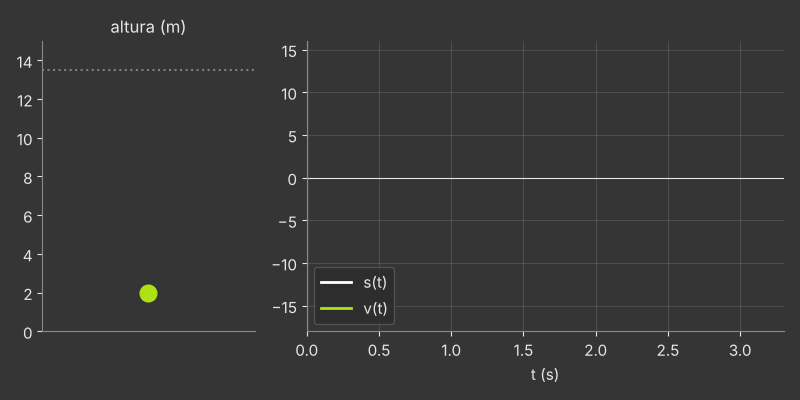

**Antiderivando.** $v(t)=\int-9{,}8\,dt=-9{,}8t+C_1$; $v(0)=15\Rightarrow v(t)=15-9{,}8t$.
$s(t)=\int v\,dt=15t-4{,}9t^2+C_2$; $s(0)=2\Rightarrow s(t)=-4{,}9t^2+15t+2$.

**Altura máxima.** $v=0\iff t=\frac{15}{9{,}8}\approx1{,}531$ s, com $s\approx2+\frac{15^2}{2\cdot9{,}8}\approx13{,}48$ m.

**Chão.** $-4{,}9t^2+15t+2=0\Rightarrow t=\dfrac{15+\sqrt{225+39{,}2}}{9{,}8}\approx3{,}19$ s (a raiz negativa é descartada).

**Velocidade de impacto:** $v(3{,}19)\approx-16{,}25$ m/s, um pouco maior em módulo que a de lançamento, porque a bola caiu 2 m a mais do que subiu.

**Animação.** A bola sobe e desce; ao lado, os gráficos de $s(t)$ e $v(t)$ são traçados juntos.

---
