# Capítulo 5 — Integração: exercícios

São 65 exercícios. Os pontos antes de cada número indicam a dificuldade: **•** fácil, **••** médio, **•••** difícil e **••••** desafio. Tente resolver antes de abrir a resposta. Os marcados com ★ têm [solução completa com animação](#soluções-completas).

Muitos enunciados são adaptados de *Calculus Volume 1* (OpenStax, CC BY-NC-SA 4.0).

## Lista

`•` **5.1** Calcule $\displaystyle\sum_{i=1}^{20}(3i-2)$ e $\displaystyle\sum_{i=1}^{10}i^2$ usando as fórmulas de somatório.

Resposta

$590$ e $385$.

`•` **5.2** Calcule $L_4$ e $R_4$ para $f(x)=x^2+1$ em $[0,2]$. Qual subestima a área? Por quê?

Resposta

$L_4=3{,}75$; $R_4=5{,}75$; $L_4$ subestima, pois $f$ é crescente.

`•` **5.3** Calcule a soma do ponto médio $M_4$ para $f(x)=\dfrac1x$ em $[1,3]$.

Resposta

$M_4=\tfrac{2}{5}+\tfrac27+\tfrac29+\tfrac2{11}\approx1{,}0898$ (exato: $\ln3\approx1{,}0986$).

`•` **5.4** Interprete $\int_0^3\sqrt{9-x^2}\,dx$ como área e calcule-a sem antiderivadas.

Resposta

Um quarto do círculo de raio 3: $\tfrac{9\pi}4$.

`•` **5.5** Use áreas de figuras geométricas para calcular $\int_{-2}^{4}|x-1|\,dx$.

Resposta

$\tfrac92+\tfrac92=9$.

`•` **5.6** Sabendo que $\int_0^5f=7$, $\int_0^3f=4$ e $\int_0^5g=-2$, calcule $\int_3^5f$, $\int_5^0(2f-3g)$ e $\int_3^3g$.

Resposta

$3$; $-20$; $0$.

`•` **5.7** Calcule o valor médio de $f(x)=x^2$ em $[0,3]$ e encontre $c$ com $f(c)=f_{\text{méd}}$.

Resposta

$3$; $c=\sqrt3$.

`•` **5.8** Calcule $\dfrac{d}{dx}\displaystyle\int_2^x\frac{\operatorname{sen} t}{t}\,dt$ e $\dfrac{d}{dx}\displaystyle\int_0^{x^3}\sqrt{1+t^2}\,dt$.

Resposta

$\tfrac{\operatorname{sen} x}x$; $3x^2\sqrt{1+x^6}$.

`•` **5.9** Calcule $\displaystyle\int_1^2\Big(3x^2-\frac2{x^3}\Big)dx$.

Resposta

$\tfrac{25}4$.

`•` **5.10** Calcule $\displaystyle\int_0^{\pi/3}\sec^2x\,dx$ e $\displaystyle\int_0^{\pi}(\cos x+2)\,dx$.

Resposta

$\sqrt3$; $2\pi$.

`•` **5.11** Calcule $\displaystyle\int_1^4\frac{x-1}{\sqrt x}\,dx$.

Resposta

$\tfrac83$.

`•` **5.12** Calcule $\displaystyle\int_0^1(e^x-2^x)\,dx$.

Resposta

$e-1-\tfrac1{\ln2}\approx0{,}276$.

`•` **5.13** Calcule $\displaystyle\int(2x+1)^7\,dx$ e $\displaystyle\int\cos(3x-1)\,dx$.

Resposta

$\tfrac{(2x+1)^8}{16}+C$; $\tfrac13\operatorname{sen}(3x-1)+C$.

`•` **5.14** Calcule $\displaystyle\int x\sqrt{x^2+1}\,dx$.

Resposta

$\tfrac13(x^2+1)^{3/2}+C$.

`•` **5.15** Calcule $\displaystyle\int\frac{x}{x^2+4}\,dx$ e $\displaystyle\int\frac{dx}{2x+5}$.

Resposta

$\tfrac12\ln(x^2+4)+C$; $\tfrac12\ln|2x+5|+C$.

`•` **5.16** Calcule $\displaystyle\int e^{5x}\,dx$ e $\displaystyle\int x^2e^{x^3}\,dx$.

Resposta

$\tfrac15e^{5x}+C$; $\tfrac13e^{x^3}+C$.

`•` **5.17** Calcule $\displaystyle\int\frac{dx}{\sqrt{9-x^2}}$ e $\displaystyle\int\frac{dx}{16+x^2}$.

Resposta

$\operatorname{arcsen}\tfrac x3+C$; $\tfrac14\operatorname{arctg}\tfrac x4+C$.

`•` **5.18** Calcule $\displaystyle\int_0^{\pi/2}\operatorname{sen} x\cos^3x\,dx$.

Resposta

$\tfrac14$.

`•` **5.19** Calcule $\displaystyle\int_{-1}^{1}(x^5-3x^3+x^2)\,dx$ usando simetria.

Resposta

$\tfrac23$.

`•` **5.20** Uma partícula tem $v(t)=2t-4$ m/s em $[0,5]$. Calcule o deslocamento e a distância percorrida.

Resposta

$5$ m e $13$ m.

`••` **5.21** **Somas de Riemann convergindo.** Para $f(x)=4-x^2$ em $[0,2]$, calcule $L_4$ e $R_4$, escreva $R_n$ em função de $n$ e encontre a área exata como $\lim_{n\to\infty}R_n$. ★ [ver solução](#ex-5-21)

Resposta

$L_4=6{,}25$; $R_4=4{,}25$; $R_n=8-\tfrac{4(n+1)(2n+1)}{3n^2}$; área $\tfrac{16}3$.

`••` **5.22** **Integral pela definição.** Use a definição (limite de somas de Riemann com extremidades direitas) para calcular $\int_0^1x^3\,dx$. ★ [ver solução](#ex-5-22)

Resposta

$\tfrac14$.

`••` **5.23** Escreva $\displaystyle\lim_{n\to\infty}\sum_{i=1}^n\Big(1+\frac{2i}n\Big)^2\frac2n$ como integral definida e calcule.

Resposta

$\int_1^3x^2\,dx=\tfrac{26}3$.

`••` **5.24** Mostre, sem calcular, que $2\le\displaystyle\int_0^2\sqrt{1+x^3}\,dx\le6$.

Resposta

$1\le\sqrt{1+x^3}\le3$ em $[0,2]$.

`••` **5.25** **A função área.** Seja $g(x)=\displaystyle\int_0^x(t-1)(t-3)\,dt$ para $0\le x\le4$. Use o TFC para encontrar $g'(x)$, os intervalos em que $g$ cresce e decresce, e os extremos locais de $g$. Calcule $g(1)$, $g(3)$ e $g(4)$. ★ [ver solução](#ex-5-25)

Resposta

$g'(x)=(x-1)(x-3)$; máx. local $g(1)=\tfrac43$; mín. local $g(3)=0$; $g(4)=\tfrac43$.

`••` **5.26** **TFC com limites variáveis.** Calcule $\dfrac{d}{dx}\displaystyle\int_x^{x^2}e^{t^2}\,dt$. ★ [ver solução](#ex-5-26)

Resposta

$2x\,e^{x^4}-e^{x^2}$.

`••` **5.27** Calcule $\dfrac{d}{dx}\displaystyle\int_{\cos x}^{1}\frac{dt}{1+t^2}$.

Resposta

$\dfrac{\operatorname{sen} x}{1+\cos^2x}$.

`••` **5.28** Calcule $\displaystyle\int_0^3|x^2-4|\,dx$.

Resposta

$\tfrac{23}3$.

`••` **5.29** **Deslocamento e distância.** Uma partícula tem velocidade $v(t)=3t^2-12t+9$ m/s para $0\le t\le4$. Calcule o deslocamento e a distância percorrida. Se $s(0)=2$, onde ela está em $t=4$? ★ [ver solução](#ex-5-29)

Resposta

Deslocamento 4 m; distância 12 m; $s(4)=6$.

`••` **5.30** **Valor médio de uma função.** Calcule o valor médio de $f(x)=\operatorname{sen} x$ em $[0,\pi]$ e encontre todos os $c$ garantidos pelo TVM para integrais. ★ [ver solução](#ex-5-30)

Resposta

$f_{\text{méd}}=\tfrac2\pi\approx0{,}637$; $c=\operatorname{arcsen}\tfrac2\pi\approx0{,}690$ ou $c=\pi-0{,}690\approx2{,}451$.

`••` **5.31** Calcule $\displaystyle\int x\sqrt{x+2}\,dx$.

Resposta

$\tfrac25(x+2)^{5/2}-\tfrac43(x+2)^{3/2}+C$.

`••` **5.32** Calcule $\displaystyle\int\frac{\cos x}{\operatorname{sen}^2x}\,dx$ e $\displaystyle\int\sec^2x\,\operatorname{tg}^3x\,dx$.

Resposta

$-\operatorname{cossec} x+C$; $\tfrac14\operatorname{tg}^4x+C$.

`••` **5.33** **Substituição em integral definida.** Calcule $\displaystyle\int_0^2x\sqrt{4-x^2}\,dx$ trocando os limites de integração, e interprete a substituição geometricamente. ★ [ver solução](#ex-5-33)

Resposta

$\tfrac83$.

`••` **5.34** Calcule $\displaystyle\int_0^{1}\frac{e^x}{1+e^x}\,dx$.

Resposta

$\ln\tfrac{1+e}2\approx0{,}620$.

`••` **5.35** Calcule $\displaystyle\int\frac{(\ln x)^2}{x}\,dx$ e $\displaystyle\int\frac{dx}{x\ln x}$.

Resposta

$\tfrac13(\ln x)^3+C$; $\ln|\ln x|+C$.

`••` **5.36** Calcule $\displaystyle\int\frac{e^{x}}{1+e^{2x}}\,dx$.

Resposta

$\operatorname{arctg}(e^x)+C$.

`••` **5.37** Calcule $\displaystyle\int_0^{1/2}\frac{dx}{\sqrt{1-x^2}}$ e $\displaystyle\int_{0}^{\sqrt3}\frac{dx}{1+x^2}$.

Resposta

$\tfrac\pi6$; $\tfrac\pi3$.

`••` **5.38** Calcule $\displaystyle\int\frac{dx}{x^2-6x+13}$ completando o quadrado.

Resposta

$\tfrac12\operatorname{arctg}\tfrac{x-3}2+C$.

`••` **5.39** **Simetria salva contas.** Calcule $\displaystyle\int_{-\pi}^{\pi}\big(x^3\cos x+2\cos x+x\big)\,dx$ usando simetria. ★ [ver solução](#ex-5-39)

Resposta

$0$.

`••` **5.40** Calcule $\displaystyle\int\frac{x+3}{x^2+1}\,dx$ (separe em duas integrais).

Resposta

$\tfrac12\ln(x^2+1)+3\operatorname{arctg} x+C$.

`•••` **5.41** **Calculando $\pi$ com uma integral.** Mostre que $\displaystyle\int_0^1\frac{4}{1+x^2}\,dx=\pi$ e use a regra do ponto médio com $n=4$ para estimar $\pi$. ★ [ver solução](#ex-5-41)

Resposta

$4\operatorname{arctg}1=\pi$; $M_4\approx3{,}14680$.

`•••` **5.42** **Vazão e volume.** Água entra num tanque à taxa $r(t)=200-4t$ L/min, $0\le t\le50$, que inicialmente tem 1000 L. Quanto há no tanque em $t=50$? Em que instante o volume cresce mais rapidamente? Esboce $V(t)$. ★ [ver solução](#ex-5-42)

Resposta

$6000$ L; em $t=0$; $V(t)=1000+200t-2t^2$, parábola crescente até o vértice em $t=50$.

`•••` **5.43** **Integral da tangente e da secante.** Mostre que $\int\operatorname{tg} x\,dx=\ln|\sec x|+C$ e que $\int\sec x\,dx=\ln|\sec x+\operatorname{tg} x|+C$. Calcule $\int_0^{\pi/4}\sec x\,dx$. ★ [ver solução](#ex-5-43)

Resposta

$\ln(\sqrt2+1)\approx0{,}8814$.

`•••` **5.44** Use somas de Riemann (extremidades direitas) para calcular $\int_1^3(2x+1)\,dx$ pela definição.

Resposta

$10$.

`•••` **5.45** Encontre $f$ contínua e a constante $a$ tais que $\displaystyle6+\int_a^x\frac{f(t)}{t^2}\,dt=2\sqrt x$ para $x>0$.

Resposta

$f(x)=x^{3/2}$, $a=9$.

`•••` **5.46** Encontre os extremos locais e os pontos de inflexão de $F(x)=\displaystyle\int_0^x\frac{t-2}{1+t^2}\,dt$, $x\ge0$.

Resposta

Mín. local em $x=2$; inflexão em $x=2+\sqrt5$.

`•••` **5.47** Calcule $\displaystyle\lim_{x\to0}\frac1{x^3}\int_0^x\operatorname{sen}(t^2)\,dt$.

Resposta

$\tfrac13$ (L'Hôpital + TFC).

`•••` **5.48** Calcule $\displaystyle\int_0^{\pi}|\cos x|\,dx$ e $\displaystyle\int_0^{2\pi}|\operatorname{sen} x-\cos x|\,dx$.

Resposta

$2$; $4\sqrt2$.

`•••` **5.49** A taxa de vendas de um produto é $r(t)=100\,t\,e^{-t^2/10}$ unidades/semana. Quantas unidades são vendidas nas 4 primeiras semanas? E no longo prazo?

Resposta

$500(1-e^{-1{,}6})\approx399$; tende a $500$.

`•••` **5.50** Calcule $\displaystyle\int\frac{x^3}{\sqrt{1-x^2}}\,dx$ (dica: $u=1-x^2$).

Resposta

$-\sqrt{1-x^2}+\tfrac13(1-x^2)^{3/2}+C$.

`•••` **5.51** Calcule $\displaystyle\int\frac{dx}{\sqrt{e^{2x}-1}}$ (dica: $u=e^x$).

Resposta

$\operatorname{arcsec}(e^x)+C$.

`•••` **5.52** Calcule $\displaystyle\int\frac{\operatorname{sen} x}{1+\cos^2x}\,dx$ e $\displaystyle\int\frac{dx}{x\sqrt{x^2-4}}$.

Resposta

$-\operatorname{arctg}(\cos x)+C$; $\tfrac12\operatorname{arcsec}\tfrac{|x|}2+C$.

`•••` **5.53** Calcule $\displaystyle\int\frac{dx}{\sqrt{-x^2+4x}}$ completando o quadrado.

Resposta

$\operatorname{arcsen}\tfrac{x-2}2+C$.

`•••` **5.54** Mostre que, se $f$ é contínua e periódica de período $T$, então $\int_a^{a+T}f$ não depende de $a$.

Resposta

Derive $G(a)=\int_a^{a+T}f$: $G'(a)=f(a+T)-f(a)=0$.

`•••` **5.55** Um carro freia com $a(t)=-8$ m/s² a partir de $30$ m/s. Use integrais para achar a distância até parar.

Resposta

$56{,}25$ m.

`•••` **5.56** O valor eficaz (RMS) de $f$ em $[a,b]$ é $\sqrt{\tfrac1{b-a}\int_a^bf^2}$. Calcule o RMS de $f(t)=\operatorname{sen} t$ em $[0,2\pi]$. (Dica: $\operatorname{sen}^2t=\tfrac{1-\cos2t}2$.)

Resposta

$\tfrac1{\sqrt2}\approx0{,}707$.

`•••` **5.57** Seja $g(x)=\int_0^x f(t)\,dt$, com $f$ crescente e $f(0)=0$. Mostre que $g$ é côncava para cima e que $g(x)\ge0$ para $x\ge0$.

Resposta

$g''=f'\ge0$; $g$ acumula valores $f(t)\ge0$.

`•••` **5.58** Calcule $\displaystyle\lim_{n\to\infty}\frac1n\sum_{i=1}^n\sqrt{\frac in}$ interpretando como integral.

Resposta

$\int_0^1\sqrt x\,dx=\tfrac23$.

`•••` **5.59** Calcule $\displaystyle\lim_{n\to\infty}\sum_{i=1}^n\frac{n}{n^2+i^2}$.

Resposta

$\int_0^1\tfrac{dx}{1+x^2}=\tfrac\pi4$.

`•••` **5.60** Calcule $\displaystyle\int_0^{\ln2}e^x\sqrt{e^x-1}\,dx$ e $\displaystyle\int_1^{e^2}\frac{dx}{x\sqrt{\ln x}}$.

Resposta

$\tfrac23$; $2\sqrt2$.

`••••` **5.61** Prove que $\displaystyle\int_0^{\pi/2}\frac{\operatorname{sen}^nx}{\operatorname{sen}^nx+\cos^nx}\,dx=\frac\pi4$ para todo $n>0$. (Dica: $u=\tfrac\pi2-x$.)

Resposta

A integral $I$ satisfaz $I=\int_0^{\pi/2}\tfrac{\cos^n}{\operatorname{sen}^n+\cos^n}$; some as duas: $2I=\tfrac\pi2$.

`••••` **5.62** Mostre que $\ln x=\int_1^x\frac{dt}{t}$ satisfaz $\ln(ab)=\ln a+\ln b$ usando apenas propriedades da integral e substituição.

Resposta

$\int_a^{ab}\tfrac{dt}t=\int_1^b\tfrac{du}u$ com $t=au$.

`••••` **5.63** Calcule $\displaystyle\int_0^1\frac{\ln(1+x)}{1+x^2}\,dx$. (Dica: $x=\operatorname{tg}\theta$ e depois $\theta\mapsto\tfrac\pi4-\theta$.)

Resposta

$\tfrac\pi8\ln2$.

`••••` **5.64** Encontre todas as funções contínuas $f$ com $\displaystyle\int_0^xf(t)\,dt=x^2+\int_x^1t^2f(t)\,dt$ para todo $x$.

Resposta

Nenhuma: derivando, $f=\tfrac{2x}{1+x^2}$, mas em $x=0$ seria preciso $\int_0^1t^2f=0$, e essa integral vale $1-\ln2$.

`••••` **5.65** Prove a desigualdade $\ln(1+n)<1+\tfrac12+\dots+\tfrac1n<1+\ln n$ comparando somas com $\int\frac{dx}x$.

Resposta

Retângulos acima e abaixo de $y=1/x$ em $[1,n+1]$ e $[1,n]$.

## Soluções completas

### 5.21 — Somas de Riemann convergindo

*Origem: OpenStax, inspirado no Exemplo 5.1.*

> Para $f(x)=4-x^2$ em $[0,2]$, calcule $L_4$ e $R_4$, escreva $R_n$ em função de $n$ e encontre a área exata como $\lim_{n\to\infty}R_n$.

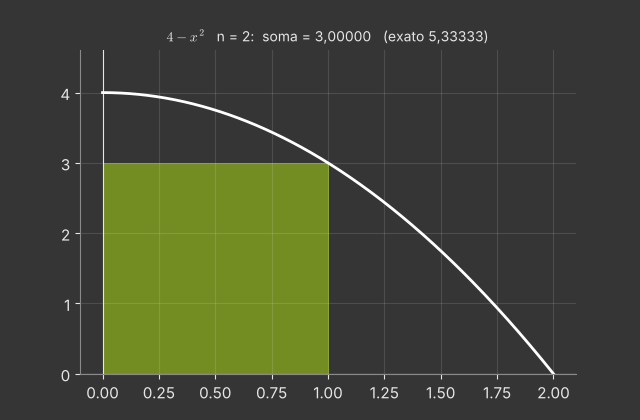

$\Delta x=\frac2n$ e $x_i=\frac{2i}n$.

**$n=4$** ($\Delta x=0{,}5$): valores de $f$ em $0;\,0{,}5;\,1;\,1{,}5;\,2$: $4;\ 3{,}75;\ 3;\ 1{,}75;\ 0$.
$L_4=0{,}5(4+3{,}75+3+1{,}75)=6{,}25$ e $R_4=0{,}5(3{,}75+3+1{,}75+0)=4{,}25$.
Como $f$ é **decrescente**, agora $L_n$ superestima e $R_n$ subestima.

**$R_n$ geral:**
$$R_n=\sum_{i=1}^n\Big(4-\frac{4i^2}{n^2}\Big)\frac2n=\frac8n\cdot n-\frac{8}{n^3}\cdot\frac{n(n+1)(2n+1)}6=8-\frac{4(n+1)(2n+1)}{3n^2}.$$

**Limite:** $\frac{(n+1)(2n+1)}{n^2}\to2$, logo $R_n\to8-\frac83=\frac{16}3\approx5{,}333$.

**Conferência pelo TFC:** $\int_0^2(4-x^2)\,dx=\left[4x-\frac{x^3}3\right]_0^2=8-\frac83=\frac{16}3$. ✓

**Animação.** $n$ cresce de 2 a 64; os retângulos (pela direita) preenchem a região e $R_n$ se aproxima de $16/3$.

---

### 5.22 — Integral pela definição

*Origem: OpenStax, inspirado na seção 5.2.*

> Use a definição (limite de somas de Riemann com extremidades direitas) para calcular $\int_0^1x^3\,dx$.

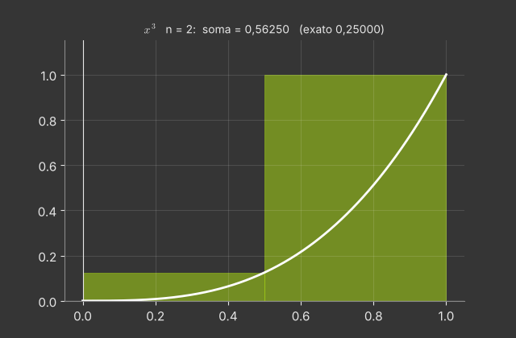

$\Delta x=\frac1n$, $x_i=\frac in$:
$$R_n=\sum_{i=1}^n\Big(\frac in\Big)^3\frac1n=\frac1{n^4}\sum_{i=1}^ni^3=\frac1{n^4}\cdot\frac{n^2(n+1)^2}{4}=\frac{(n+1)^2}{4n^2}.$$
Quando $n\to\infty$, $\frac{(n+1)^2}{n^2}\to1$, então $\int_0^1x^3\,dx=\frac14$.

**Valores intermediários:** $R_4=\frac{25}{64}\approx0{,}391$; $R_{10}=0{,}3025$; $R_{100}=0{,}255025$.

**Lição.** O cálculo pela definição exige a fórmula de $\sum i^3$; o TFC dá o mesmo resultado em uma linha, $\left[\frac{x^4}4\right]_0^1=\frac14$. Os dois caminhos concordam, e é exatamente isso que o teorema garante.

**Animação.** Os retângulos ficam cada vez mais finos e o valor de $R_n$ desce até $0{,}25$.

---

### 5.25 — A função área

*Origem: OpenStax, inspirado na seção 5.3.*

> Seja $g(x)=\displaystyle\int_0^x(t-1)(t-3)\,dt$ para $0\le x\le4$. Use o TFC para encontrar $g'(x)$, os intervalos em que $g$ cresce e decresce, e os extremos locais de $g$. Calcule $g(1)$, $g(3)$ e $g(4)$.

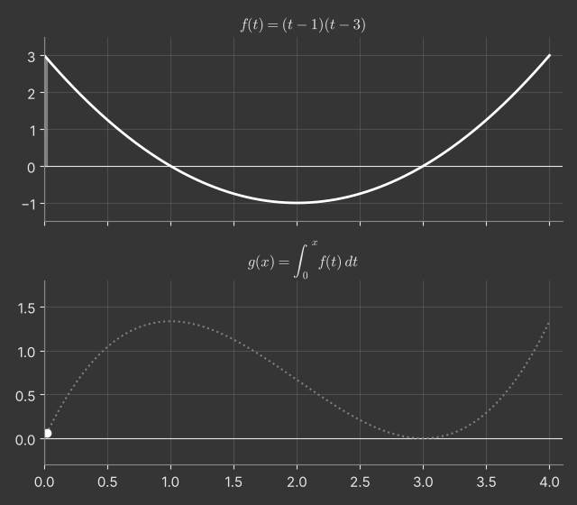

**TFC 1:** $g'(x)=(x-1)(x-3)$.

- $g'>0$ em $[0,1)$ e $(3,4]$: $g$ cresce (a área acumulada aumenta, pois o integrando é positivo);
- $g'<0$ em $(1,3)$: $g$ decresce (o integrando é negativo e "desconta" área).

**Extremos locais:** máximo em $x=1$ e mínimo em $x=3$.

**Valores** (pelo TFC 2, com $\int(t^2-4t+3)\,dt=\frac{t^3}3-2t^2+3t$):
$g(1)=\frac13-2+3=\frac43$; $g(3)=9-18+9=0$; $g(4)=\frac{64}3-32+12=\frac43$.

**Leitura geométrica.** De 0 a 1 acumulamos $\frac43$ de área positiva; de 1 a 3 perdemos $\frac43$ (a região abaixo do eixo); de 3 a 4 ganhamos $\frac43$ de novo.

**Animação.** À esquerda, a região sob $f$ é varrida (azul onde $f>0$, laranja onde $f<0$); à direita, o gráfico de $g(x)$ é desenhado ao mesmo tempo.

---

### 5.26 — TFC com limites variáveis

*Origem: OpenStax, inspirado na seção 5.3.*

> Calcule $\dfrac{d}{dx}\displaystyle\int_x^{x^2}e^{t^2}\,dt$.

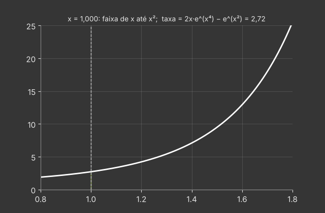

**Ideia.** Dividimos a integral num ponto fixo (qualquer, por exemplo $0$):
$$\int_x^{x^2}e^{t^2}dt=\int_0^{x^2}e^{t^2}dt-\int_0^{x}e^{t^2}dt .$$

**Derivando cada parte (TFC 1 + cadeia):**
- $\frac{d}{dx}\int_0^{x^2}e^{t^2}dt=e^{(x^2)^2}\cdot2x=2x\,e^{x^4}$;
- $\frac{d}{dx}\int_0^{x}e^{t^2}dt=e^{x^2}$.

**Resultado:** $2x\,e^{x^4}-e^{x^2}$.

**Regra geral:** $\frac{d}{dx}\int_{a(x)}^{b(x)}f(t)\,dt=f(b(x))\,b'(x)-f(a(x))\,a'(x)$.

**Observação.** $e^{t^2}$ **não tem antiderivada elementar**, mas o TFC nos dá a derivada da integral mesmo assim.

**Animação.** A faixa entre $x$ e $x^2$ sob $e^{t^2}$ muda de tamanho conforme $x$ varia (para $1\le x\le1{,}3$); a taxa de variação da área é a derivada calculada.

---

### 5.29 — Deslocamento e distância

*Origem: OpenStax, inspirado no Exemplo 5.3 e na seção 5.4.*

> Uma partícula tem velocidade $v(t)=3t^2-12t+9$ m/s para $0\le t\le4$. Calcule o deslocamento e a distância percorrida. Se $s(0)=2$, onde ela está em $t=4$?

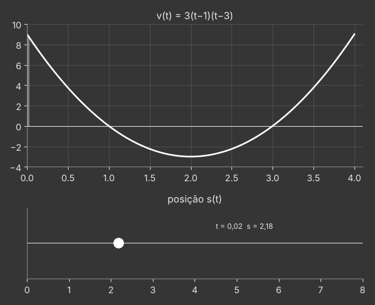

$v(t)=3(t-1)(t-3)$; uma antiderivada é $s_0(t)=t^3-6t^2+9t$.

**Deslocamento:** $\int_0^4v\,dt=s_0(4)-s_0(0)=64-96+36=4$ m.

**Distância:** separamos os intervalos de sinal:
- $\int_0^1v=s_0(1)-s_0(0)=4$ (para a frente);
- $\int_1^3v=s_0(3)-s_0(1)=0-4=-4$ (para trás);
- $\int_3^4v=s_0(4)-s_0(3)=4-0=4$ (para a frente).

Distância $=4+4+4=12$ m.

**Posição final:** $s(4)=s(0)+\int_0^4v=2+4=6$ (Teorema da Variação Total).

**Animação.** Em cima, o gráfico de $v(t)$ com as áreas acumuladas (azul positiva, laranja negativa); embaixo, a partícula se movendo na reta.

---

### 5.30 — Valor médio de uma função

*Origem: OpenStax, inspirado na seção 5.2.*

> Calcule o valor médio de $f(x)=\operatorname{sen} x$ em $[0,\pi]$ e encontre todos os $c$ garantidos pelo TVM para integrais.

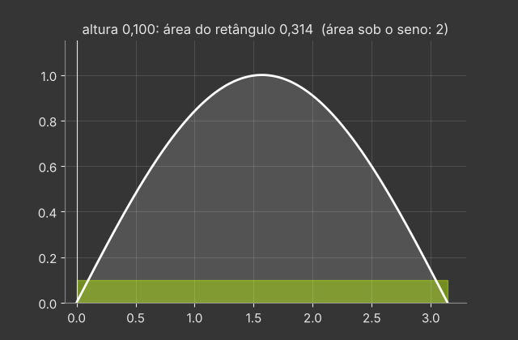

$$f_{\text{méd}}=\frac1{\pi-0}\int_0^\pi\operatorname{sen} x\,dx=\frac{[-\cos x]_0^\pi}{\pi}=\frac2\pi\approx0{,}6366 .$$

**Pontos $c$:** $\operatorname{sen} c=\frac2\pi\Rightarrow c=\operatorname{arcsen}\frac2\pi\approx0{,}6901$ ou $c=\pi-0{,}6901\approx2{,}4515$ (ambos em $[0,\pi]$).

**Interpretação geométrica.** O retângulo de base $[0,\pi]$ e altura $\frac2\pi$ tem área $2$, a mesma da região sob o arco do seno. A parte do arco acima do retângulo compensa exatamente os "cantos" vazios.

**Aplicação.** Se uma tensão alternada é $V_p\operatorname{sen}\omega t$, a média de $|V|$ num semiciclo é $\frac2\pi V_p\approx0{,}637V_p$.

**Animação.** A altura de um retângulo varia até que sua área iguale a área sob o seno; os pontos $c$ aparecem no fim.

---

### 5.33 — Substituição em integral definida

*Origem: OpenStax, inspirado na seção 5.5.*

> Calcule $\displaystyle\int_0^2x\sqrt{4-x^2}\,dx$ trocando os limites de integração, e interprete a substituição geometricamente.

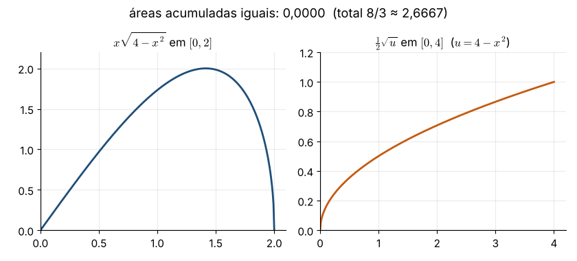

**Substituição:** $u=4-x^2$, $du=-2x\,dx\Rightarrow x\,dx=-\frac12du$.

**Limites:** $x=0\mapsto u=4$; $x=2\mapsto u=0$.
$$\int_0^2x\sqrt{4-x^2}\,dx=-\frac12\int_4^0u^{1/2}du=\frac12\int_0^4u^{1/2}du=\frac12\cdot\frac23\left[u^{3/2}\right]_0^4=\frac13\cdot8=\frac83 .$$

**Erro comum.** Esquecer de trocar os limites (ou trocar e depois voltar para $x$ sem querer). Escolha **um** caminho: ou troca os limites e fica em $u$, ou volta para $x$ e usa os limites originais.

**Interpretação.** A substituição transforma a região sob $x\sqrt{4-x^2}$ em $[0,2]$ na região sob $\frac12\sqrt u$ em $[0,4]$: formatos diferentes, **mesma área**.

**Animação.** As duas regiões aparecem lado a lado, sendo preenchidas em sincronia ($x\mapsto u=4-x^2$); as áreas acumuladas são sempre iguais.

---

### 5.39 — Simetria salva contas

*Origem: OpenStax, inspirado na seção 5.4.*

> Calcule $\displaystyle\int_{-\pi}^{\pi}\big(x^3\cos x+2\cos x+x\big)\,dx$ usando simetria.

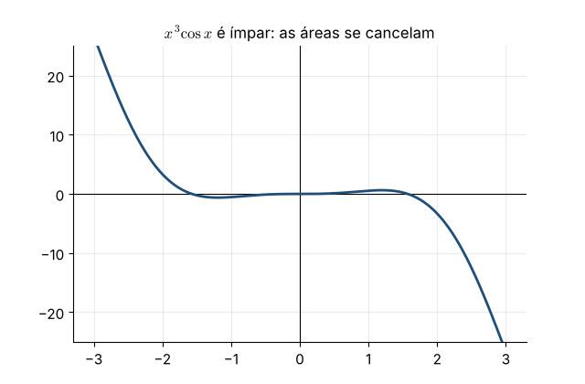

Separamos em partes ímpares e pares:
- $x^3\cos x$ é **ímpar** (ímpar × par) e $x$ é **ímpar**: suas integrais em $[-\pi,\pi]$ são $0$;
- $2\cos x$ é **par**: $\int_{-\pi}^\pi2\cos x\,dx=2\cdot2\int_0^\pi\cos x\,dx=4[\operatorname{sen} x]_0^\pi=0$.

Logo a integral vale $0$.

**Atenção.** O resultado $0$ **não** significa que não há área: a área total é positiva. As áreas acima e abaixo do eixo apenas se cancelam.

**Por que a parte ímpar some?** Para $f$ ímpar, a substituição $u=-x$ mostra que $\int_{-a}^0f=-\int_0^af$.

**Animação.** As áreas de $x^3\cos x$ são varridas simetricamente a partir da origem: cada pedaço à direita é cancelado pelo seu reflexo à esquerda.

---

### 5.41 — Calculando $\pi$ com uma integral

*Origem: OpenStax, inspirado no Exemplo 5.6.*

> Mostre que $\displaystyle\int_0^1\frac{4}{1+x^2}\,dx=\pi$ e use a regra do ponto médio com $n=4$ para estimar $\pi$.

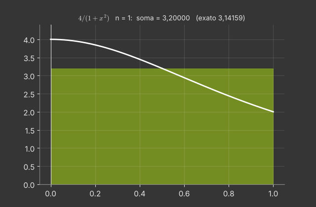

**Exato:** $\int_0^1\frac4{1+x^2}dx=4\left[\operatorname{arctg} x\right]_0^1=4\cdot\frac\pi4=\pi$.

**Ponto médio com $n=4$** ($\Delta x=\frac14$; pontos $\frac18,\frac38,\frac58,\frac78$):
$$M_4=\frac14\left(\frac{4}{1+\frac1{64}}+\frac{4}{1+\frac9{64}}+\frac{4}{1+\frac{25}{64}}+\frac{4}{1+\frac{49}{64}}\right)\approx\frac14(3{,}93846+3{,}50685+2{,}87640+2{,}26549)\approx3{,}14680 .$$
O erro é $\approx0{,}0052$ com apenas 4 retângulos.

**Desempenho:** $M_{10}\approx3{,}14243$ e $M_{100}\approx3{,}1416010$ (erro $\approx8\times10^{-6}$).

**Animação.** A regra do ponto médio com $n=1,2,4,8,\dots,128$, mostrando o valor aproximado de $\pi$ a cada passo.

---

### 5.42 — Vazão e volume

*Origem: OpenStax, inspirado na seção 5.4.*

> Água entra num tanque à taxa $r(t)=200-4t$ L/min, $0\le t\le50$, que inicialmente tem 1000 L. Quanto há no tanque em $t=50$? Em que instante o volume cresce mais rapidamente? Esboce $V(t)$.

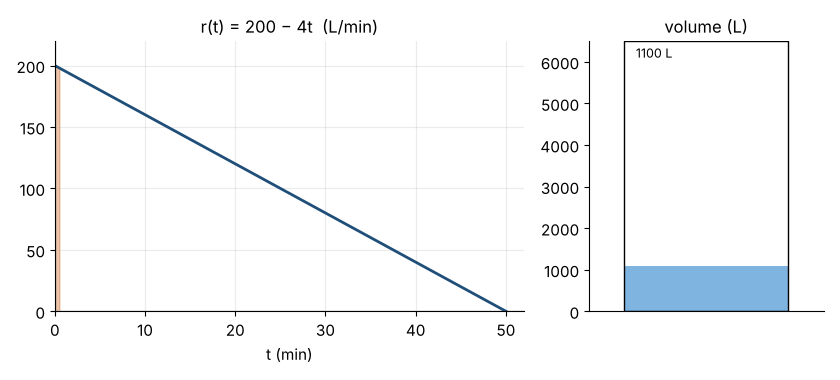

**Variação total:** $\int_0^{50}(200-4t)\,dt=\left[200t-2t^2\right]_0^{50}=10000-5000=5000$ L.
Volume final: $1000+5000=6000$ L.

**Volume em cada instante:** $V(t)=1000+\int_0^t(200-4s)\,ds=1000+200t-2t^2$.

**Crescimento mais rápido:** $V'(t)=r(t)$, máxima quando $t=0$ ($200$ L/min). Em $t=50$, $r=0$: o tanque para de encher, e $V$ tem tangente horizontal (vértice da parábola).

**Geometricamente**, os 5000 L são a área do triângulo sob $r(t)$: $\frac12\cdot50\cdot200=5000$. ✓

**Animação.** A área sob $r(t)$ é acumulada (em cima) enquanto o nível do tanque sobe (embaixo).

---

### 5.43 — Integral da tangente e da secante

*Origem: OpenStax, inspirado no Exemplo 5.5.*

> Mostre que $\int\operatorname{tg} x\,dx=\ln|\sec x|+C$ e que $\int\sec x\,dx=\ln|\sec x+\operatorname{tg} x|+C$. Calcule $\int_0^{\pi/4}\sec x\,dx$.

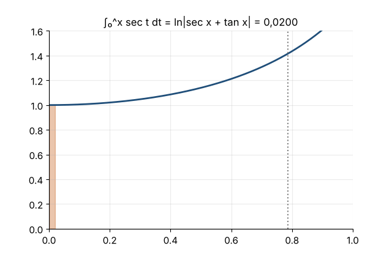

**Tangente.** $\int\frac{\operatorname{sen} x}{\cos x}dx$ com $u=\cos x$, $du=-\operatorname{sen} x\,dx$:
$-\int\frac{du}u=-\ln|\cos x|+C=\ln|\sec x|+C$.

**Secante (truque).** Multiplicamos e dividimos por $\sec x+\operatorname{tg} x$:
$$\int\sec x\,dx=\int\frac{\sec^2x+\sec x\operatorname{tg} x}{\sec x+\operatorname{tg} x}\,dx .$$
O numerador é exatamente a derivada do denominador! Com $u=\sec x+\operatorname{tg} x$: $\int\frac{du}u=\ln|\sec x+\operatorname{tg} x|+C$.

(Verifique derivando: $\frac{\sec x\operatorname{tg} x+\sec^2x}{\sec x+\operatorname{tg} x}=\sec x$. ✓)

**Valor:** $\int_0^{\pi/4}\sec x\,dx=\ln(\sqrt2+1)-\ln(1+0)=\ln(1+\sqrt2)\approx0{,}8814$.

**Curiosidade.** Essa integral aparece na projeção de Mercator: a distância vertical de um paralelo de latitude $\varphi$ até o equador, no mapa, é proporcional a $\int_0^\varphi\sec t\,dt$.

**Animação.** A região sob $\sec x$ em $[0,\pi/4]$ é preenchida, e o valor acumulado é comparado com $\ln|\sec x+\operatorname{tg} x|$.

---
