# Capítulo 6 — Aplicações da integração: exercícios

São 65 exercícios. Os pontos antes de cada número indicam a dificuldade: **•** fácil, **••** médio, **•••** difícil e **••••** desafio. Tente resolver antes de abrir a resposta. Os marcados com ★ têm [solução completa com animação](#soluções-completas).

Muitos enunciados são adaptados de *Calculus Volume 1* (OpenStax, CC BY-NC-SA 4.0).

## Lista

`•` **6.1** Esboce a região entre $y=x^2$ e $y=2x-x^2$ e calcule a sua área.

Resposta

$\tfrac13$.

`•` **6.2** Calcule a área entre $y=\operatorname{sen} x$ e $y=\cos x$ para $0\le x\le\tfrac\pi2$ (atenção ao cruzamento).

Resposta

$2\sqrt2-2\approx0{,}828$.

`•` **6.3** Calcule a área total da região limitada por $y=x^3$ e $y=x$.

Resposta

$\tfrac12$.

`•` **6.4** Calcule a área entre $x=y^2$ e $x=4$ integrando em $y$.

Resposta

$\tfrac{32}3$.

`•` **6.5** Calcule a área entre $y=e^x$, $y=e^{-x}$ e a reta $x=1$.

Resposta

$e+e^{-1}-2\approx1{,}086$.

`•` **6.6** Gire em torno do eixo $x$ a região sob $y=x^2$, $0\le x\le2$. Calcule o volume.

Resposta

$\tfrac{32\pi}5$.

`•` **6.7** Gire em torno do eixo $x$ a região entre $y=\sqrt x$ e $y=x$. Calcule o volume (arruelas).

Resposta

$\tfrac\pi6$.

`•` **6.8** Gire em torno do eixo $y$ a região sob $y=\sqrt x$, $0\le x\le4$. Calcule o volume por cascas.

Resposta

$\tfrac{128\pi}5$.

`•` **6.9** Deduza o volume de um cone circular reto de raio $r$ e altura $h$ girando uma reta adequada.

Resposta

Girando $y=\tfrac rhx$, $0\le x\le h$: $V=\tfrac13\pi r^2h$.

`•` **6.10** Calcule o comprimento de arco de $y=2x^{3/2}$ para $0\le x\le\tfrac13$.

Resposta

$\tfrac{14}{27}$.

`•` **6.11** São necessários $6$ J para esticar uma mola $0{,}3$ m além do comprimento natural. Quanto trabalho é preciso para esticá-la de $0{,}3$ m até $0{,}5$ m?

Resposta

$k=\tfrac{400}3$ N/m; $W=\tfrac{32}3\approx10{,}7$ J.

`•` **6.12** Uma barra ocupa $0\le x\le4$ (em metros) e tem densidade $\rho(x)=2+\sqrt x$ kg/m. Calcule a massa e diga se o centro de massa fica à esquerda ou à direita de $x=2$.

Resposta

$\tfrac{40}3$ kg; à direita (a barra é mais densa na ponta $x=4$).

`•` **6.13** Calcule o centroide da região sob $y=2x$, $0\le x\le3$, e confira com o centroide do triângulo (média dos vértices).

Resposta

$(2,\,2)$.

`•` **6.14** Uma população de bactérias dobra a cada $3$ h. Quanto tempo leva para ficar $10$ vezes maior?

Resposta

$3\tfrac{\ln10}{\ln2}\approx9{,}97$ h.

`•` **6.15** Um isótopo tem meia-vida de $8$ dias. De $200$ mg, quanto resta após $30$ dias?

Resposta

$200\cdot2^{-30/8}\approx14{,}9$ mg.

`•` **6.16** Mostre que $\dfrac{d}{dx}(x\operatorname{senh} x-\cosh x)=x\cosh x$ e use isso para calcular $\int_0^1x\cosh x\,dx$.

Resposta

$1-e^{-1}\approx0{,}632$.

`•` **6.17** Calcule $\displaystyle\int\operatorname{senh} x\cosh^2x\,dx$ e $\displaystyle\int_0^{\ln2}\cosh x\,dx$.

Resposta

$\tfrac13\cosh^3x+C$; $\tfrac34$.

`•` **6.18** Usando $\ln2=\int_1^2\frac{dt}t$, estime $\ln2$ pela regra do ponto médio com $n=4$ e compare com $0{,}69315$.

Resposta

$M_4\approx0{,}69122$ (erro $\approx0{,}002$).

`•` **6.19** Uma placa quadrada de $1$ m de lado está submersa na vertical, com a borda superior a $2$ m de profundidade. Calcule a força hidrostática numa face.

Resposta

$9800\int_2^3h\,dh=24\,500$ N.

`•` **6.20** A base de um sólido é o disco $x^2+y^2\le4$; as seções perpendiculares ao eixo $x$ são quadrados. Calcule o volume.

Resposta

$\int_{-2}^24(4-x^2)\,dx=\tfrac{128}3$.

`••` **6.21** **Área quando as curvas se cruzam.** Calcule a área total da região limitada por $y=x^3-3x$ e $y=x$. ★ [ver solução](#ex-6-21)

Resposta

$8$.

`••` **6.22** Calcule a área entre $y=4-x^2$ e $y=x+2$.

Resposta

$\tfrac92$.

`••` **6.23** Calcule a área da região limitada por $y=|x|$ e $y=2-x^2$.

Resposta

$\tfrac73$.

`••` **6.24** Calcule a área da região limitada por $y=\ln x$, $y=0$ e $x=e$ integrando em $y$.

Resposta

$\int_0^1(e-e^y)\,dy=1$.

`••` **6.25** Calcule a área total entre $y=\operatorname{sen} x$ e $y=\cos x$ em $[0,2\pi]$.

Resposta

$4\sqrt2$.

`••` **6.26** Encontre $k$ tal que a reta $y=k$ divida a região entre $y=4-x^2$ e o eixo $x$ em duas partes de mesma área.

Resposta

$(4-k)^{3/2}=4$: $k=4-2^{4/3}\approx1{,}480$.

`••` **6.27** **Arruelas em torno de uma reta horizontal.** Gire a região entre $y=x$ e $y=x^2$ ($0\le x\le1$) em torno da reta $y=2$. Calcule o volume. ★ [ver solução](#ex-6-27)

Resposta

$\tfrac{8\pi}{15}$.

`••` **6.28** Gire em torno do eixo $x$ a região sob $y=\sec x$, $0\le x\le\tfrac\pi4$. Calcule o volume.

Resposta

$\pi$.

`••` **6.29** A base de um sólido é a região entre $y=x^2$ e $y=1$; as seções perpendiculares ao eixo $x$ são semicírculos. Calcule o volume.

Resposta

$\int_{-1}^1\tfrac\pi8(1-x^2)^2dx=\tfrac{2\pi}{15}$.

`••` **6.30** **Cascas e arruelas: dois caminhos.** Gire a região entre $y=x$ e $y=x^2$ ($0\le x\le1$) em torno da reta $x=-1$. Calcule o volume pelo método das cascas e confira com arruelas. ★ [ver solução](#ex-6-30)

Resposta

$\tfrac\pi2$.

`••` **6.31** Gire em torno do eixo $y$ a região sob $y=e^{-x^2}$, $0\le x\le1$.

Resposta

$\pi(1-e^{-1})\approx1{,}986$.

`••` **6.32** Para a região sob $y=\frac1x$, $1\le x\le3$, calcule o volume do giro em torno do eixo $x$ e em torno do eixo $y$.

Resposta

$\tfrac{2\pi}3$ e $4\pi$.

`••` **6.33** **Um comprimento de arco que dá certo.** Calcule o comprimento de arco de $y=\dfrac{x^3}6+\dfrac1{2x}$ para $1\le x\le3$. ★ [ver solução](#ex-6-33)

Resposta

$\tfrac{14}3$.

`••` **6.34** Calcule o comprimento de arco de $y=\ln(\cos x)$ para $0\le x\le\tfrac\pi4$.

Resposta

$\int_0^{\pi/4}\sec x\,dx=\ln(1+\sqrt2)\approx0{,}881$.

`••` **6.35** Calcule a área da superfície obtida girando $y=x^3$, $0\le x\le1$, em torno do eixo $x$.

Resposta

$\tfrac\pi{27}(10\sqrt{10}-1)\approx3{,}563$.

`••` **6.36** Uma corrente de $10$ m com $2$ kg/m pende do alto de um prédio. Quanto trabalho é preciso para içá-la toda até o topo?

Resposta

$\int_0^{10}2\cdot9{,}8\,y\,dy=980$ J.

`••` **6.37** Um disco de raio $2$ m tem densidade $\rho(r)=\frac1{1+r^2}$ kg/m² ($r$ = distância ao centro). Calcule a massa.

Resposta

$\int_0^2\tfrac{2\pi r}{1+r^2}dr=\pi\ln5\approx5{,}06$ kg.

`••` **6.38** **Centroide e Pappus.** Encontre o centroide da região entre $y=x$ e $y=x^2$ e use o Teorema de Pappus para recalcular o volume do giro em torno do eixo $x$ (Exemplo 6.3b). ★ [ver solução](#ex-6-38)

Resposta

$(\bar x,\bar y)=\big(\tfrac12,\tfrac25\big)$; $V=\tfrac{2\pi}{15}$.

`••` **6.39** **Crescimento de uma cultura.** Uma cultura de bactérias cresce a uma taxa proporcional ao seu tamanho e passa de $1000$ para $3000$ indivíduos em $2$ h. Encontre $k$, o tempo de duplicação, o tamanho após $5$ h e quando ela chega a $10\,000$. ★ [ver solução](#ex-6-39)

Resposta

$k=\tfrac{\ln3}2\approx0{,}549$/h; $T_2\approx1{,}26$ h; $\approx15\,588$; $\approx4{,}19$ h.

`••` **6.40** R\$ $1000$ são aplicados a $8%$ ao ano com juros compostos continuamente. Em quanto tempo o capital dobra? Quanto há após $10$ anos?

Resposta

$\tfrac{\ln2}{0{,}08}\approx8{,}66$ anos; $1000e^{0{,}8}\approx$ R\$ $2225{,}54$.

`•••` **6.41** **Esvaziando um tanque cônico.** Um tanque cônico (vértice para baixo) tem $3$ m de raio no topo e $6$ m de altura e está cheio de água. Calcule o trabalho para bombear toda a água até $1$ m acima do topo. ★ [ver solução](#ex-6-41)

Resposta

$441\,000\pi\approx1{,}39\times10^6$ J.

`•••` **6.42** **Força numa comporta triangular.** Uma comporta vertical tem a forma de um triângulo com base de $4$ m na superfície da água e vértice $3$ m abaixo. Calcule a força hidrostática sobre ela. ★ [ver solução](#ex-6-42)

Resposta

$58\,800$ N.

`•••` **6.43** **O teorema de Arquimedes da faixa esférica.** Mostre que a área da faixa de uma esfera de raio $R$ entre dois planos paralelos a distância $h$ (ambos cortando a esfera) é $2\pi Rh$, qualquer que seja a posição dos planos. Que fração da superfície da Terra fica acima da latitude $60^\circ$? ★ [ver solução](#ex-6-43)

Resposta

$S=2\pi Rh$; cerca de $6{,}7%$.

`•••` **6.44** **O cabo suspenso.** Um cabo pende entre dois postes de mesma altura, separados por $40$ m, na forma $y=a\cosh\frac xa$ com $a=20$ m ($-20\le x\le20$). Mostre que o comprimento é $L=2a\operatorname{senh}\frac{20}a$ e calcule $L$ e a flecha (desnível entre os apoios e o ponto mais baixo). ★ [ver solução](#ex-6-44)

Resposta

$L=40\operatorname{senh}1\approx47{,}0$ m; flecha $20(\cosh1-1)\approx10{,}9$ m.

`•••` **6.45** **Volume do toro: Pappus × cascas.** Gire o disco $(x-3)^2+y^2\le1$ em torno do eixo $y$. Calcule o volume do toro por Pappus e confira pelo método das cascas. ★ [ver solução](#ex-6-45)

Resposta

$6\pi^2\approx59{,}22$.

`•••` **6.46** Calcule a área da região limitada por $y=x^2-2x$ e $y=4x-x^2$.

Resposta

$9$.

`•••` **6.47** Calcule a área da região limitada por $y=\dfrac1{1+x^2}$ e $y=\dfrac{x^2}2$.

Resposta

$\tfrac\pi2-\tfrac13\approx1{,}237$.

`•••` **6.48** Gire em torno da reta $x=4$ a região limitada por $y=\sqrt x$, $y=0$ e $x=4$.

Resposta

Cascas de raio $4-x$: $\tfrac{256\pi}{15}$.

`•••` **6.49** Gire em torno da reta $y=4$ a região limitada por $y=x^2$ e $y=4$.

Resposta

Discos de raio $4-x^2$: $\tfrac{512\pi}{15}$.

`•••` **6.50** Um furo cilíndrico é feito pelo centro de uma esfera de raio $R$, deixando um anel de altura $h$. Mostre que o volume que sobra é $\tfrac16\pi h^3$, independentemente de $R$.

Resposta

Cascas: $V=2\pi\int_r^R2x\sqrt{R^2-x^2}\,dx=\tfrac43\pi(R^2-r^2)^{3/2}$ com $h=2\sqrt{R^2-r^2}$.

`•••` **6.51** Calcule o comprimento de arco de $y=\cosh x$ para $0\le x\le\ln2$.

Resposta

$\operatorname{senh}(\ln2)=\tfrac34$.

`•••` **6.52** Calcule o comprimento de arco de $y=\dfrac{x^2}4-\dfrac{\ln x}2$ para $1\le x\le e$.

Resposta

$\tfrac{e^2+1}4\approx2{,}097$.

`•••` **6.53** Girando um segmento de reta, mostre que a área lateral de um cone de raio $r$ e geratriz $\ell$ é $\pi r\ell$.

Resposta

$y=\tfrac rhx$: $S=2\pi\int_0^h\tfrac rhx\tfrac{\ell}{h}\,dx=\pi r\ell$.

`•••` **6.54** Uma tigela hemisférica de raio $2$ m está cheia de água. Calcule o trabalho para bombear toda a água até a borda.

Resposta

$9800\pi\int_0^2(4-u^2)u\,du=39\,200\pi\approx1{,}23\times10^5$ J.

`•••` **6.55** Uma janela circular de raio $0{,}5$ m está na parede vertical de um aquário, com o centro a $2$ m de profundidade. Calcule a força na janela por integral e verifique que $F=\rho g\,\bar h\,A$ ($\bar h$ = profundidade do centroide).

Resposta

$4900\pi\approx15\,394$ N.

`•••` **6.56** Use o Teorema de Pappus e o volume da esfera para mostrar que o centroide do semidisco de raio $r$ está a $\frac{4r}{3\pi}$ do diâmetro.

Resposta

$\tfrac43\pi r^3=2\pi\bar y\cdot\tfrac{\pi r^2}2$.

`•••` **6.57** A força gravitacional sobre um satélite de $1000$ kg a distância $r$ do centro da Terra é $F=\frac{gR^2m}{r^2}$ ($R=6{,}4\times10^6$ m). Calcule o trabalho para elevá-lo da superfície até $1000$ km de altitude.

Resposta

$gmR\big(1-\tfrac R{R+h}\big)\approx8{,}48\times10^9$ J.

`•••` **6.58** Pela lei de resfriamento de Newton, $T'=-k(T-20)$. Um café a $90$\textdegree C esfria para $60$\textdegree C em $10$ min. Quando chega a $40$\textdegree C? (Dica: $y=T-20$.)

Resposta

$10\tfrac{\ln3{,}5}{\ln1{,}75}\approx22{,}4$ min.

`•••` **6.59** Usando $\ln x=\int_1^x\frac{dt}t$, prove que $\ln x\le x-1$ para todo $x>0$ e conclua que $\tfrac12\le\ln2\le1$.

Resposta

Compare $\tfrac1t$ com $1$ (e com $\tfrac12$ em $[1,2]$).

`•••` **6.60** Calcule $\displaystyle\int\frac{dx}{\sqrt{x^2+4x+5}}$ completando o quadrado.

Resposta

$\operatorname{arcsen} h(x+2)+C=\ln\big(x+2+\sqrt{x^2+4x+5}\big)+C$.

`••••` **6.61** Um plano corta uma esfera de raio $R$. Mostre que uma calota de altura $h$ tem volume $\tfrac13\pi h^2(3R-h)$ e encontre $h$ para que o plano divida a esfera em volumes na razão $1:3$.

Resposta

$t=\tfrac hR$ satisfaz $t^3-3t^2+1=0$: $h\approx0{,}6527R$.

`••••` **6.62** Mostre que para $y=\cosh x$ o comprimento de arco de $0$ a $b$ é igual à área sob a curva de $0$ a $b$. Prove que, entre as funções com $f(0)=1$ e $f'\ge0$, só $\cosh$ tem essa propriedade para todo $b$.

Resposta

Derivando: $\sqrt{1+f'^2}=f$, logo $f'=\sqrt{f^2-1}$, cuja solução com $f(0)=1$ é $\cosh x$.

`••••` **6.63** Calcule o volume comum a dois cilindros de raio $r$ cujos eixos se cruzam em ângulo reto (sólido de Steinmetz). (Dica: as seções paralelas aos dois eixos são quadrados.)

Resposta

$\int_{-r}^r4(r^2-x^2)\,dx=\tfrac{16}3r^3$.

`••••` **6.64** Encontre $f>0$ derivável com $f(0)=1$ tal que, para todo $x>0$: (a) a área sob $f$ de $0$ a $x$ seja $f(x)-1$; (b) essa área seja $f(x)^2-1$.

Resposta

(a) $f=e^x$; (b) $f=1+\tfrac x2$.

`••••` **6.65** Prove que $\displaystyle\lim_{n\to\infty}\Big(\frac1{n+1}+\frac1{n+2}+\dots+\frac1{2n}\Big)=\ln2$.

Resposta

É uma soma de Riemann de $\int_0^1\tfrac{dx}{1+x}=\ln2$.

## Soluções completas

### 6.21 — Área quando as curvas se cruzam

*Origem: OpenStax, inspirado no Exemplo 6.1.*

> Calcule a área total da região limitada por $y=x^3-3x$ e $y=x$.

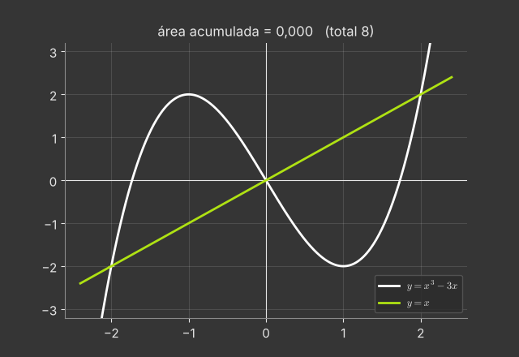

**Interseções:** $x^3-3x=x\iff x^3-4x=0\iff x(x-2)(x+2)=0$, ou seja, $x=-2,\,0,\,2$.

**Quem está por cima?** Teste um ponto de cada intervalo:
- em $x=-1$: cúbica $=2$, reta $=-1$ → a cúbica está por cima em $[-2,0]$;
- em $x=1$: cúbica $=-2$, reta $=1$ → a reta está por cima em $[0,2]$.

**Área:**
$$A=\int_{-2}^0\big[(x^3-3x)-x\big]dx+\int_0^2\big[x-(x^3-3x)\big]dx=\int_{-2}^0(x^3-4x)\,dx+\int_0^2(4x-x^3)\,dx.$$
Cada parcela vale $\left[2x^2-\frac{x^4}4\right]_0^2=8-4=4$ (a primeira pela simetria: $x^3-4x$ é ímpar). Logo $A=8$.

**Cuidado.** $\int_{-2}^2\big[(x^3-3x)-x\big]dx=0$: as duas partes se cancelam porque o integrando é ímpar. Área é $\int|f-g|$, nunca a integral com sinal quando as curvas se cruzam.

**Animação.** Uma faixa vertical percorre $[-2,2]$; a área acumulada cresce nas duas metades (cores diferentes conforme quem está por cima).

---

### 6.27 — Arruelas em torno de uma reta horizontal

*Origem: OpenStax, inspirado no Exemplo 6.3.*

> Gire a região entre $y=x$ e $y=x^2$ ($0\le x\le1$) em torno da reta $y=2$. Calcule o volume.

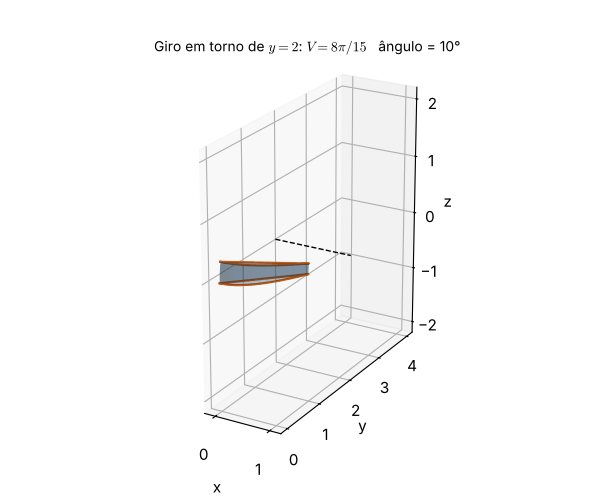

**Raios.** O eixo $y=2$ fica *acima* da região. A distância de um ponto de altura $y$ até o eixo é $2-y$. Na fatia em $x$:
- a curva mais **longe** do eixo é a de baixo, $y=x^2$: raio externo $R=2-x^2$;
- a mais **perto** é a de cima, $y=x$: raio interno $r=2-x$.

**Volume:**
$$V=\pi\int_0^1\big[(2-x^2)^2-(2-x)^2\big]dx=\pi\int_0^1(x^4-5x^2+4x)\,dx=\pi\Big(\tfrac15-\tfrac53+2\Big)=\frac{8\pi}{15}\approx1{,}676.$$

**Erro comum:** usar $R=x$ e $r=x^2$ (raios medidos a partir do eixo $x$). Isso daria o giro em torno de $y=0$, que vale $\tfrac{2\pi}{15}$, quatro vezes menos.

**Conferência por Pappus.** O centroide da região está em $\bar y=\tfrac25$ (exercício do centroide), a distância $2-\tfrac25=\tfrac85$ do eixo, e a área é $\tfrac16$: $V=2\pi\cdot\tfrac85\cdot\tfrac16=\tfrac{8\pi}{15}$. ✓

**Animação.** A região gira em torno de $y=2$ e o sólido (um anel de parede curva) vai se formando.

---

### 6.30 — Cascas e arruelas: dois caminhos

*Origem: OpenStax, inspirado no Exemplo 6.4.*

> Gire a região entre $y=x$ e $y=x^2$ ($0\le x\le1$) em torno da reta $x=-1$. Calcule o volume pelo método das cascas e confira com arruelas.

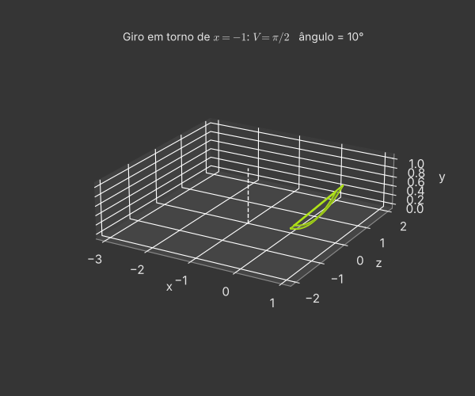

**Cascas** (faixas verticais, paralelas ao eixo $x=-1$): raio $=x-(-1)=x+1$, altura $=x-x^2$.
$$V=2\pi\int_0^1(x+1)(x-x^2)\,dx=2\pi\int_0^1(x-x^3)\,dx=2\pi\Big(\tfrac12-\tfrac14\Big)=\frac\pi2 .$$

**Arruelas** (faixas horizontais, perpendiculares ao eixo): para $0\le y\le1$, a região vai de $x=y$ (reta) até $x=\sqrt y$ (parábola). Distâncias ao eixo: $R=\sqrt y+1$, $r=y+1$.
$$V=\pi\int_0^1\big[(\sqrt y+1)^2-(y+1)^2\big]dy=\pi\int_0^1\big(2\sqrt y-y-y^2\big)dy=\pi\Big(\tfrac43-\tfrac12-\tfrac13\Big)=\frac\pi2 . \ ✓$$

**Qual escolher?** As cascas usaram as funções na forma dada ($y$ em função de $x$); as arruelas exigiram inverter as curvas. Em geral, escolha a fatia que **não** obriga a resolver equações.

**Animação.** A região gira em torno de $x=-1$; o sólido é desenhado à medida que o ângulo vai de $0$ a $2\pi$.

---

### 6.33 — Um comprimento de arco que dá certo

*Origem: OpenStax, inspirado na seção 6.4.*

> Calcule o comprimento de arco de $y=\dfrac{x^3}6+\dfrac1{2x}$ para $1\le x\le3$.

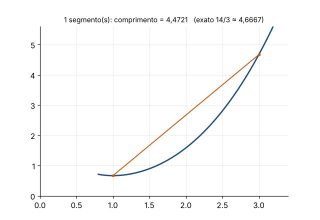

**Derivada:** $f'(x)=\frac{x^2}2-\frac1{2x^2}$.

**O truque do quadrado perfeito:**
$$1+f'^2=1+\frac{x^4}4-\frac12+\frac1{4x^4}=\frac{x^4}4+\frac12+\frac1{4x^4}=\Big(\frac{x^2}2+\frac1{2x^2}\Big)^2 .$$
O ``$-\frac12$'' do produto cruzado virou ``$+\frac12$'' ao somar $1$. Essa é a marca das funções feitas para ter comprimento de arco elementar.

**Integral:**
$$L=\int_1^3\Big(\frac{x^2}2+\frac1{2x^2}\Big)dx=\Big[\frac{x^3}6-\frac1{2x}\Big]_1^3=\Big(\frac{27}6-\frac16\Big)-\Big(\frac16-\frac12\Big)=\frac{13}3+\frac13=\frac{14}3\approx4{,}667.$$

**Conferência.** A corda de $(1,\tfrac23)$ a $(3,\tfrac{14}3)$ mede $\sqrt{4+16}\approx4{,}472<4{,}667$, como deve ser.

**Animação.** Poligonais com $1,2,4,\dots,64$ segmentos se aproximam da curva; seus comprimentos crescem até $14/3$.

---

### 6.38 — Centroide e Pappus

*Origem: OpenStax, inspirado no Exemplo 6.7.*

> Encontre o centroide da região entre $y=x$ e $y=x^2$ e use o Teorema de Pappus para recalcular o volume do giro em torno do eixo $x$ (Exemplo 6.3b).

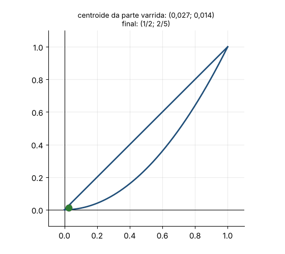

**Área:** $A=\int_0^1(x-x^2)\,dx=\frac12-\frac13=\frac16$.

**$\bar x$:**
$$\bar x=\frac1A\int_0^1x(x-x^2)\,dx=6\Big(\frac13-\frac14\Big)=\frac12 .$$
(Não é por simetria em relação a $x=\tfrac12$: a região *não* é simétrica, mas a altura $x-x^2$ é. Isso basta para $\bar x$.)

**$\bar y$:**
$$\bar y=\frac1A\int_0^1\frac{x^2-x^4}2\,dx=6\cdot\frac12\Big(\frac13-\frac15\Big)=\frac25 .$$

**Pappus:** girando em torno do eixo $x$, o centroide percorre uma circunferência de raio $\bar y=\tfrac25$:
$$V=2\pi\cdot\frac25\cdot\frac16=\frac{2\pi}{15}, $$
igual ao resultado por arruelas. ✓

**Animação.** A região é varrida da esquerda para a direita; o ponto mostra o centroide da parte já varrida e para em $(\tfrac12,\tfrac25)$.

---

### 6.39 — Crescimento de uma cultura

*Origem: OpenStax, inspirado na seção 6.8.*

> Uma cultura de bactérias cresce a uma taxa proporcional ao seu tamanho e passa de $1000$ para $3000$ indivíduos em $2$ h. Encontre $k$, o tempo de duplicação, o tamanho após $5$ h e quando ela chega a $10\,000$.

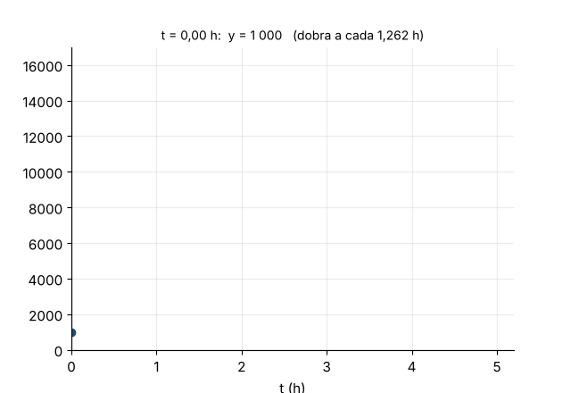

**Modelo:** $y'=ky\Rightarrow y=1000\,e^{kt}$.

**$k$:** $3000=1000e^{2k}\Rightarrow k=\frac{\ln3}2\approx0{,}5493$ por hora.

**Tempo de duplicação:** $T_2=\frac{\ln2}k=\frac{2\ln2}{\ln3}\approx1{,}262$ h $\approx$ 1 h 16 min.

**Após 5 h:** $y(5)=1000e^{5\ln3/2}=1000\cdot3^{5/2}=1000\cdot9\sqrt3\approx15\,588$.

**Quando $y=10\,000$:** $e^{kt}=10\Rightarrow t=\frac{\ln10}k=\frac{2\ln10}{\ln3}\approx4{,}19$ h.

**Forma alternativa.** $y=1000\cdot3^{t/2}$: ``triplica a cada 2 h''. Toda exponencial pode ser escrita com a base que for mais conveniente; $e^{kt}$ é a que torna a derivada simples.

**Animação.** A curva cresce e marcas horizontais mostram as duplicações sucessivas, igualmente espaçadas no tempo.

---

### 6.41 — Esvaziando um tanque cônico

*Origem: OpenStax, inspirado no Exemplo 6.6.*

> Um tanque cônico (vértice para baixo) tem $3$ m de raio no topo e $6$ m de altura e está cheio de água. Calcule o trabalho para bombear toda a água até $1$ m acima do topo.

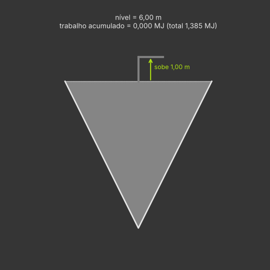

**Coordenadas:** $y$ = altura medida a partir do vértice, $0\le y\le6$. Por semelhança de triângulos, o raio da superfície na altura $y$ é $r=\frac36y=\frac y2$.

**Fatia típica:** camada de espessura $\Delta y$ na altura $y$:
- volume $\pi r^2\Delta y=\frac\pi4y^2\Delta y$;
- peso $9800\cdot\frac\pi4y^2\Delta y$ N;
- distância a subir: até $y=7$, isto é, $7-y$.

**Trabalho:**
$$W=\int_0^6 9800\,\frac\pi4\,y^2(7-y)\,dy=2450\pi\Big[\frac{7y^3}3-\frac{y^4}4\Big]_0^6=2450\pi(504-324)=441\,000\pi\approx1{,}385\times10^6\ \text{J}.$$

**Intuição.** A maior parte da água está perto do topo (onde o cone é largo) e por isso sobe pouco. O mesmo volume num cilindro de mesma altura e mesmo volume exigiria mais trabalho.

**Animação.** O nível da água desce; o contador mostra o trabalho acumulado a cada camada retirada.

---

### 6.42 — Força numa comporta triangular

*Origem: OpenStax, inspirado no Exemplo 6.6.*

> Uma comporta vertical tem a forma de um triângulo com base de $4$ m na superfície da água e vértice $3$ m abaixo. Calcule a força hidrostática sobre ela.

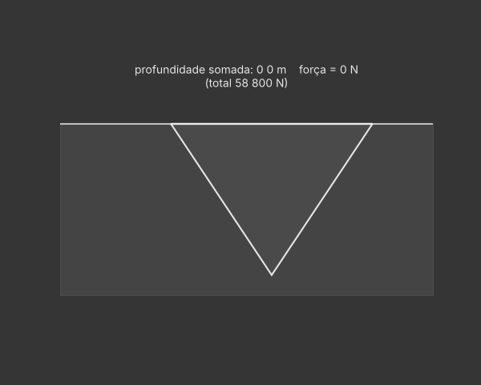

**Largura na profundidade $h$:** a largura cai linearmente de $4$ (em $h=0$) a $0$ (em $h=3$): $w(h)=\frac43(3-h)$.

**Força numa faixa:** pressão $9800h$ vezes área $w(h)\Delta h$.
$$F=\int_0^3 9800\,h\cdot\frac43(3-h)\,dh=\frac{39\,200}3\Big[\frac{3h^2}2-\frac{h^3}3\Big]_0^3=\frac{39\,200}3\cdot4{,}5=58\,800\ \text{N}.$$

**Conferência ($F=\rho g\bar hA$):** a área é $6$ m² e o centroide do triângulo fica a $\frac13$ da altura a partir da base, $\bar h=1$ m: $9800\cdot1\cdot6=58\,800$ N. ✓

**Observação.** Se o triângulo estivesse invertido (vértice para cima, na superfície), o centroide ficaria a $2$ m e a força dobraria: a parte larga estaria onde a pressão é maior.

**Animação.** Faixas horizontais são somadas de cima para baixo, com setas proporcionais à pressão, e a força total vai se acumulando.

---

### 6.43 — O teorema de Arquimedes da faixa esférica

*Origem: OpenStax, inspirado no Exemplo 6.5.*

> Mostre que a área da faixa de uma esfera de raio $R$ entre dois planos paralelos a distância $h$ (ambos cortando a esfera) é $2\pi Rh$, qualquer que seja a posição dos planos. Que fração da superfície da Terra fica acima da latitude $60^\circ$?

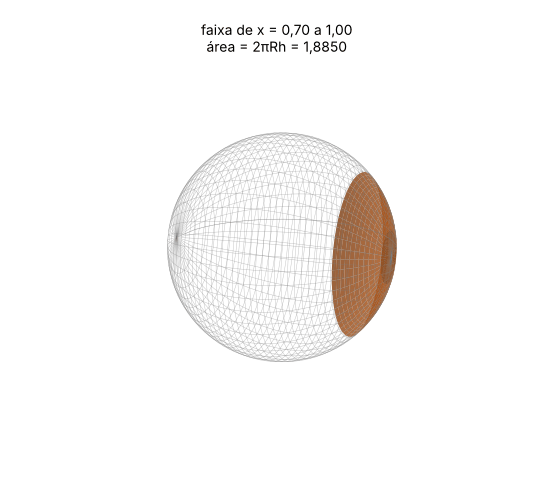

**Superfície de revolução:** gire $f(x)=\sqrt{R^2-x^2}$ em torno do eixo $x$, entre $x=a$ e $x=a+h$.

$f'(x)=-\frac x{\sqrt{R^2-x^2}}$, e
$$f\sqrt{1+f'^2}=\sqrt{R^2-x^2}\cdot\sqrt{\frac{R^2-x^2+x^2}{R^2-x^2}}=R .$$
O integrando é **constante**:
$$S=2\pi\int_a^{a+h}R\,dx=2\pi Rh .$$

**Esfera inteira:** $h=2R$ dá $4\pi R^2$.

**Interpretação (Arquimedes).** A área é a mesma do cilindro circunscrito na mesma faixa. Perto do ``equador'' a faixa é larga mas pouco inclinada; perto dos polos é estreita mas muito inclinada, e os dois efeitos se compensam exatamente.

**Terra acima de $60^\circ$:** a calota começa à altura $R\operatorname{sen}60^\circ$ e termina em $R$: $h=R(1-\tfrac{\sqrt3}2)\approx0{,}134R$. Fração $=\frac{2\pi Rh}{4\pi R^2}=\frac{1-\sqrt3/2}2\approx0{,}067$, ou seja, $6{,}7\%$.

**Animação.** Uma faixa de largura fixa $h$ desliza do polo ao equador; o valor da área permanece $2\pi Rh$.

---

### 6.44 — O cabo suspenso

*Origem: OpenStax, inspirado na seção 6.9.*

> Um cabo pende entre dois postes de mesma altura, separados por $40$ m, na forma $y=a\cosh\frac xa$ com $a=20$ m ($-20\le x\le20$). Mostre que o comprimento é $L=2a\operatorname{senh}\frac{20}a$ e calcule $L$ e a flecha (desnível entre os apoios e o ponto mais baixo).

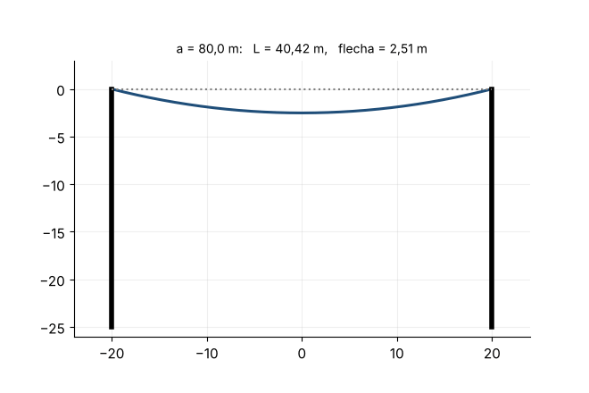

**Comprimento:** $y'=\operatorname{senh}\frac xa$ e $1+\operatorname{senh}^2u=\cosh^2u$, logo
$$L=\int_{-20}^{20}\cosh\frac xa\,dx=a\Big[\operatorname{senh}\frac xa\Big]_{-20}^{20}=2a\operatorname{senh}\frac{20}a .$$
Com $a=20$: $L=40\operatorname{senh}1=20(e-e^{-1})\approx47{,}01$ m.

**Flecha:** o ponto mais baixo é $y(0)=a=20$; nos apoios, $y(20)=20\cosh1\approx30{,}86$. Flecha $=20(\cosh1-1)\approx10{,}86$ m.

**O parâmetro $a$.** $a$ grande deixa o cabo esticado (flecha pequena, $L$ pouco maior que $40$); $a$ pequeno deixa-o frouxo. Por exemplo, $a=50$ dá $L\approx41{,}1$ m e flecha $\approx4{,}0$ m.

**Por que não uma parábola?** Perto do vértice, $\cosh u\approx1+\frac{u^2}2$, então a catenária parece uma parábola quando a flecha é pequena; mas a forma exata do cabo sob o próprio peso é o cosseno hiperbólico.

**Animação.** O parâmetro $a$ diminui e o cabo afrouxa; o título mostra $L$ e a flecha.

---

### 6.45 — Volume do toro: Pappus × cascas

*Origem: OpenStax, inspirado no Exemplo 6.7.*

> Gire o disco $(x-3)^2+y^2\le1$ em torno do eixo $y$. Calcule o volume do toro por Pappus e confira pelo método das cascas.

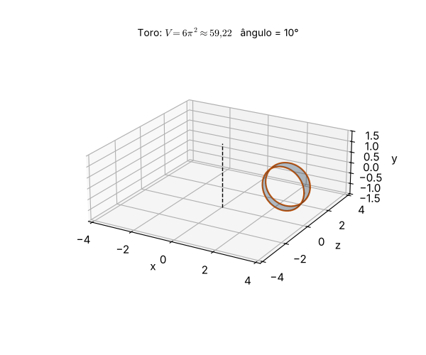

**Pappus:** área $\pi\cdot1^2=\pi$; centroide no centro $(3,0)$, a distância $d=3$ do eixo:
$V=2\pi\cdot3\cdot\pi=6\pi^2\approx59{,}22$.

**Cascas:** em $x\in[2,4]$, a faixa vertical tem altura $2\sqrt{1-(x-3)^2}$ e raio $x$:
$$V=2\pi\int_2^4x\cdot2\sqrt{1-(x-3)^2}\,dx .$$
Com $u=x-3$:
$$V=4\pi\int_{-1}^1(u+3)\sqrt{1-u^2}\,du=4\pi\Big[\underbrace{\int_{-1}^1u\sqrt{1-u^2}\,du}_{0\ (\text{ímpar})}+3\underbrace{\int_{-1}^1\sqrt{1-u^2}\,du}_{\pi/2\ (\text{semidisco})}\Big]=4\pi\cdot\frac{3\pi}2=6\pi^2 .\ ✓$$

**Generalização:** raio do tubo $r$, distância do centro ao eixo $R$: $V=2\pi^2Rr^2$, que é o volume de um cilindro de base $\pi r^2$ e comprimento $2\pi R$ (o toro ``desenrolado'').

**Animação.** O disco gira em torno do eixo $y$ e o toro vai se fechando.

---
