# Capítulo 7 — Técnicas de integração: exercícios

São 65 exercícios. Os pontos antes de cada número indicam a dificuldade: **•** fácil, **••** médio, **•••** difícil e **••••** desafio. Tente resolver antes de abrir a resposta. Os marcados com ★ têm [solução completa com animação](#soluções-completas).

Muitos enunciados são adaptados de *Calculus Volume 1* (OpenStax, CC BY-NC-SA 4.0).

## Lista

`•` **7.1** Calcule $\displaystyle\int x\cos x\,dx$ e $\displaystyle\int xe^{-x}\,dx$.

Resposta

$x\operatorname{sen} x+\cos x+C$; $-(x+1)e^{-x}+C$.

`•` **7.2** Calcule $\displaystyle\int x\ln x\,dx$.

Resposta

$\tfrac{x^2}2\ln x-\tfrac{x^2}4+C$.

`•` **7.3** Calcule $\displaystyle\int\operatorname{arctg} x\,dx$ (use $dv=dx$).

Resposta

$x\operatorname{arctg} x-\tfrac12\ln(1+x^2)+C$.

`•` **7.4** Calcule $\displaystyle\int_0^{\pi/2}x\operatorname{sen} x\,dx$.

Resposta

$1$.

`•` **7.5** Calcule $\displaystyle\int\operatorname{sen}^3x\,dx$.

Resposta

$-\cos x+\tfrac13\cos^3x+C$.

`•` **7.6** Calcule $\displaystyle\int\cos^2x\,dx$ e $\displaystyle\int_0^\pi\operatorname{sen}^2x\,dx$.

Resposta

$\tfrac x2+\tfrac{\operatorname{sen}2x}4+C$; $\tfrac\pi2$.

`•` **7.7** Calcule $\displaystyle\int\operatorname{sen}^2x\cos^3x\,dx$.

Resposta

$\tfrac13\operatorname{sen}^3x-\tfrac15\operatorname{sen}^5x+C$.

`•` **7.8** Calcule $\displaystyle\int\operatorname{tg}^2x\,dx$ e $\displaystyle\int\sec^4x\,dx$.

Resposta

$\operatorname{tg} x-x+C$; $\operatorname{tg} x+\tfrac13\operatorname{tg}^3x+C$.

`•` **7.9** Calcule $\displaystyle\int\operatorname{sen}3x\cos2x\,dx$ usando produto em soma.

Resposta

$-\tfrac1{10}\cos5x-\tfrac12\cos x+C$.

`•` **7.10** Calcule $\displaystyle\int_0^2\sqrt{4-x^2}\,dx$ com $x=2\operatorname{sen}\theta$ e confira com a área de um quarto de círculo.

Resposta

$\pi$.

`•` **7.11** Calcule $\displaystyle\int\frac{dx}{(x^2+9)^{3/2}}$ com $x=3\operatorname{tg}\theta$.

Resposta

$\tfrac{x}{9\sqrt{x^2+9}}+C$.

`•` **7.12** Calcule $\displaystyle\int\frac{dx}{(x-1)(x+2)}$.

Resposta

$\tfrac13\ln\Big|\tfrac{x-1}{x+2}\Big|+C$.

`•` **7.13** Calcule $\displaystyle\int\frac{3x+1}{x^2-1}\,dx$.

Resposta

$2\ln|x-1|+\ln|x+1|+C$.

`•` **7.14** Calcule $\displaystyle\int\frac{x^3}{x-1}\,dx$ (divida primeiro).

Resposta

$\tfrac{x^3}3+\tfrac{x^2}2+x+\ln|x-1|+C$.

`•` **7.15** Calcule $T_4$ e $S_4$ para $\int_0^2x^3\,dx$ e compare com o valor exato. Por que $S_4$ acerta?

Resposta

$T_4=4{,}25$; $S_4=4$ (exato): Simpson é exata para cúbicas.

`•` **7.16** Decida se convergem e calcule quando for o caso: $\int_1^\infty\frac{dx}{x^3}$ e $\int_1^\infty\frac{dx}{\sqrt x}$.

Resposta

$\tfrac12$; diverge.

`•` **7.17** Calcule $\int_0^\infty e^{-2x}\,dx$ e $\int_0^1\ln x\,dx$.

Resposta

$\tfrac12$; $-1$.

`•` **7.18** Calcule $\int_0^4\frac{dx}{\sqrt{4-x}}$ e decida se $\int_0^2\frac{dx}{(x-1)^2}$ converge.

Resposta

$4$; diverge (o integrando explode em $x=1$).

`•` **7.19** Calcule $\displaystyle\int x^2\operatorname{sen} x\,dx$ e confira derivando a resposta.

Resposta

$-x^2\cos x+2x\operatorname{sen} x+2\cos x+C$.

`•` **7.20** Calcule $\displaystyle\int e^x\cos x\,dx$ (integral cíclica).

Resposta

$\tfrac12e^x(\operatorname{sen} x+\cos x)+C$.

`••` **7.21** **Partes com logaritmo (e a figura do retângulo).** Calcule $\int_1^e\ln x\,dx$ e $\int_1^ex\ln x\,dx$ por partes. Interprete o primeiro resultado como uma diferença de áreas num retângulo. ★ [ver solução](#ex-7-21)

Resposta

$1$; $\tfrac{e^2+1}4\approx2{,}097$.

`••` **7.22** **Uma integral que volta a si mesma.** Calcule $\int e^x\operatorname{sen} x\,dx$ e depois $\int_0^\pi e^x\operatorname{sen} x\,dx$. ★ [ver solução](#ex-7-22)

Resposta

$\tfrac12e^x(\operatorname{sen} x-\cos x)+C$; $\tfrac{e^\pi+1}2\approx12{,}070$.

`••` **7.23** **A integral da secante ao cubo.** Mostre que $\int\sec^3x\,dx=\frac12\big(\sec x\operatorname{tg} x+\ln|\sec x+\operatorname{tg} x|\big)+C$ e calcule $\int_0^{\pi/4}\sec^3x\,dx$. ★ [ver solução](#ex-7-23)

Resposta

$\tfrac12\big(\sqrt2+\ln(1+\sqrt2)\big)\approx1{,}1478$.

`••` **7.24** **A área da elipse.** Use substituição trigonométrica para mostrar que a elipse $\frac{x^2}{a^2}+\frac{y^2}{b^2}\le1$ tem área $\pi ab$. ★ [ver solução](#ex-7-24)

Resposta

$\pi ab$.

`••` **7.25** **Frações parciais com fator repetido.** Calcule $\displaystyle\int\frac{5x^2+3x-2}{x^3+2x^2}\,dx$ e depois a integral de $1$ a $2$. ★ [ver solução](#ex-7-25)

Resposta

$2\ln|x|+\frac1x+3\ln|x+2|+C$; $2\ln2-\tfrac12+3\ln\tfrac43\approx1{,}749$.

`••` **7.26** **Trapézio e Simpson para $e^{-x^2}$.** A função $e^{-x^2}$ não tem antiderivada elementar. Calcule $T_4$ e $S_4$ para $\int_0^1e^{-x^2}dx$ e use os limitantes de erro (com $|f''|\le2$ e $|f^{(4)}|\le12$ em $[0,1]$) para dizer quantas casas são confiáveis. ★ [ver solução](#ex-7-26)

Resposta

$T_4\approx0{,}742984$; $S_4\approx0{,}746855$; valor $\approx0{,}746824$.

`••` **7.27** Calcule $\displaystyle\int x^2\cos x\,dx$.

Resposta

$x^2\operatorname{sen} x+2x\cos x-2\operatorname{sen} x+C$.

`••` **7.28** Calcule $\displaystyle\int x^3e^{x^2}\,dx$ (substituição e depois partes).

Resposta

$\tfrac12e^{x^2}(x^2-1)+C$.

`••` **7.29** Calcule $\displaystyle\int\operatorname{arcsen} x\,dx$ e $\displaystyle\int(\ln x)^2\,dx$.

Resposta

$x\operatorname{arcsen} x+\sqrt{1-x^2}+C$; $x(\ln x)^2-2x\ln x+2x+C$.

`••` **7.30** Calcule $\displaystyle\int\operatorname{sen}^4x\,dx$.

Resposta

$\tfrac{3x}8-\tfrac{\operatorname{sen}2x}4+\tfrac{\operatorname{sen}4x}{32}+C$.

`••` **7.31** Calcule $\displaystyle\int\operatorname{tg}^3x\sec^3x\,dx$.

Resposta

$\tfrac15\sec^5x-\tfrac13\sec^3x+C$.

`••` **7.32** Calcule $\displaystyle\int\frac{\sqrt{x^2-9}}{x}\,dx$ ($x>3$).

Resposta

$\sqrt{x^2-9}-3\operatorname{arcsec}\tfrac x3+C$.

`••` **7.33** Calcule $\displaystyle\int\frac{x^2}{\sqrt{9-x^2}}\,dx$.

Resposta

$\tfrac92\operatorname{arcsen}\tfrac x3-\tfrac x2\sqrt{9-x^2}+C$.

`••` **7.34** Calcule $\displaystyle\int\frac{x^2+1}{x(x-1)^2}\,dx$.

Resposta

$\ln|x|-\tfrac2{x-1}+C$.

`••` **7.35** Calcule $\displaystyle\int\frac{4}{x^3+4x}\,dx$.

Resposta

$\ln|x|-\tfrac12\ln(x^2+4)+C$.

`••` **7.36** Calcule $\displaystyle\int\frac{dx}{e^x+1}$ (faça $u=e^x$ e use frações parciais).

Resposta

$x-\ln(1+e^x)+C$.

`••` **7.37** Calcule $S_4$ para $\int_0^\pi\operatorname{sen} x\,dx$. Qual o menor $n$ que garante, pelo teorema, erro de Simpson menor que $10^{-6}$?

Resposta

$S_4=\tfrac\pi{12}(4\sqrt2+2)\approx2{,}00456$; $n=38$.

`••` **7.38** Calcule $\int_0^\infty xe^{-x}\,dx$ e $\int_{-\infty}^\infty\frac{dx}{x^2+4x+5}$.

Resposta

$1$; $\pi$.

`••` **7.39** Calcule $\int_0^3\frac{dx}{(x-1)^{2/3}}$ (cuidado com $x=1$).

Resposta

$3+3\sqrt[3]2\approx6{,}780$.

`••` **7.40** Use comparação para decidir: $\int_1^\infty\frac{dx}{x^2+\sqrt x}$ e $\int_2^\infty\frac{dx}{\ln x}$.

Resposta

Converge ($\le\tfrac1{x^2}$); diverge ($\tfrac1{\ln x}\ge\tfrac1x$).

`•••` **7.41** **O comprimento da parábola.** Calcule o comprimento de arco de $y=x^2$ para $0\le x\le1$. ★ [ver solução](#ex-7-41)

Resposta

$\tfrac14\big(2\sqrt5+\ln(2+\sqrt5)\big)\approx1{,}4789$.

`•••` **7.42** **A trombeta de Gabriel.** Gire $y=\frac1x$, $x\ge1$, em torno do eixo $x$. Mostre que o sólido tem volume finito, mas a superfície tem área infinita. ★ [ver solução](#ex-7-42)

Resposta

$V=\pi$; $S=\infty$.

`•••` **7.43** **A função gama.** Seja $\Gamma(x)=\int_0^\infty t^{x-1}e^{-t}\,dt$ para $x>0$. Mostre que $\Gamma(1)=1$, que $\Gamma(x+1)=x\,\Gamma(x)$ e conclua que $\Gamma(n+1)=n!$. ★ [ver solução](#ex-7-43)

Resposta

$\Gamma(n+1)=n!$.

`•••` **7.44** **A substituição universal $t=\operatorname{tg}(x/2)$.** Com $t=\operatorname{tg}\frac x2$, mostre que $\cos x=\frac{1-t^2}{1+t^2}$ e $dx=\frac{2\,dt}{1+t^2}$, e calcule $\displaystyle\int_0^{\pi/2}\frac{dx}{2+\cos x}$. ★ [ver solução](#ex-7-44)

Resposta

$\tfrac{\pi}{3\sqrt3}\approx0{,}6046$.

`•••` **7.45** **Crescimento logístico.** Uma população segue $\dfrac{dP}{dt}=0{,}5\,P\Big(1-\dfrac P{1000}\Big)$, com $P(0)=100$. Separe as variáveis, use frações parciais e encontre $P(t)$. Quando a população chega a $500$? Quando cresce mais rápido? ★ [ver solução](#ex-7-45)

Resposta

$P(t)=\dfrac{1000}{1+9e^{-t/2}}$; $t=2\ln9\approx4{,}39$; crescimento máximo quando $P=500$.

`•••` **7.46** Calcule $\displaystyle\int e^{2x}\operatorname{sen}3x\,dx$.

Resposta

$\tfrac1{13}e^{2x}(2\operatorname{sen}3x-3\cos3x)+C$.

`•••` **7.47** Calcule $\displaystyle\int\cos\sqrt x\,dx$.

Resposta

$2\big(\sqrt x\operatorname{sen}\sqrt x+\cos\sqrt x\big)+C$.

`•••` **7.48** Deduza a fórmula de redução $\int\operatorname{sen}^nx\,dx=-\frac1n\operatorname{sen}^{n-1}x\cos x+\frac{n-1}n\int\operatorname{sen}^{n-2}x\,dx$ e calcule $\int_0^{\pi/2}\operatorname{sen}^6x\,dx$.

Resposta

$\tfrac56\cdot\tfrac34\cdot\tfrac12\cdot\tfrac\pi2=\tfrac{5\pi}{32}$.

`•••` **7.49** Calcule $\displaystyle\int x\operatorname{arctg} x\,dx$.

Resposta

$\tfrac12\big[(x^2+1)\operatorname{arctg} x-x\big]+C$.

`•••` **7.50** Calcule $\displaystyle\int\frac{dx}{(1+x^2)^2}$ e $\displaystyle\int_0^1\frac{dx}{(1+x^2)^2}$.

Resposta

$\tfrac12\big(\operatorname{arctg} x+\tfrac x{1+x^2}\big)+C$; $\tfrac\pi8+\tfrac14$.

`•••` **7.51** Calcule $\displaystyle\int\frac{e^x}{e^{2x}+3e^x+2}\,dx$.

Resposta

$\ln\tfrac{e^x+1}{e^x+2}+C$.

`•••` **7.52** Calcule $\displaystyle\int\frac{x^3+x+1}{(x^2+1)^2}\,dx$.

Resposta

$\tfrac12\ln(x^2+1)+\tfrac12\big(\operatorname{arctg} x+\tfrac x{1+x^2}\big)+C$.

`•••` **7.53** Calcule $\displaystyle\int\frac{dx}{x^3+1}$.

Resposta

$\tfrac13\ln|x+1|-\tfrac16\ln(x^2-x+1)+\tfrac1{\sqrt3}\operatorname{arctg}\tfrac{2x-1}{\sqrt3}+C$.

`•••` **7.54** Calcule $\displaystyle\int\frac{\sqrt x}{1+x}\,dx$ (racionalize com $u=\sqrt x$).

Resposta

$2\sqrt x-2\operatorname{arctg}\sqrt x+C$.

`•••` **7.55** Quantos subintervalos garantem, pela regra do trapézio, erro menor que $10^{-4}$ em $\int_1^2\frac{dx}x$?

Resposta

$\tfrac{2}{12n^2}<10^{-4}$: $n\ge41$.

`•••` **7.56** Calcule $\int_0^\infty e^{-x}\operatorname{sen} x\,dx$.

Resposta

$\tfrac12$.

`•••` **7.57** Calcule $\int_1^\infty\frac{\ln x}{x^2}\,dx$.

Resposta

$1$.

`•••` **7.58** Para quais $p$ a integral $\int_0^1\frac{dx}{x^p}$ converge, e para quanto? E $\int_0^\infty\frac{dx}{x^p}$?

Resposta

$p<1$, vale $\tfrac1{1-p}$; a segunda diverge para todo $p$.

`•••` **7.59** Calcule $\displaystyle\int_0^\infty\frac{dx}{(1+x)\sqrt x}$ (é imprópria nas duas pontas).

Resposta

$\pi$ (com $u=\sqrt x$).

`•••` **7.60** A transformada de Laplace de $f$ é $F(s)=\int_0^\infty e^{-st}f(t)\,dt$. Calcule-a para $f(t)=1$ e $f(t)=t$ ($s>0$).

Resposta

$\tfrac1s$; $\tfrac1{s^2}$.

`••••` **7.61** Prove que $\displaystyle\int_0^1\frac{x^4(1-x)^4}{1+x^2}\,dx=\frac{22}7-\pi$ e conclua que $\pi<\frac{22}7$.

Resposta

Divida: o quociente é $x^6-4x^5+5x^4-4x^2+4$ e o resto dá $-4\operatorname{arctg} x$; o integrando é positivo.

`••••` **7.62** Calcule $\displaystyle\int_0^{\pi/2}\ln(\operatorname{sen} x)\,dx$. (Dica: compare com $\int_0^{\pi/2}\ln(\cos x)\,dx$ e use $\operatorname{sen}2x=2\operatorname{sen} x\cos x$.)

Resposta

$-\tfrac\pi2\ln2$.

`••••` **7.63** Prove que $\displaystyle\int_1^\infty\frac{\operatorname{sen} x}x\,dx$ converge (partes com $u=\frac1x$), mas $\int_1^\infty\frac{|\operatorname{sen} x|}x\,dx$ diverge.

Resposta

Partes: $\cos1-\int_1^\infty\tfrac{\cos x}{x^2}dx$, absolutamente convergente; e $|\operatorname{sen} x|\ge\operatorname{sen}^2x=\tfrac{1-\cos2x}2$.

`••••` **7.64** Sabendo que $\int_0^\infty e^{-x^2}dx=\frac{\sqrt\pi}2$, mostre que $\Gamma(\tfrac12)=\sqrt\pi$ e calcule $\Gamma(\tfrac52)$.

Resposta

$t=x^2$; $\Gamma(\tfrac52)=\tfrac32\cdot\tfrac12\sqrt\pi=\tfrac{3\sqrt\pi}4$.

`••••` **7.65** Sejam $I_n=\int_0^{\pi/2}\operatorname{sen}^nx\,dx$. Mostre que $I_{2n+1}\le I_{2n}\le I_{2n-1}$ e use a fórmula de redução para provar o produto de Wallis $\frac\pi2=\lim_{n\to\infty}\frac{2\cdot2\cdot4\cdot4\cdots2n\cdot2n}{1\cdot3\cdot3\cdot5\cdots(2n-1)(2n+1)}$.

Resposta

$\tfrac{I_{2n}}{I_{2n+1}}\to1$ pelo sanduíche, e essa razão é $\tfrac\pi2$ dividido pelo produto parcial.

## Soluções completas

### 7.21 — Partes com logaritmo (e a figura do retângulo)

*Origem: OpenStax, inspirado no Exemplo 7.1.*

> Calcule $\int_1^e\ln x\,dx$ e $\int_1^ex\ln x\,dx$ por partes. Interprete o primeiro resultado como uma diferença de áreas num retângulo.

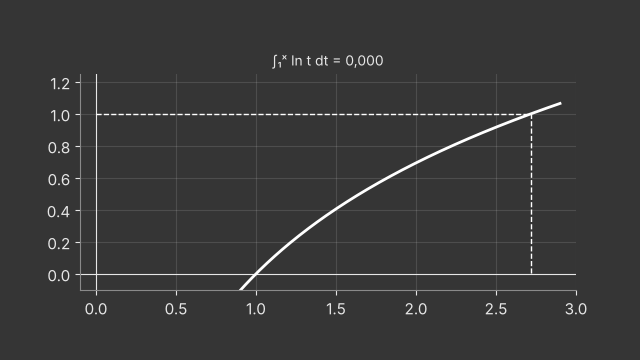

**Primeira.** $u=\ln x$ (L de LIATE), $dv=dx$: $du=\frac{dx}x$, $v=x$.
$$\int_1^e\ln x\,dx=\big[x\ln x\big]_1^e-\int_1^e x\cdot\frac1x\,dx=(e-0)-(e-1)=1 .$$

**Geometria.** O gráfico de $y=\ln x$ entre $(1,0)$ e $(e,1)$ é o mesmo que $x=e^y$ para $0\le y\le1$. A região *sob* $\ln x$ e a região *à esquerda* da curva (entre o eixo $y$ e $x=e^y$) preenchem o retângulo $[0,e]\times[0,1]$, de área $e$. Como a segunda vale $\int_0^1e^y\,dy=e-1$, sobra $1$ para a primeira. Partes é exatamente isto: $\int u\,dv+\int v\,du=uv$.

**Segunda.** $u=\ln x$, $dv=x\,dx$: $v=\frac{x^2}2$.
$$\int_1^ex\ln x\,dx=\Big[\frac{x^2}2\ln x\Big]_1^e-\int_1^e\frac x2\,dx=\frac{e^2}2-\Big[\frac{x^2}4\Big]_1^e=\frac{e^2}2-\frac{e^2}4+\frac14=\frac{e^2+1}4 .$$

**Por que não $u=x$?** Teríamos $dv=\ln x\,dx$, e integrar $\ln x$ é justamente o problema. O logaritmo simplifica ao derivar ($\frac1x$), por isso vai para $u$.

**Animação.** A área sob $\ln x$ (azul) e a área $\int_0^1e^y\,dy$ (laranja) preenchem juntas o retângulo $e\times1$.

---

### 7.22 — Uma integral que volta a si mesma

*Origem: OpenStax, inspirado na seção 7.1.*

> Calcule $\int e^x\operatorname{sen} x\,dx$ e depois $\int_0^\pi e^x\operatorname{sen} x\,dx$.

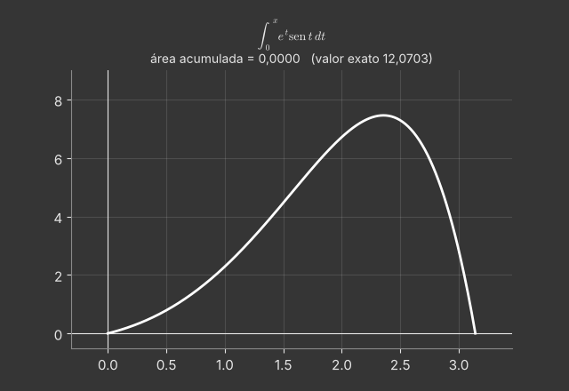

Seja $I=\int e^x\operatorname{sen} x\,dx$.

**Primeira vez** ($u=\operatorname{sen} x$, $dv=e^xdx$): $I=e^x\operatorname{sen} x-\int e^x\cos x\,dx$.

**Segunda vez** ($u=\cos x$, $dv=e^xdx$, mantendo a escolha!): $\int e^x\cos x\,dx=e^x\cos x+\int e^x\operatorname{sen} x\,dx=e^x\cos x+I$.

**Juntando:** $I=e^x\operatorname{sen} x-e^x\cos x-I$, logo
$$I=\tfrac12e^x(\operatorname{sen} x-\cos x)+C .$$

**Atenção.** Se na segunda vez escolhermos $u=e^x$, as partes se desfazem e chegamos a $I=I$. A escolha de $dv$ tem de ser a mesma nas duas etapas.

**Definida:** $\Big[\tfrac12e^x(\operatorname{sen} x-\cos x)\Big]_0^\pi=\tfrac12e^\pi(0+1)-\tfrac12(0-1)=\frac{e^\pi+1}2\approx12{,}070$.

**Conferência derivando:** $\tfrac12\big[e^x(\operatorname{sen} x-\cos x)+e^x(\cos x+\operatorname{sen} x)\big]=e^x\operatorname{sen} x$. ✓

**Animação.** A área sob $e^x\operatorname{sen} x$ é acumulada de $0$ a $\pi$ e comparada com a fórmula.

---

### 7.23 — A integral da secante ao cubo

*Origem: OpenStax, inspirado no Exemplo 7.2.*

> Mostre que $\int\sec^3x\,dx=\frac12\big(\sec x\operatorname{tg} x+\ln|\sec x+\operatorname{tg} x|\big)+C$ e calcule $\int_0^{\pi/4}\sec^3x\,dx$.

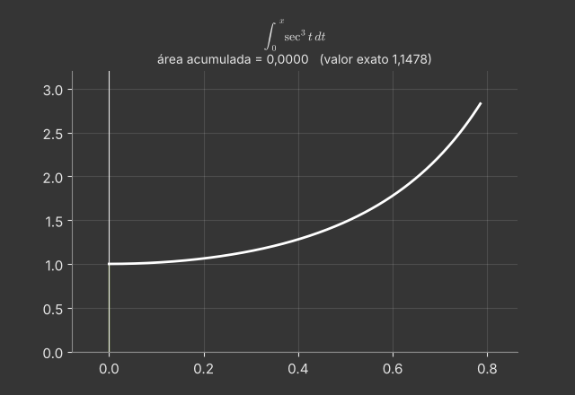

**Partes:** $u=\sec x$, $dv=\sec^2x\,dx$, então $du=\sec x\operatorname{tg} x\,dx$, $v=\operatorname{tg} x$.
$$\int\sec^3x\,dx=\sec x\operatorname{tg} x-\int\sec x\operatorname{tg}^2x\,dx .$$

**Identidade** $\operatorname{tg}^2x=\sec^2x-1$:
$$\int\sec^3x\,dx=\sec x\operatorname{tg} x-\int\sec^3x\,dx+\int\sec x\,dx .$$
A integral reapareceu (cíclica). Passando para a esquerda e usando $\int\sec x\,dx=\ln|\sec x+\operatorname{tg} x|$ (capítulo 5):
$$2\int\sec^3x\,dx=\sec x\operatorname{tg} x+\ln|\sec x+\operatorname{tg} x|+C .$$

**Valor:** em $x=\frac\pi4$, $\sec=\sqrt2$, $\operatorname{tg}=1$; em $0$, $\sec=1$, $\operatorname{tg}=0$:
$$\int_0^{\pi/4}\sec^3x\,dx=\tfrac12\big(\sqrt2+\ln(\sqrt2+1)\big)-\tfrac12(0+\ln1)\approx1{,}1478 .$$

**Onde aparece.** Essa integral surge na substituição $x=a\operatorname{tg}\theta$ em $\int\sqrt{a^2+x^2}\,dx$, por exemplo no comprimento de arco da parábola (outro exercício resolvido desta lista).

**Animação.** A área sob $\sec^3x$ cresce até $\pi/4$; o valor acumulado coincide com a fórmula.

---

### 7.24 — A área da elipse

*Origem: OpenStax, inspirado no Exemplo 7.3.*

> Use substituição trigonométrica para mostrar que a elipse $\frac{x^2}{a^2}+\frac{y^2}{b^2}\le1$ tem área $\pi ab$.

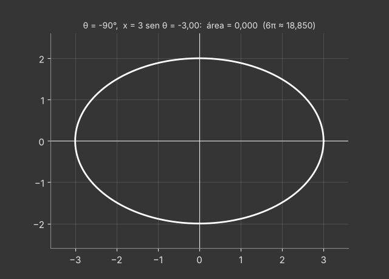

**Montagem.** A metade de cima é $y=\frac ba\sqrt{a^2-x^2}$. Por simetria, a área é quatro vezes a do primeiro quadrante:
$$A=4\int_0^a\frac ba\sqrt{a^2-x^2}\,dx .$$

**Substituição** $x=a\operatorname{sen}\theta$: $dx=a\cos\theta\,d\theta$, $\sqrt{a^2-x^2}=a\cos\theta$; limites $x=0\mapsto\theta=0$, $x=a\mapsto\theta=\frac\pi2$.
$$A=4\cdot\frac ba\int_0^{\pi/2}a^2\cos^2\theta\,d\theta=4ab\int_0^{\pi/2}\frac{1+\cos2\theta}2\,d\theta=4ab\cdot\frac\pi4=\pi ab .$$

**Conferências.** $a=b=r$ dá $\pi r^2$ (círculo). A elipse é o círculo unitário esticado por $a$ na horizontal e por $b$ na vertical, e áreas se multiplicam por $ab$.

**Exemplo numérico:** $a=3$, $b=2$: $A=6\pi\approx18{,}85$.

**Animação.** O ângulo $\theta$ vai de $-\pi/2$ a $\pi/2$; a faixa vertical em $x=3\operatorname{sen}\theta$ varre a elipse e a área acumulada chega a $6\pi$.

---

### 7.25 — Frações parciais com fator repetido

*Origem: OpenStax, inspirado no Exemplo 7.4.*

> Calcule $\displaystyle\int\frac{5x^2+3x-2}{x^3+2x^2}\,dx$ e depois a integral de $1$ a $2$.

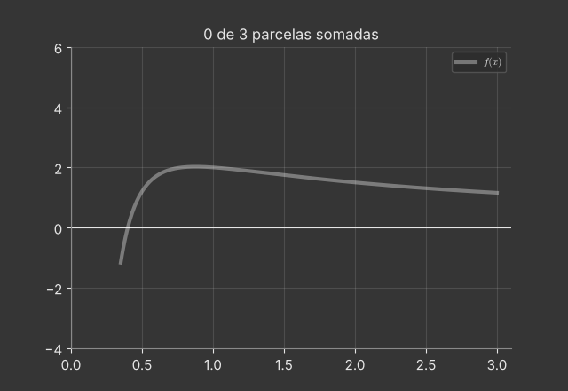

**Fatoração:** $x^3+2x^2=x^2(x+2)$: fator $x$ repetido e fator linear $x+2$. A fração é própria (grau 2 < grau 3).

**Forma:**
$$\frac{5x^2+3x-2}{x^2(x+2)}=\frac Ax+\frac B{x^2}+\frac C{x+2}\iff5x^2+3x-2=Ax(x+2)+B(x+2)+Cx^2 .$$

**Constantes:**
- $x=0$: $-2=2B\Rightarrow B=-1$;
- $x=-2$: $20-6-2=12=4C\Rightarrow C=3$;
- coeficiente de $x^2$: $A+C=5\Rightarrow A=2$.

**Integral:**
$$\int\Big(\frac2x-\frac1{x^2}+\frac3{x+2}\Big)dx=2\ln|x|+\frac1x+3\ln|x+2|+C .$$

**De 1 a 2:** $\big(2\ln2+\tfrac12+3\ln4\big)-\big(0+1+3\ln3\big)=2\ln2-\tfrac12+3\ln\tfrac43\approx1{,}749$.

**Por que precisa de $\frac B{x^2}$?** Só com $\frac Ax+\frac C{x+2}$ o denominador comum seria $x(x+2)$, de grau 2, e não haveria como reproduzir o $x^2$ do denominador original.

**Animação.** As três parcelas são desenhadas e somadas uma a uma até reproduzirem a função original.

---

### 7.26 — Trapézio e Simpson para $e^{-x^2}$

*Origem: OpenStax, inspirado no Exemplo 7.5.*

> A função $e^{-x^2}$ não tem antiderivada elementar. Calcule $T_4$ e $S_4$ para $\int_0^1e^{-x^2}dx$ e use os limitantes de erro (com $|f''|\le2$ e $|f^{(4)}|\le12$ em $[0,1]$) para dizer quantas casas são confiáveis.

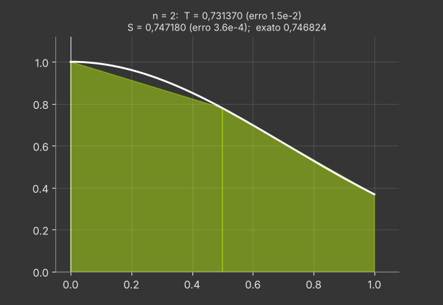

**Valores** ($\Delta x=0{,}25$): $f(0)=1$; $f(0{,}25)\approx0{,}939413$; $f(0{,}5)\approx0{,}778801$; $f(0{,}75)\approx0{,}569783$; $f(1)\approx0{,}367879$.

**Trapézio:**
$$T_4=\tfrac{0{,}25}2\big[1+2(0{,}939413+0{,}778801+0{,}569783)+0{,}367879\big]\approx0{,}742984 .$$

**Simpson:**
$$S_4=\tfrac{0{,}25}3\big[1+4(0{,}939413)+2(0{,}778801)+4(0{,}569783)+0{,}367879\big]\approx0{,}746855 .$$

**Cotas de erro:**
- $|E_T|\le\frac{2\cdot1^3}{12\cdot4^2}\approx0{,}0104$;
- $|E_S|\le\frac{12\cdot1^5}{180\cdot4^4}\approx0{,}00026$.

Logo $S_4$ garante $\int_0^1e^{-x^2}dx\in[0{,}7466;\,0{,}7471]$. O valor real é $0{,}746824$: os erros efetivos são $0{,}0038$ (trapézio) e $0{,}00003$ (Simpson).

**Tendência:** com $n=8$, $T_8\approx0{,}745866$ e $S_8\approx0{,}746826$. O erro do trapézio cai cerca de 4 vezes; o de Simpson, cerca de 16.

**Animação.** Os trapézios para $n=2,4,8,16$ se ajustam à curva e o título compara $T_n$ e $S_n$ com o valor exato.

---

### 7.41 — O comprimento da parábola

*Origem: OpenStax, inspirado nas seções 6.4 e 7.3.*

> Calcule o comprimento de arco de $y=x^2$ para $0\le x\le1$.

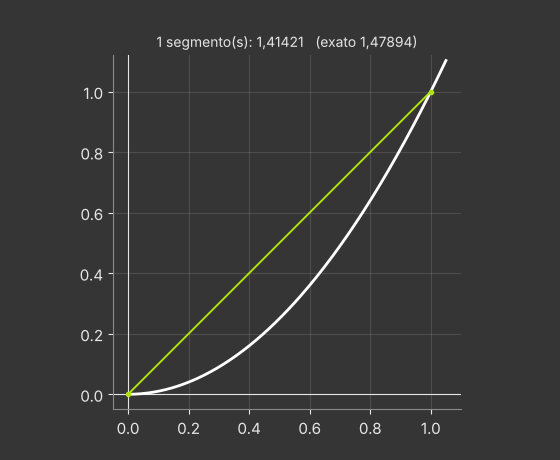

**Integral:** $y'=2x$, então $L=\int_0^1\sqrt{1+4x^2}\,dx$. É o caso $\sqrt{a^2+u^2}$, com $u=2x$.

**Substituição** $2x=\operatorname{tg}\theta$: $dx=\frac12\sec^2\theta\,d\theta$, $\sqrt{1+4x^2}=\sec\theta$. Limites: $x=0\mapsto\theta=0$; $x=1\mapsto\theta=\alpha$, com $\operatorname{tg}\alpha=2$, $\sec\alpha=\sqrt5$.
$$L=\frac12\int_0^\alpha\sec^3\theta\,d\theta=\frac14\Big[\sec\theta\operatorname{tg}\theta+\ln|\sec\theta+\operatorname{tg}\theta|\Big]_0^\alpha=\frac14\big(2\sqrt5+\ln(2+\sqrt5)\big).$$
(Usamos a integral de $\sec^3$ do exercício da secante ao cubo.)

**Valor:** $\frac14(4{,}4721+1{,}4436)\approx1{,}4789$.

**Conferência:** a corda de $(0,0)$ a $(1,1)$ mede $\sqrt2\approx1{,}4142<1{,}4789$; e o caminho pelos catetos mede $2$. O arco fica entre os dois, como deve.

**Lição.** Até a parábola, a curva mais simples depois da reta, exige substituição trigonométrica e uma integral cíclica para ter o comprimento calculado.

**Animação.** Poligonais com cada vez mais lados se aproximam da parábola; o comprimento converge para $1{,}4789$.

---

### 7.42 — A trombeta de Gabriel

*Origem: OpenStax, inspirado na seção 7.6.*

> Gire $y=\frac1x$, $x\ge1$, em torno do eixo $x$. Mostre que o sólido tem volume finito, mas a superfície tem área infinita.

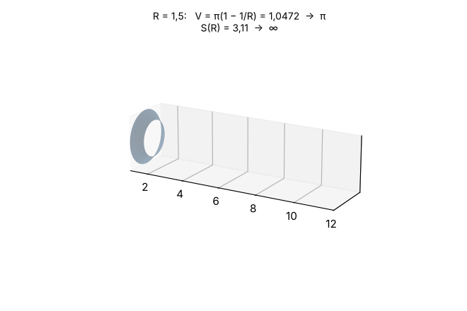

**Volume (discos):**
$$V=\pi\int_1^\infty\frac{dx}{x^2}=\pi\lim_{t\to\infty}\Big(1-\frac1t\Big)=\pi .$$

**Área de superfície:**
$$S=2\pi\int_1^\infty\frac1x\sqrt{1+\frac1{x^4}}\,dx .$$
Não precisamos calculá-la: como $\sqrt{1+\frac1{x^4}}\ge1$,
$$\frac1x\sqrt{1+\frac1{x^4}}\ge\frac1x,\qquad\text{e}\qquad\int_1^\infty\frac{dx}x=\infty .$$
Pelo **teste da comparação**, $S=\infty$.

**O paradoxo do pintor.** A trombeta ``cabe'' em $\pi$ unidades de tinta (o volume), mas a parede interna teria área infinita, e nenhuma quantidade de tinta a cobriria. A saída: uma camada de tinta com espessura constante não cabe no tubo, que fica mais fino que qualquer espessura. Encher o volume não é o mesmo que pintar a superfície.

**Truncando em $x=R$:** $V(R)=\pi(1-\frac1R)\to\pi$, enquanto $S(R)\ge2\pi\ln R\to\infty$.

**Animação.** A trombeta se estende até $R$ cada vez maior; o título mostra $V(R)$ estabilizando em $\pi$ e $S(R)$ crescendo sem limite.

---

### 7.43 — A função gama

*Origem: OpenStax, inspirado na seção 7.6.*

> Seja $\Gamma(x)=\int_0^\infty t^{x-1}e^{-t}\,dt$ para $x>0$. Mostre que $\Gamma(1)=1$, que $\Gamma(x+1)=x\,\Gamma(x)$ e conclua que $\Gamma(n+1)=n!$.

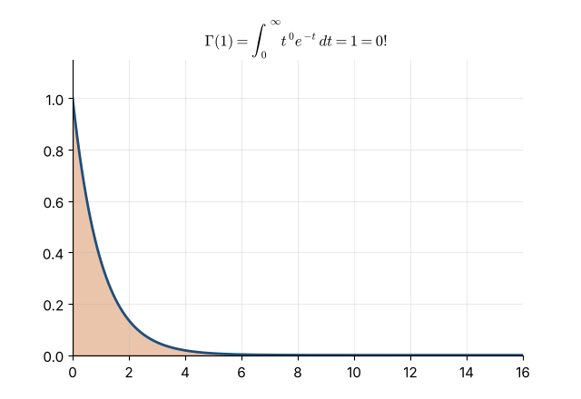

**Convergência.** Perto de $t=0$, $t^{x-1}e^{-t}\le t^{x-1}$, integrável se $x-1>-1$, isto é, $x>0$. Para $t$ grande, $t^{x-1}e^{-t/2}\to0$, então $t^{x-1}e^{-t}\le e^{-t/2}$ a partir de algum ponto, e $\int^\infty e^{-t/2}$ converge.

**$\Gamma(1)=\int_0^\infty e^{-t}dt=\lim_{b\to\infty}(1-e^{-b})=1$.**

**Recorrência (partes):** $u=t^x$, $dv=e^{-t}dt$:
$$\Gamma(x+1)=\int_0^\infty t^xe^{-t}dt=\Big[-t^xe^{-t}\Big]_0^\infty+x\int_0^\infty t^{x-1}e^{-t}dt=0+x\,\Gamma(x) .$$
(O termo de fronteira some: $t^xe^{-t}\to0$ quando $t\to\infty$, e vale $0$ em $t=0$ porque $x>0$.)

**Fatorial:** $\Gamma(2)=1\cdot\Gamma(1)=1$, $\Gamma(3)=2\cdot1$, $\Gamma(4)=3\cdot2\cdot1$, e por indução $\Gamma(n+1)=n!$.

**Significado.** $\Gamma$ estende o fatorial a números não inteiros: por exemplo $\Gamma(\tfrac12)=\sqrt\pi$, que é o desafio 7.64.

**Animação.** Para $n=0,1,\dots,5$, a área sob $t^ne^{-t}$ é preenchida e vale $n!$: $1,1,2,6,24,120$.

---

### 7.44 — A substituição universal $t=\operatorname{tg}(x/2)$

*Origem: OpenStax, inspirado na seção 7.4.*

> Com $t=\operatorname{tg}\frac x2$, mostre que $\cos x=\frac{1-t^2}{1+t^2}$ e $dx=\frac{2\,dt}{1+t^2}$, e calcule $\displaystyle\int_0^{\pi/2}\frac{dx}{2+\cos x}$.

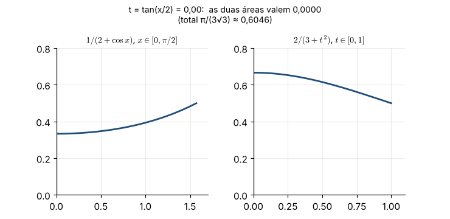

**Fórmulas.** $\cos x=\cos^2\frac x2-\operatorname{sen}^2\frac x2=\frac{1-\operatorname{tg}^2(x/2)}{\sec^2(x/2)}=\frac{1-t^2}{1+t^2}$. De $x=2\operatorname{arctg} t$: $dx=\frac{2\,dt}{1+t^2}$. (Analogamente, $\operatorname{sen} x=\frac{2t}{1+t^2}$.)

**Transformando:** $2+\cos x=\frac{2(1+t^2)+1-t^2}{1+t^2}=\frac{3+t^2}{1+t^2}$. Limites: $x=0\mapsto t=0$; $x=\frac\pi2\mapsto t=1$.
$$\int_0^{\pi/2}\frac{dx}{2+\cos x}=\int_0^1\frac{1+t^2}{3+t^2}\cdot\frac{2\,dt}{1+t^2}=\int_0^1\frac{2\,dt}{3+t^2}=\frac2{\sqrt3}\Big[\operatorname{arctg}\frac t{\sqrt3}\Big]_0^1=\frac2{\sqrt3}\cdot\frac\pi6=\frac\pi{3\sqrt3}.$$

**Valor:** $\approx0{,}6046$. Conferência: o integrando fica entre $\frac13$ e $\frac12$, então a integral está entre $\frac\pi6\approx0{,}52$ e $\frac\pi4\approx0{,}79$. ✓

**Por que ``universal''.** Toda função racional de $\operatorname{sen} x$ e $\cos x$ vira uma função racional de $t$, que sempre pode ser integrada por frações parciais (embora nem sempre seja o caminho mais curto).

**Animação.** As áreas sob $\frac1{2+\cos x}$ em $[0,\pi/2]$ e sob $\frac2{3+t^2}$ em $[0,1]$ são preenchidas juntas e têm sempre o mesmo valor.

---

### 7.45 — Crescimento logístico

*Origem: OpenStax, inspirado na seção 7.4.*

> Uma população segue $\dfrac{dP}{dt}=0{,}5\,P\Big(1-\dfrac P{1000}\Big)$, com $P(0)=100$. Separe as variáveis, use frações parciais e encontre $P(t)$. Quando a população chega a $500$? Quando cresce mais rápido?

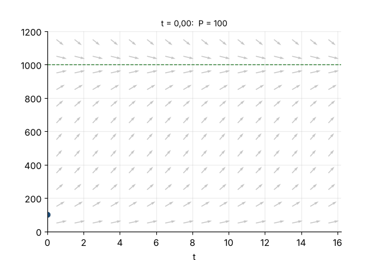

**Separando:** $\displaystyle\int\frac{1000\,dP}{P(1000-P)}=\int0{,}5\,dt$.

**Frações parciais:** $\frac{1000}{P(1000-P)}=\frac1P+\frac1{1000-P}$ (verifique somando).

**Integrando:** $\ln P-\ln(1000-P)=0{,}5t+C$, isto é, $\frac P{1000-P}=Ke^{t/2}$. Com $P(0)=100$: $K=\frac{100}{900}=\frac19$.

**Isolando $P$:**
$$P(t)=\frac{1000}{1+9e^{-t/2}} .$$

**$P=500$:** $9e^{-t/2}=1\Rightarrow t=2\ln9\approx4{,}39$.

**Crescimento mais rápido:** $P'=0{,}5P(1-\frac P{1000})$ é uma parábola em $P$ com máximo em $P=500$, onde $P'=125$ por unidade de tempo. Portanto o ponto de inflexão da curva é $(2\ln9;\,500)$.

**Comportamento:** $P\to1000$ (capacidade de suporte). No início, $P\ll1000$ e $P'\approx0{,}5P$: crescimento quase exponencial.

**Animação.** A curva logística é desenhada sobre o campo de inclinações; o ponto de inflexão é marcado em $P=500$.

---
